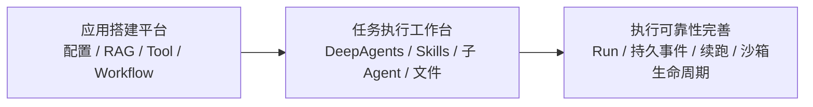

# NiceAgent 从零到一演进与技术决策复盘

整理日期：2026-09-11。面向 AI Agent 开发、大模型应用开发和 Python 后端面试。

本文按你确认的经历整理：**从早期 LangGraph 平台到 DeepAgents 任务工作台，由你独立完成开发，过程中使用 Codex 辅助分析、实现和排障。** 讲述重点是你如何确定产品边界、选择方案、验证问题并承担最终实现责任。框架自带的规划、子 Agent 和持久化机制，应明确说明是复用后完成平台集成。

证据来自后端与前端 Git 历史、相关 Codex 任务记录，以及当前实现。后端历史核对覆盖到 `28b54e4`；整理期间另有测评重构提交 `ec8d8b5`，本文不把其新增细节纳入历史结论。本文没有重新运行模型、数据库或沙箱联调。

配套阅读：[核心技术与代码入口](/D:/spring_project/py/my-dify/docs/NiceAgent-核心技术亮难点与面试准备.md) · [深入问答与故障推演](/D:/spring_project/py/my-dify/docs/NiceAgent-面试深入问答与故障推演.md) · [模拟面试与七天计划](/D:/spring_project/py/my-dify/docs/NiceAgent-模拟面试与七天复习计划.md)。

## 一、先分清哪些内容可以作为真实经历

具体简历措辞对应的当前实现与技术追问见[简历逐条实现详解与追问](/D:/spring_project/py/my-dify/docs/NiceAgent-简历逐条实现详解与追问.md)；本文侧重历史问题和方案选择，两篇配合使用。

| 标记 | 证据含义 | 面试表达 |
| --- | --- | --- |
| 实际问题 | 用户在历史任务中报告症状，并有对应修复 | “开发调试时遇到……” |
| 实现演进 | Git 差异证明旧实现被替换或收敛 | “早期实现是……后来改为……” |
| 讨论方案 | 对话或设计文档出现，但没有落地证据 | “评估过……最终没有采用” |
| 后续设计 | 从当前边界推导的扩展方向 | “如果规模扩大，我会……” |
| 历史验证报告 | 当时 Codex 最终回复记录的测量或联调结果 | “当时本地验证记录显示……范围是……” |

提交时间只证明版本演进，不能证明期间每天连续开发；提交数量、代码行数也不能替代工作量或能力判断。没有线上事故、客户规模、收入和高并发证据，下面的案例均按开发与联调经历讲述。

## 二、项目从 0 到 1 的演进主线

### 1. 面试开场：90 秒版本

> 这个项目是我独立开发的 AI Agent 开发与任务执行平台。第一阶段以应用搭建为核心，打通了模型、提示词、工具、知识库、工作流的配置、调试和发布，Agent 执行主要基于 LangGraph。
>
> 后来需求扩展到检索资料、拆解任务、调用多个 Agent、执行脚本并交付文件，我把运行时升级到基于 LangGraph 的 DeepAgents，复用它的规划、文件工具、Skills 和子 Agent 能力。
>
> 升级的主要工作是把这些框架能力接入平台：按应用配置装配权限、把一次任务建模为 Run、持久化事件并支持断线补取、通过 interrupt 等待用户补充，以及管理沙箱和文件回写。
>
> 过程中也做过取舍。例如长期记忆最初做得比较结构化，后来发现管理流程超过用户需要，改为分类文件；流式协议则从持续监听会话改成明确绑定一次 Run，并解决了后端已经结束、前端仍显示运行的问题。这些经历让我更关注状态和资源的完整生命周期。

### 2. 时间线与可追溯提交

下面的日期是 Git 提交日期；同阶段的功能可能跨多次提交迭代。

| 阶段 | 能力变化 | 后端证据 |
| --- | --- | --- |
| 2025-12～2026-01 初期 | 项目结构、统一异常、API 工具、知识库与 COS | `6198d2c`、`fd420fb`、`26b3b5b`、`2812641`、`6bc4404` |
| 2026-01 平台闭环 | 基础 Agent、OAuth、应用配置版本、工作流、调试发布与 WebApp | `722eb38`、`d202fff`、`e9f8598`、`f2cdf91`、`1f544ad`、`d265a8e` |
| 2026-02～03 能力扩展 | 记忆、多用户向量处理、工作流模板与生成、语音、SCF 代码节点、MCP | `5cf7ed6`、`89bd1ca`、`411a920`、`543a420`、`b62c5df`、`9647dc7`、`87e5300` |
| 2026-07-28 初次升级 | 接入 DeepAgents、工作区、摘要、子 Agent，并修复原生接入问题 | `46d3e1c`、`6a7f54f`、`b27e9eb`、`16e8db7`、`23911b3` |
| 2026-08 V2 迭代 | 重建运行时、持久化 Skills/工作区、原生异步子 Agent 与待办事件 | `b79be78`、`2e17244`、`3078229`、`df314fd`、`cbdb18a` |
| 2026-08 末～09 初 | 工作台协议、V3 生命周期、连接池、Bubblewrap/Daytona、公共事件投影 | `ce6dd82`、`1013bc4`、`1afdafb`、`47b79c8`、`70bdc36`、`22d21d4` |
| 2026-09-08～09 | 会话统一、输入续跑、文件记忆、状态接口性能、沙箱延迟创建与复用 | `869a9ef`、`ae33e26`、`7fd5767`、`82896b0`、`ced736c` |
| 2026-09-10～11 | MCP、验收与观测、Run 级 SSE、有界执行、模型继承与服务职责整理 | `b36525b`、`132a80c`、`76a751a`、`21f37be`、`6610eae`、`28b54e4` |

前端也同步演进：早期团队编辑与轨迹 `008506f`，工具事件展示 `ca6cbdd`，工作台客户端 `1d3ec11`，文件记忆 `07e2052`，历史按需恢复 `2fd4b41`，Run 级订阅 `f305edd`，终态修复 `6f46be3` / `5944a08`，旧 Run 绑定清理 `ec51fb4`，模型继承与覆盖 `5609f4c`。

### 3. 三次真正的架构变化



第一阶段解决“一个应用怎样配置并发布”；第二阶段解决“一个复杂任务怎样拆解并交付”；第三阶段解决“任务运行较久、连接中断、用户编辑文件时，系统怎样保持可解释、可恢复”。DeepAgents 仍建立在 LangGraph 上，升级后没有抛弃 LangGraph 的状态与持久化能力。

## 三、从 0 到 1 的基础设计：怎样讲清自己的判断

这一部分有功能提交和当前实现依据，但早期未找到完整的逐项选型对话。因此，以下理由是对设计的解释，不能声称所有对照方案都做过 PoC 或性能测试。

| 设计点 | 项目采用的实现 | 可以解释的取舍 | 不应扩大的说法 |
| --- | --- | --- | --- |
| 应用载体 | App 统一承载配置，区分草稿与发布版本 | 调试允许持续编辑，运行要有明确的配置来源 | 没有证据证明做过多租户 SaaS 的全部治理能力 |
| Agent 与 Workflow | 开放任务由 Agent 决策，固定步骤由 DSL 编译成图 | 灵活性与执行路径可控性服务不同场景 | Workflow 当前不是支持任意循环的通用 BPM 引擎 |
| 工具接入 | Builtin、OpenAPI、MCP、发布工作流统一为 BaseTool | 统一调用接口，分别处理 Schema、认证与协议差异 | 统一接口不能自动统一远端副作用、超时和幂等性 |
| 检索 | 文档解析、切片、索引，语义/关键词/混合检索 | 索引更新与检索使用分开，适配不同查询需求 | 当前关键词匹配不能写成 BM25，混合检索不能写成已具备精排模型 |
| 向量模型 | 使用模型指纹约束索引与查询一致性 | 同维度向量也可能属于不同语义空间 | 不应声称更换模型后原索引仍能无损使用 |
| 文件持久化 | 对象存储保存正文，数据库保存元数据与版本 | 大文件存储和业务查询各用合适介质 | COS 与数据库之间没有跨系统原子事务 |
| 执行隔离 | 早期 Workflow 代码节点使用云函数，任务工作台增加沙箱 | 固定代码节点与多步文件任务需要不同执行环境 | 不能说所有代码节点已经迁移到 Daytona |

可用的回答句式：

> 我先完成应用配置、运行和发布的最小闭环，再扩展能力。固定流程保留工作流，开放任务交给 Agent；两者在工具层复用，所以后续升级运行时不需要把知识库和工作流重新实现一遍。这里是职责划分上的判断，我没有做所有框架和数据库的完整横向基准测试。

## 四、真实问题与技术决策案例

### 案例 1：接入了 DeepAgents，为什么文件能力仍没有贯通？

**证据类型：实现演进＋排障讨论。** 后端 `16e8db7` 的 factory、summary、saver 差异；历史任务 H01。

早期把工作区 Backend 只传给了显式创建的 FilesystemMiddleware，顶层 `create_deep_agent()` 没有拿到同一个 Backend。文件工具看似接上了，但子 Agent、Skills 和摘要卸载等原生能力没有统一的资源入口。

另一个问题是误解中间件替换规则。为了避免名称冲突，自定义摘要器改名为 `MyDifySummarizationMiddleware`。在当时使用的 DeepAgents 版本中，原生装配按 `.name` 替换同名中间件；改名后反而追加了第二个摘要器。

**尝试与最终选择：** 从单独追加文件/摘要中间件，改为顶层传入 `backend=workspace_backend`；摘要配置使用原生名称进行替换，后续进一步收敛原生装配。需要特别纠正：当时同名 FilesystemMiddleware 是替换，不是重复；真正重复的是改过名字的摘要器。

**亮点与代价：** 难点在理解框架装配、状态和资源传播规则。复用原生机制减少重复实现，但依赖具体版本的行为，升级时必须核对扩展点，不能把旧版本结论推广到所有版本。

**面试讲法：**

> 我最初从文件工具入口接入工作区，后来发现这只是局部接通。检查 DeepAgents 的装配过程后，我把 Backend 提升到图构建入口，让原生能力使用一致的资源路由。同时纠正摘要中间件的同名替换规则，避免业务摘要和默认摘要同时存在。这次排障让我意识到，框架接入要核对整个生命周期，不能只看单个工具能否执行。

当前入口：[DeepAgent 构建](/D:/spring_project/py/my-dify/internal/core/agent_v2/assembly/graph/deep_agent_factory.py)、[Backend 路由](/D:/spring_project/py/my-dify/internal/core/agent_v2/backends/composition/composite_backend_factory.py)。

### 案例 2：PostgresSaver 为什么不能直接缓存工厂返回值？

**证据类型：实现缺陷与修复。** 后端 `16e8db7` 的 saver 差异，后续连接生命周期提交 `1afdafb`、`dd6b5b1`；H01。

早期代码把 `PostgresSaver.from_conn_string(...)` 的返回值当成 Saver 单例，并直接调用 setup。它实际是上下文管理器，不能按普通实例长期缓存。部分入口当时还关闭了 checkpointer，仅有工厂代码不能证明真实会话已持久化。

**最终选择：** 显式持有框架所需的 PostgreSQL 连接池，正确构造 Saver 并管理进程退出清理；业务读写则缩短事务范围，不让 SSE 和模型网络等待长期占用数据库连接。当前实现已迁移到专门的 provider，不能拿历史 saver 文件路径代表现状。

**关键区分：** Checkpointer 保存图执行状态；业务 Run 保存任务状态与执行权；Store 保存跨会话记忆。都使用 PostgreSQL，也仍是不同职责和数据模型。

**面试讲法：**

> 我遇到过原生 Saver 的生命周期接错：把上下文管理器当作持久实例缓存。修复时明确了两种生命周期，框架连接池随进程管理，业务事务围绕短读写释放。同时检查真实执行入口是否传入 Checkpointer，避免只有配置但没有生效。持久化图状态之后，我也没有把它宣传成任意故障都能自动续跑，因为外部工具副作用还需要单独处理。

当前入口：[Checkpoint Provider](/D:/spring_project/py/my-dify/internal/core/agent_v2/persistence/langgraph_checkpoint_provider.py)、[Store Provider](/D:/spring_project/py/my-dify/internal/core/agent_v2/persistence/langgraph_store_provider.py)。

### 案例 3：工具执行成功，为什么整个任务仍报错？

**证据类型：真实调试问题＋已核对修复差异。** 后端 `f3822c5`，前端 `ca6cbdd`；H03。

历史问题中，`ls` 已执行成功，随后事件翻译阶段报 `NameError`。根因是 `_subagent_name(tool_call)` 内引用了不存在的变量 `tool`，同时普通工具结束事件也调用了子 Agent 名称解析。旁边的 LangSmith 序列化 warning 容易误导排障，但不是这次失败的根因。

**最终选择：** 只对原生 `task` 委派走子 Agent 分支，修正变量引用，补齐普通工具开始事件的展示信息，并保存错误、超时、停止等结果。后续公共事件投影进一步集中。

**亮点：** 明确“工具调用成功”“事件投影成功”“业务任务成功”是三件事。排查应沿执行层→翻译层→落库→SSE→前端逐段验证。

**面试讲法：**

> 我遇到过工具已经返回成功，但任务仍失败的情况。根据堆栈定位到事件翻译层，发现普通工具误走子 Agent 解析，并存在变量引用错误。修复后我把普通工具与委派事件分支明确分开，补齐开始和结束的展示数据。这个问题说明可观测链路本身也可能成为故障源，不能把所有失败都归到模型或工具服务。

注意：该提交修改的是历史 `events/translator.py`。后续协议已重构，复盘看提交，学习当前结构看 [协议投影目录](/D:/spring_project/py/my-dify/internal/service/agent_protocol)。

### 案例 4：工作台为什么从独立状态仓库收敛到会话与 Run？

**证据类型：实现演进。** `869a9ef` 删除 Redis 工作台仓库及多层协调/工厂类，重组会话、事件与运行服务；H06 记录了代码混乱的反馈。

随着工作台迭代，独立的工作台状态仓库和既有 Conversation/Message/Run 并存，访问校验、运行创建、事件队列之间有较多协调层。这里没有证据表明发生过线上 Redis 数据丢失，不能编造为事故。

**最终选择：** 工作台生命周期与会话模型统一，持久化事件作为补取依据，本地队列承担通知；减少重复协调入口。后续继续按查询、命令、执行与资源装配职责整理，不以“类越多越解耦”为目标。

**取舍：** 数据库成为事件读取与写入的重要承载，需要按需取列、批量提交和索引；进程内通知适合当前单进程部署，不能直接说成分布式消息总线。Redis 仍用于项目其他场景，并未从技术栈删除。

**面试讲法：**

> 工作台扩展后，原有会话模型与新增工作台状态之间出现了较多协调逻辑。我把生命周期收敛到会话、Run 和持久事件，通知层只负责唤醒，避免让通知缓存承担恢复依据。代价是数据库访问更关键，所以接着优化事件批次、字段投影和历史分页。这个重构的目标是减少状态来源，而不是继续增加抽象层。

当前入口：[Agent 服务目录](/D:/spring_project/py/my-dify/internal/service/agent)、[Run 模型](/D:/spring_project/py/my-dify/internal/model/agent_run.py)。

### 案例 5：从会话级订阅改成 Run 级 SSE，兼容回退为什么被移除？

**证据类型：明确方案抉择＋真实接口错误。** 后端 `21f37be`、前端 `f305edd`；H10。

早期流在一次任务结束后仍等待该会话的后续任务。你明确判断当前交互应是一次 Run 对应一次流，终态后关闭。中间实现曾保留“未传 run_id 则绑定最新 Run”的兼容路径，你要求前后端共同升级，随后移除这一回退。

协议改成必填 `run_id` 后，又遇到 SDK 在启动命令返回前自动订阅生命周期事件，造成参数缺失；额外 `thread.subscribe()` 与 EOF 重试叠加，出现不断请求 stream 的现象。

**最终链路：**

```text
提交命令 → 拿到 run_id → 订阅该 Run → 持久化事件增量输出
执行中断线 → 按该 Run 的游标补取 → 收到终态 → 正常关闭
```

**关键机制：** 后端校验 Run 属于当前会话、应用及入口；前端冻结订阅身份，游标按 Run 隔离，删除额外订阅。正常完成和意外断线必须不同处理。

**面试讲法：**

> 我把协议从持续监听会话改为明确订阅一次 Run。这里不仅是多传一个 ID，还涉及 SDK 的订阅时序：它原来会在命令返回前建流，所以我改成拿到 run_id 后再打开 SSE，并清理多余订阅。没有保留读取最新 Run 的回退，因为这会使一次请求到底跟踪哪个任务变得模糊。协议收紧需要前后端同步发布，这是接受的代价。

当前入口：[客户端适配](/D:/spring_project/py/my-dify-ui/src/services/agent-workbench.ts)、[SSE 传输](/D:/spring_project/py/my-dify-ui/src/services/workbench-sse-fetch.ts)。

### 案例 6：任务 1 分 10 秒完成，页面为什么到 3 分钟仍在计时？

**证据类型：用户报告的真实症状＋两次修复差异。** 前端 `6f46be3`、`5944a08`，后续 `ec51fb4`；H10。

你在调试中反馈：后端任务实际在 1 分 10 秒完成，页面持续显示执行中，等到约 3 分钟刷新后才看到完整结果。这是本次整理中最适合讲的真实排障案例。

**根因分两层：**

1. 终态回调调用 `hydrate()`，在当前流还处理终态时重新恢复状态，干扰事件消费过程。
2. 自定义异步迭代器在 EOF 时只唤醒现有等待者，没有保存“已经结束”的状态。若之后才调用 `next()`，可能重新进入等待。

**修复：** 移除终态回调中的强制 hydrate；增加 `ended` 标记，缓冲区读完后 `next()` 稳定返回 `done: true`，保留 Run 级终态关闭和断线游标。之后继续清理旧 Run 绑定，避免下次提交沿用旧订阅身份。

**技术难点：** 这是协议、异步迭代器和前端状态的时序问题。连接关闭不等于业务消费结束，终态落库也不等于 UI 已完成收敛。

**面试讲法：**

> 有一次任务约 70 秒已经结束，页面却计时到 3 分钟，刷新才恢复。我先利用刷新后能读到完整结果这个现象，缩小到实时链路，再结合代码确认终态回调重建状态和迭代器 EOF 两个问题。修复时让终态正常走完当前消费过程，并让迭代器永久记住结束状态。这次结果是修正完成语义，不是把模型推理从 3 分钟优化到 70 秒。

**追问准备：** 若 EOF 前没有收到终态，应检查 Run 状态或尝试补取，不能无条件标记成功；终态之后仍需排空已经接收的事件；用户切会话后的旧请求不能覆盖新会话状态。

### 案例 7：为什么没有把 Agent 执行直接全部迁到 Celery？

**证据类型：明确约束与方案抉择。** 后端 `21f37be`；H10。

你说明当前后端按单进程部署，同时要求线程和队列实现可控。原先按 Run 创建执行线程，会让并发资源缺少明确上限。最终使用有界执行池与信号量控制接纳；当前限制 4 个执行槽位。

**讨论但未作为最终主链路采用：** 把完整 Agent 执行放进 Celery。原因是任务输入、运行定义、人工恢复命令等需要先变成可重建的持久化协议，不能把带本地资源的对象直接塞进队列。取消、租约、重复投递和外部副作用也需要设计。

**已落地的 Celery 职责：** 独立测评以及失联 Run 定时扫描。失联扫描将过期任务收敛为失败/取消并补齐状态，不是自动重放任意失败任务。

**面试讲法：**

> 当前是单进程部署，我先限制后台执行并发，避免每个请求无限创建线程，同时用持久化 Run、心跳和后台扫描处理失联。Celery 已用于测评和扫描，但我没有直接迁移整个 Agent，因为人工续跑和运行输入的重建语义还要一起设计。后续扩容时先解决任务可重建和执行权，再替换调度承载。

### 案例 8：长期记忆为什么从结构化治理改回文件？

**证据类型：已实现后替换＋完整产品讨论。** 后端 `7fd5767`，前端 `07e2052`；H07。

早期结构化记忆包含主题、分类、依据、候选/暂停/遗忘状态，以及历史和撤销管理。最初的优化建议还想继续加强确认和治理，但你明确指出这是给普通用户使用的记忆，编排处只需要开关，工作台应该易读易改，不需要复杂表单和版本管理。

**讨论过程：** 保留结构化治理 → 单个 MEMORY.md → 三类大文件 → 最终按分类组织主题文件。前三者中有讨论建议，不应全部写成上线过的版本。

**最终选择：** 用户偏好、背景信息、经验方法三个分类，每个主题一份文件；用户和 Agent 均可新增、修改和删除。底层继续使用 PostgresStore，通过 StoreBackend 和原生文件工具读写；模型调用前刷新，注入有界索引及少量偏好，其他正文按需读。

**保留的必要机制：** 服务端身份/应用作用域、路径约束、内容预算，以及锁和内容摘要冲突检测。没有用户可见版本管理，不意味着允许并发覆盖。

**2026-09-11 当前实现补充：** 在 `e0e8544` 之后的工作区中进一步删除旧结构化条目实体、仓储、中间件、Schema 及兼容导入模块。文件列表与动态索引只读，写入不再预先列目录触发转换，也不写入导入标记。此处记录本次代码调整，不将它归入上文 `7fd5767` 的历史提交或宣称已部署。保存和语义合并由模型通过文件工具完成，没有独立的逐轮总结调用或向量检索。

**接受的代价：** 失去候选审批和历史撤销流程；记忆正确性仍依赖提炼质量与用户纠正。删除 Store 文件也不会自动清除历史会话 Checkpoint 中已经出现的内容。若面向公开应用终端用户，需要继续核对身份映射，不能把账号＋应用隔离扩大成所有终端用户场景已完善。

**面试讲法：**

> 我做过一版结构化长期记忆，后来发现用户只是想查看、纠正和积累偏好，复杂状态和表单带来的操作成本超过收益。我把交互改成分类文件，底层复用框架的 Store 和文件工具，保留并发保护与作用域隔离。最终方案减少了管理能力，但更贴近产品目标。这里的自进化指记忆随反馈更新，不是模型权重训练。

当前入口：[文件记忆设计](/D:/spring_project/py/my-dify/docs/file-memory.md)、[记忆仓库](/D:/spring_project/py/my-dify/internal/core/agent_v2/persistence/agent_memory_repository.py)、[刷新中间件](/D:/spring_project/py/my-dify/internal/core/agent_v2/middleware/reloading_memory_middleware.py)。

### 案例 9：Daytona 初始化失败，为什么不是简单的网络问题？

**证据类型：真实报错与路径修复。** 相关改动纳入 `0d5f480`；H05。

报错停在创建 Sandbox Workspace 目录。历史诊断确认 Daytona 默认用户没有权限在根目录创建 `/workspace`，因此初始化失败。此前也出现过供应商账号暂停或邮箱验证问题，两者必须分开，不能用同一种重试策略处理。

**最终选择：** 将 Agent 的虚拟根映射到用户可写目录，例如 `/workspace` 对应 `/home/daytona/workspace`。上传、下载、读写、检索和常用命令路径统一转换，返回信息再恢复为虚拟路径，同时保留供应商具体错误输出。

**为什么不直接改所有提示词？** 稳定的虚拟路径让 Skills、文件工具和其他沙箱 Backend 共用约定；供应商目录差异留在适配层处理。路径替换只是适配手段，不能宣称它能完整解析任意 shell 语法或提供独立的安全隔离。

**验证口径：** H05 的当时报告记录了真实 Daytona 创建、文件写入和回写链路验证；本次只是核对记录与代码，没有重新调用供应商。

**面试讲法：**

> 接 Daytona 时，任务在模型运行前就因目录初始化失败。定位后发现平台约定的虚拟根与供应商普通用户权限不一致。我在 Backend 层统一做路径映射，让模型继续使用稳定的工作区路径，并保留具体错误信息。这让我把账号状态、目录权限、工具依赖和运行代码错误分开处理，避免笼统归为沙箱不可用。

当前入口：[Daytona Backend](/D:/spring_project/py/my-dify/internal/core/agent_v2/backends/sandbox/daytona_sandbox_backend.py)。

### 案例 10：普通问答为什么也要等沙箱启动？

**证据类型：实现演进。** 后端 `ced736c` 新增 LazySandboxBackend、会话池与压缩上传；当前代码可核对。

早期装配阶段直接创建远程沙箱，即使任务只需要文字回答，也会承担创建和文件上传开销。每次释放后重建又无法复用同一会话的环境。

**最终选择：** Daytona/LangSmith 远程后端延迟到需要执行能力时创建；Daytona 增加会话独占租约、generation、TTL 与空闲容量淘汰，Skills 使用压缩包上传。创建操作移到池锁之外，减少慢网络操作对其他会话的阻塞。

**为什么不能只做一个全局共享沙箱？** 不同会话的文件、依赖和执行过程会互相影响；即使同一会话，也必须有独占租约和释放后的状态检查。

**边界：** 当前池在进程内，不是分布式资源池；Bubblewrap 不属于同样的远程延迟创建路径；压缩上传减少请求开销但不能保证所有场景更快，没有实测不能写冷启动降低百分比。

**面试讲法：**

> 我把远程沙箱从装配时立即创建改成按需创建，避免普通问答支付执行环境成本。需要执行时再获取会话沙箱，并通过独占租约、TTL 和容量淘汰控制复用。难点是复用后仍要处理旧句柄、技能变化和文件回写，不能只把沙箱对象放进缓存。

当前入口：[延迟 Backend](/D:/spring_project/py/my-dify/internal/core/agent_v2/backends/sandbox/lazy_sandbox_backend.py)、[会话沙箱池](/D:/spring_project/py/my-dify/internal/core/agent_v2/backends/sandbox/session_sandbox_pool.py)、[Skills 上传](/D:/spring_project/py/my-dify/internal/core/agent_v2/backends/sandbox/sandbox_skill_upload.py)。

### 案例 11：Bubblewrap、Daytona、LocalShell 怎样选择？

**证据类型：实现与环境选型讨论。** `47b79c8`、`70bdc36` 及当前 Backend；H04。

| 方案 | 使用定位 | 取舍 |
| --- | --- | --- |
| Bubblewrap | 自有 Linux 环境隔离执行 | 控制部署与资源，但依赖 Linux 内核能力，需要自行运维与限制资源 |
| Daytona | 托管远程执行 | 减少本地环境依赖，增加网络、账号配额和生命周期管理 |
| LocalShell | Windows 本地开发调试 | 方便联调，直接使用宿主能力，不作为生产沙箱 |
| LangSmith Sandbox | 已有适配的远程后端 | 受供应商可用性与使用条件约束，不能保证当前账号可用 |
| WSL2＋Bubblewrap | 讨论过的 Windows 开发路径 | 需要额外环境准备，不能说已被作为统一部署方案 |
| Vercel Sandbox | 对话评估过 | 没有项目落地证据，不列为已实现能力 |
| ShellToolMiddleware | 讨论过的另一种 shell 接入 | 与既有 Backend 路由可能形成额外执行入口，未用来替代生产隔离 |

历史中 Windows 的 `python3` 还指向不可用的系统别名，处理方式是让开发环境的命令解析使用服务实际 Python；缺失某个浏览器 CLI 则属于依赖问题。这些是环境兼容问题，不能描述为突破沙箱安全限制。

**面试讲法：**

> 我把执行能力放到统一 Backend 下，Linux 自部署和远程托管可以按环境选择。Windows 开发时提供受环境限制的 LocalShell 方便联调，但它不具备生产隔离能力。选择依据是部署环境、维护成本和任务需求，并没有把某个供应商描述成所有场景下最优。

### 案例 12：响应慢，为什么先拆 state，而不是换模型？

**证据类型：性能优化记录＋提交。** 后端 `82896b0`，前端 `2fd4b41`；H08。

当时 `state` 同时恢复消息、历史执行详情和模型配置，调用频率高却重复构建较少变化的模型目录；列表还有逐条关联查询。你先提出模型信息放在 state 不合适，随后实施职责与查询优化。

**最终选择：** 模型配置拆到 `/model-settings`，不阻塞首条提交；列表批量查询；运行状态提供轻量读取；历史详情展开后分页；大 JSON 只取需要的字段。流式写入保留先提交后通知，批次只通知一次，首个文本增量优先提交。

**同时修复的时序问题：** 隐藏事件导致续传扫描停滞、订阅关闭后资源未释放、取消请求返回时用户已切换会话、鉴权前执行失联状态修改等。说明性能改造必须一起核对游标和授权顺序。

**可引用的数据严格限定为当时本地只读样本报告：**

| 样本 | 优化前 → 后 | 解释边界 |
| --- | --- | --- |
| Agent 列表，4 个条目 | SQL 9 → 2；433 → 92 ms | 当时本地服务读取，不是生产 P95 |
| 会话列表，20 条 | SQL 21 → 2；794 → 88 ms | 固定小样本，不是大规模压测 |
| compact state | 78.7 → 12.1 KB；595 → 306 ms | 不计失联恢复检查，与完整状态返回范围不同 |
| 2048 条前端事件窗口追加 1 条 | 只检查末尾 2 项 | 指定增量处理案例，不代表所有操作 O(1) |

历史记录明确提到 SSE 重放耗时没有明显改善；没有真实模型首字延迟的端到端结论。本次未重新跑这些数字。

**面试讲法：**

> 我把等待拆成平台读取、装配、模型和工具执行几段，先处理能确定的无效开销。state 混入了模型配置与全部历史详情，所以我拆接口、按需加载，并消除列表的逐条查询。当时 20 条会话的本地读取样本从 21 条 SQL 降到 2 条，耗时约 794 降到 88 毫秒。这只能说明该接口样本的优化效果，我不会把它说成模型响应整体提升。

当前入口：[状态投影](/D:/spring_project/py/my-dify/internal/service/agent_protocol/state_projector.py)、[历史按需加载](/D:/spring_project/py/my-dify-ui/src/hooks/use-workbench-run-history.ts)。

### 案例 13：Skills 与子 Agent，哪些自己做，哪些交给框架？

**证据类型：阶段性设计取舍＋实现演进。** `b27e9eb`、`df314fd`、`cbdb18a`；H02。

初期讨论出现过技能正文 CRUD、上传编辑、任务注册表、Redis 自定义调度等方向。你随后收敛第一版：内置只读 Skills，前端查看与绑定，子 Agent 只拿授权子集；先同步子 Agent，异步与人工交互后续再做。

**最终演进：** 后续接入原生异步子 Agent 和原生 todo 事件。todo 表示计划状态，实际委派通过 `task` 等框架能力完成；没有把每条 todo 自动变成独立调度任务。

**平台真正实现的部分：** 技能包校验与应用绑定、主/子 Agent 的只读路由、模型与工具选择、内部调用认证、工作区边界和事件关联。子 Agent 的工具列表显式配置，不能因为字段缺省而意外继承主 Agent 全部能力。

**取舍：** 少维护一套调度状态，但要遵守原生协议及共享资源语义。同步子 Agent 的共享工作区不等于完全隔离进程；技能版本和摘要校验也不等于不可变的历史制品仓库。

**面试讲法：**

> 第一版我把范围收敛到内置只读 Skills 和同步委派，先验证主 Agent 能按授权调用子 Agent。规划沿用原生 todo，执行沿用原生 task，避免同时维护一套计划调度器。随后再接异步协议。我的重点是把模型、工具和技能的权限明确装配到每个 Agent，并让它们的过程能在同一个任务中追踪。

当前入口：[子 Agent 适配](/D:/spring_project/py/my-dify/internal/core/agent_v2/assembly/graph/subagent_spec_adapter.py)、[Skill Backend](/D:/spring_project/py/my-dify/internal/core/agent_v2/backends/skill_backend.py)。

### 案例 14：文件交付怎样避免覆盖用户的新修改？

**证据类型：当前实现与演进，可作为技术设计故事；没有检索到完整的真实丢文件事故记录。** 工作区边界提交 `20205a1` 及后续同步机制。

任务运行时，用户可能在工作台修改同一文件。如果关闭沙箱时直接覆盖整个目录，会把用户的新版本写回旧内容。项目为工作区文件保存版本信息，沙箱回写时比较内容摘要，仅提交改变的文件，并携带预期版本检测冲突，删除也需要校验。

对象存储与元数据跨系统写入采用分步写入和失败补偿：正文写入新对象，再更新元数据；元数据失败则尝试清理新对象。补偿是尽力而为，可能残留孤立对象，不能说成跨系统事务。

**取舍：** 冲突时暴露问题，避免悄悄覆盖；目前按文件提交，不保证多文件一起原子成功。内容增量主要指只回写变化文件，不能说远端文件完全无需下载或实现了块级同步。

**面试讲法：**

> 文件交付要考虑用户和 Agent 同时编辑。我用内容摘要识别沙箱变化，回写时带预期版本，发现工作台已经更新就报告冲突。这样保护了用户新内容，但当前是文件级一致性，多个文件仍可能部分成功。后续如果要求整套报告原子发布，可以先生成不可变产物清单，再一次切换清单引用。

当前入口：[沙箱同步](/D:/spring_project/py/my-dify/internal/core/agent_v2/backends/sandbox/sandbox_workspace_sync.py)、[工作区文件服务](/D:/spring_project/py/my-dify/internal/service/file/workspace_file_service.py)。

## 五、把所有备选方案放在一张表里

| 决策 | 早期/备选 | 最终或当前选择 | 证据强度 |
| --- | --- | --- | --- |
| Agent 运行时 | 手写基础 Agent 图与业务装配 | DeepAgents 原生构图＋平台装配 | 已实现后升级 |
| 文件资源入口 | 单独给文件中间件传 Backend | 顶层 backend＋CompositeBackend | 已实现后修复 |
| 摘要扩展 | 改名追加自定义摘要器 | 遵循原生替换/配置机制 | 已实现后修复 |
| 工作台状态 | 独立 Redis 仓库及多层协调 | Conversation/Run/持久事件＋通知 | 已实现后重构 |
| 流订阅范围 | 会话常驻；缺 ID 回退最新 Run | 必填 run_id，终态关闭 | 已实现后替换 |
| 执行承载 | 每 Run 启线程；全部迁 Celery | 当前有界本地执行；Celery 测评/扫描 | 前者已替换，完整迁移仅讨论 |
| 记忆交互 | 结构化状态与版本管理 | 分类主题文件 | 已实现后替换 |
| 记忆文件粒度 | 单文件、每类一个大文件 | 分类目录＋主题文件 | 中间粒度主要为讨论 |
| Skills 产品形态 | 正文 CRUD/上传编辑平台 | 内置只读包＋绑定与授权 | 完整编辑平台属于收敛掉的规划 |
| 计划调度 | todo 驱动自定义调度器 | todo 描述计划，task 执行委派 | 自定义调度主要为规划讨论 |
| 多 Agent 路线 | 一次做全同步/异步/HITL | 同步先行，后续原生异步与输入续跑 | 分阶段落地 |
| 远程沙箱 | 装配立即创建、频繁重建 | 按需创建＋Daytona 会话复用 | 已实现后优化 |
| 状态读取 | 大状态接口承载配置和历史 | 配置分离＋轻量状态＋分页详情 | 已实现后优化 |
| 文件回写 | 直接覆盖是问题对照方案 | 摘要变化检测＋预期版本 | 当前有实现；不声称曾用覆盖导致事故 |
| 分布式扩展 | 多 Worker/分布式沙箱租约 | 当前保留单进程约束 | 后续设计，尚未完成 |

## 六、优先准备的 5 个 STAR 故事

每个故事控制在 2～3 分钟。先说真实触发，再说你做的定位和选择，最后说结果及边界。

| 故事 | S/T：场景与目标 | A：你的关键动作 | R：可信结果 | 推荐追问 |
| --- | --- | --- | --- | --- |
| 终态丢失与页面卡住 | 后端约 70 秒结束，页面继续计时 | 从实时/刷新差异定位，修复 hydrate 与 EOF | 完成语义修正，有明确提交 | 为什么连接结束不等于任务成功？ |
| DeepAgents 原生接入 | 文件、摘要、子 Agent 资源未贯通 | 检查装配和同名替换，将 Backend 统一传入 | 消除错误装配与重复摘要路径 | 为什么不继续自己维护图？ |
| 记忆简化 | 功能能用但管理过重 | 收敛产品目标，改分类文件并保留并发保护 | 前后端完成替换，交互减少状态步骤 | 放弃版本管理损失什么？ |
| 接口性能优化 | 状态与列表查询承担重复开销 | 分接口、批量查询、投影与分页 | 有限定范围的本地样本数据 | 如何测真实 TTFT 和 P95？ |
| 沙箱接入与生命周期 | 路径权限失败，普通问答也初始化 | Backend 映射、延迟创建、独占复用 | 对应路径修复与资源管理实现 | 多进程以后租约如何保证？ |

若面试问“最失败的一次尝试”，可以讲结构化记忆过度设计或误解摘要器替换规则。重点是明确承认早期判断、说明如何被证据纠正，并给出最终简化后的边界；不需要把每次尝试都包装成预先设计好的路线。

## 七、独立开发经历怎样回答更可信

**问：这些都是你一个人完成的吗？**

> 是，从基础平台到 DeepAgents 升级由我独立开发，覆盖后端、前端和部署。我使用 Codex 辅助编码和排障，但需求范围、方案取舍和最终验证由我负责。比如记忆管理是否需要版本、SSE 应该按会话还是 Run 订阅，都是我结合产品使用过程推动调整的。我可以结合提交和代码解释具体机制。

**问：是否只是把框架封装了一层？**

> 规划、文件工具、子 Agent 执行和图持久化确实复用了框架。项目工作在于让这些能力按应用配置和权限运行，并接入任务状态、前后端事件协议、人工续跑、持久文件和沙箱资源。框架能执行一个 Agent，不会自动替平台解决这些业务生命周期问题。

**问：为什么改了多版，前期设计是否有问题？**

> 有些是需求从应用搭建扩展到复杂任务，有些确实是早期实现过重或对框架理解不完整。比如记忆治理做得超过用户需要，我选择简化；摘要器装配理解有误，我按框架行为修正。我会区分需求演进和技术纠错，不把全部重构都归为业务增长。

**问：你证明过生产级吗？**

> 当前做了持久状态、提交去重、执行权校验、有界并发、断线补取与失联收敛。验证包括开发联调与部分本地样本记录，部署仍有单进程等约束。我能解释可靠性机制和剩余风险，但没有生产大规模压测数据，不会据此宣称高并发 SLA。

## 八、面试中容易讲错的 12 个点

1. DeepAgents 建立在 LangGraph 上，升级不是用前者完全替代后者。
2. 规划和子 Agent 是框架能力；授权装配、资源与协议治理是平台工作。
3. Checkpoint 恢复图状态，SSE 补取事件，二者不等于外部工具 exactly-once。
4. `interrupt / Command(resume)` 是明确暂停点续跑，不代表进程崩溃后任意自动重试。
5. 当前 Agent 主执行不是 Celery；线程池限制也不等于整个进程只有 4 条线程。
6. 终态卡住案例修复的是 UI 与流消费，不是模型推理提速。
7. 文件记忆没有版本管理 UI，但仍有并发保护；删除记忆不等于清除历史上下文。
8. 沙箱虚拟路径映射不等于安全隔离；LocalShell 仅是开发执行方式。
9. Daytona 池在本地进程内；分布式租约与全局容量需要后续设计。
10. 当前关键词召回不是 BM25；混合检索不自动包含 Cross-Encoder rerank。
11. 独立测评使用隔离能力，不是生产 Agent 全工具链回放，也不能保证裁判绝对正确。
12. 不把讨论过的 Vercel、自定义调度器、完整 Celery 执行、线上大规模收益写成已完成成果。

## 九、证据索引与复核方式

### 1. 历史 Codex 任务

标题采用任务读取结果或历史索引显示值；编号用于本文引用。部分任务标题被应用截断，保留可检索 ID 即可。没有导出完整会话、用户附件、账号标识或密钥。

| 编号 | 任务标题/识别信息 | 任务 ID | 主要证据 |
| --- | --- | --- | --- |
| H01 | 2026-07-28 DeepAgents 接入排障记录，按 ID 检索 | `019fa6b0-30b1-78b2-80fb-8fd054a114ee` | Backend 传播、摘要替换、Saver |
| H02 | 2026-07-28 方案与原生能力对齐记录，按 ID 检索 | `019fa853-93ce-7173-8aa4-0ff9371b75dd` | Skills 范围、同步先行、todo 与 task |
| H03 | 2026-08-20 工具事件排障记录，按 ID 检索 | `01a01b0f-6fe2-7b81-86e5-b86ea62ab214` | 工具成功后 NameError |
| H04 | 2026-09-01 沙箱选型与开发环境记录，按 ID 检索 | `01a05c35-cf83-7043-8896-e4b89b789d22` | Windows、LocalShell、供应商备选 |
| H05 | 修复 Daytona sandbox 初始化失败 | `01a07b2f-d66d-7913-90d1-aff74790546a` | 目录权限、路径映射、当时联调报告 |
| H06 | 重构 workbench 实现 | `01a07bea-f34e-76d1-8016-eddaafcd9947` | 代码结构问题反馈，结合 Git 判断重构 |
| H07 | 梳理 agent 记忆组织结构 | `01a085b7-ce5c-7b32-9d10-b863275a5bf9` | 记忆方案连续取舍和最终提交 |
| H08 | 优化 agent 响应速度 | `01a085d6-1143-79a1-b3fd-cd815fbdc9c9` | 接口职责、性能样本与限制 |
| H10 | Run 级 SSE 与页面终态排障记录，按 ID 检索 | `01a08c8b-85dd-7823-b9c1-33c8838b9515` | run_id、迭代器、线程池/Celery 抉择 |

### 2. 在仓库中复核历史

历史文件可能已经被删除或移动。当前代码入口用于理解最终结构，真实旧方案应看对应提交差异。

```powershell
# 后端：确认实际修复内容
git -C D:/spring_project/py/my-dify show 16e8db7 -- internal/core/agent_v2/factory.py internal/core/agent_v2/saver.py
git -C D:/spring_project/py/my-dify show f3822c5 -- internal/core/agent_v2/events/translator.py
git -C D:/spring_project/py/my-dify show 869a9ef --stat
git -C D:/spring_project/py/my-dify show 7fd5767 --stat
git -C D:/spring_project/py/my-dify show ced736c --stat

# 前端：核对终态消费与 EOF 修复
git -C D:/spring_project/py/my-dify-ui show 6f46be3
git -C D:/spring_project/py/my-dify-ui show 5944a08
```

优先读案例 6、1、8、12、10，再对照代码讲一遍。准备好“当时为什么这么选”“最终还缺什么”“如何证明修复有效”，比背完全部类名更有价值。
