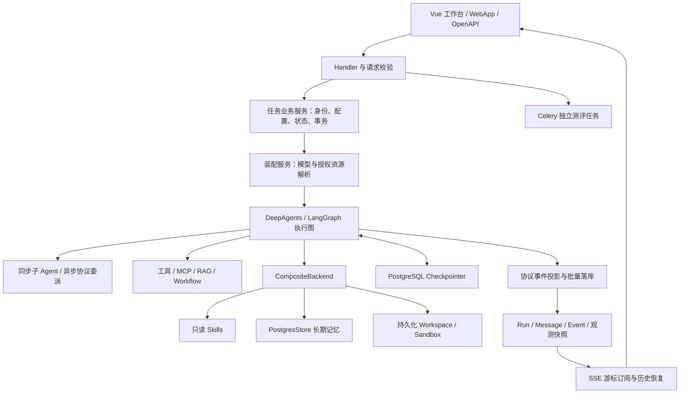
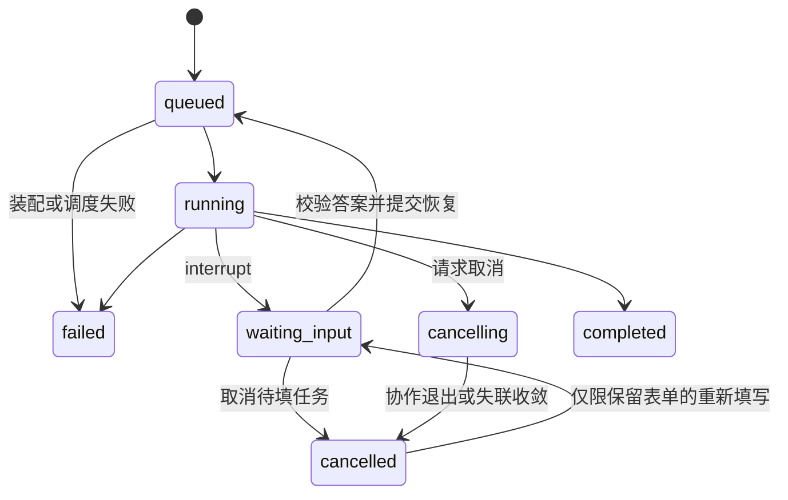
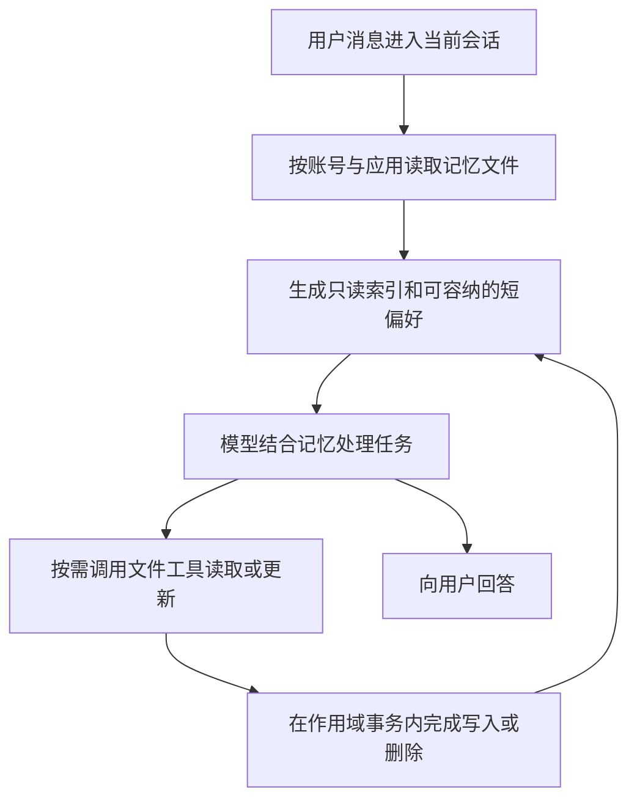

# NiceAgent 核心技术亮难点与面试准备

核对日期：2026-09-11。后端代码基线：`ea633d5`，结合当前前端实现与项目文档整理。

适用岗位：AI Agent 开发、大模型应用开发、Python 后端。本文基于静态代码核对，不代表真实模型联调、线上压测或安全审计结论。文中的性能指标均为建议测量项，没有虚构业务规模或提升比例。

## 配套文档与阅读顺序

**从简历准备面试，先读：[简历逐条实现详解与追问](/D:/spring_project/py/my-dify/docs/NiceAgent-简历逐条实现详解与追问.md)。** 按七条简历逐句解释真实链路、源码、原理、异常和连续追问，另补应用发布与多端部署；该篇已补充核对 `8b47df8` 的测评与观测结构。

1. 本文：建立项目全貌，掌握核心实现与代码入口。
2. [深入问答、故障推演与系统设计](/D:/spring_project/py/my-dify/docs/NiceAgent-面试深入问答与故障推演.md)：60 道深入问答、12 个故障场景，以及扩容设计。
3. [模拟面试与七天复习计划](/D:/spring_project/py/my-dify/docs/NiceAgent-模拟面试与七天复习计划.md)：分轮次练习、评分标准、白板题和演示准备。
4. [从零到一演进与技术决策复盘](/D:/spring_project/py/my-dify/docs/NiceAgent-从零到一演进与技术决策复盘.md)：Git 与历史 Codex 任务证据、14 个问题与设计案例、尝试方案和最终取舍。准备个人经历时优先读这一篇。

后续补充核对了当前工作区的服务职责重构。业务源文件可能持续变化，本文和配套文档以所列代码机制为依据；生产是否已生效，还需结合迁移、部署和联调确认。

记忆专题补充核对：2026-09-11，以 `e0e8544` 之后的当前工作区实现为准。旧结构化条目与兼容导入代码已移除；本次补充不改变其他专题各自注明的历史基线。

## 一、先建立项目的讲述主线

### 1. 项目的核心价值

NiceAgent 覆盖 AI 应用的配置、调试、发布和任务执行。早期能力包括多模型接入、知识库、工具和可视化工作流；当前以 DeepAgents 为执行基础，增加任务规划、多 Agent 协作、Skills、文件工作区、长期记忆、人机交互与独立测评。

面试时建议围绕一个具体任务解释系统：用户要求“检索资料并生成一份报告”，系统如何选择应用配置、绑定模型与工具、执行和展示进度、在缺少信息时暂停、保存文件，以及验收结果。

### 2. 60 秒项目介绍

> 我做的是一个 AI Agent 开发与任务执行平台，用户可以配置模型、知识库、工具、Skills 和子 Agent，也可以用工作流描述固定流程，然后发布为 WebApp 或 API。
>
> 运行时基于 DeepAgents 和 LangGraph。我主要解决平台化执行中的几个问题：一是模型、工具和技能的授权装配；二是长任务的状态管理、人工补充和流式重连；三是沙箱生命周期与文件回写的一致性；四是回答验收和运行观测。
>
> 比如任务需要用户补充信息时，系统通过 Checkpointer 保存图状态，用户提交表单后校验身份、配置和重复请求，再恢复执行。任务产生文件时，系统按内容摘要识别修改，并用文件版本号避免覆盖用户的新编辑。这些机制让应用从普通对话扩展到可交互、可交付文件的任务执行。

个人职责已按你的补充确认：从基础平台到 DeepAgents 升级由你独立开发，使用 Codex 辅助实现与排障。面试时区分框架原生能力和你完成的平台集成、产品取舍及验证。

### 3. 复习优先级

| 优先级 | 专题 | 面试重点 |
| --- | --- | --- |
| P0 | 任务状态、租约与人工续跑 | Checkpoint、业务状态和客户端状态如何保持一致 |
| P0 | 沙箱与文件回写 | 冷启动、资源复用、并发编辑和失败清理 |
| P0 | 多 Agent 与能力装配 | 框架能力与平台实现的分工、授权边界 |
| P0 | 评测与可观测性 | 如何证明结果满足要求，如何定位慢和失败 |
| P1 | SSE 持久化事件 | 断线重连、顺序、去重与首字延迟 |
| P1 | Skills 与长期记忆 | 按需加载、作用域隔离、并发更新 |
| P1 | RAG 与工作流 | 检索算法、向量一致性、图校验与分支汇聚 |
| P2 | 模型配置、MCP、部署 | 参数契约、同步异步适配、扩展边界 |

## 二、系统结构与一次任务的完整链路



### 1. 六类数据各自负责什么

| 数据 | 负责的事实 | 不能替代什么 |
| --- | --- | --- |
| App 与配置版本 | 应用能力定义、草稿与发布配置 | 不承担单次任务状态 |
| Conversation / Message | 会话归属、用户输入和业务回答 | 不足以表示执行租约与待填表单 |
| AgentRun | 一次业务运行的状态、执行身份、恢复信息 | 不替代 LangGraph 内部执行状态 |
| AgentRunEvent | 已提交的公开事件和重连游标 | 不等于框架完整 Checkpoint |
| Checkpointer | 图执行状态、中断点及恢复所需信息 | 不负责业务鉴权、表单提交幂等 |
| Store / Workspace | 跨会话记忆与任务文件 | 不等于会话消息历史 |

### 2. 从提交到交付

1. 入口解析请求并确定可信身份，校验会话归属及应用访问范围。
2. 业务服务锁定会话，检查重复输入、活动任务冲突，创建消息与 Run。
3. 数据库提交后，将运行投递到进程内有界执行池。
4. 装配服务解析草稿／发布定义，绑定模型、工具、知识库、工作流、Skills 与子 Agent。
5. Core 创建图、Checkpoint、Backend 等执行资源，消费原生图事件。
6. 协议层将原生事件转换为前端公开事件，按 Run 序号批量保存，提交成功后通知订阅者。
7. 若需要用户信息，保存待填状态并结束本次执行资源生命周期；提交答案后重新装配并恢复图。
8. 执行结束时同步文件、释放资源，将最终 Run、消息、事件及观测结果落库，再交付终态。

**关键回答：** 数据库是公开运行历史的数据源；内存通知用于唤醒订阅者。图状态、业务状态、文件状态各有职责，不能靠一张消息表包办。

## 三、专题 1：Agent 运行时与多 Agent 协作

### 要解决的问题

不同入口不能各自拼接模型、提示词和工具，否则会出现草稿／发布配置混用、子 Agent 意外继承全部工具、恢复前后资源不一致，以及资源创建失败后泄漏等问题。

### 核心实现

- 外层服务负责应用定义、身份和授权资源解析；Core 接收已经解析好的模型、工具与运行上下文，不查询应用业务权限。
- `build_deep_agent` 调用框架构建主图，接入平台中间件、同步 SubAgent 和远程 AsyncSubAgent 配置。
- 同步子 Agent 显式传入工具列表；空列表也显式传递，避免继承主 Agent 全部业务工具。
- 子 Agent 使用独立文件权限规则，只开放授权 Skill 与共享 Workspace，避免继承主 Agent 记忆访问范围。
- 自定义子 Agent 可绑定独立模型；未覆盖时沿用父模型。已发布应用形式的子 Agent 按其发布配置解析模型。
- 工具名称做重复及保留名称检查，避免覆盖 `task`、`execute`、`ask_user` 等框架工具。
- 中间件负责工具参数校验、内容审核、瞬时模型故障重试、只读工具重试和调用次数限制。
- 装配器通过 `ExitStack` 登记已创建资源；装配失败清理部分资源，成功后将关闭责任转交本次执行资源对象。

### 框架与项目实现的分工

| 框架提供 | 项目实现 |
| --- | --- |
| Agent 图与工具调用循环、任务规划机制 | 应用配置转换、入口统一、模型与资源解析 |
| SubAgent / AsyncSubAgent 能力 | 子 Agent 模型继承、工具白名单、Skill 与文件权限 |
| Checkpointer、Store、Backend 协议 | PostgreSQL 接入、作用域、沙箱与业务文件适配 |
| Middleware、Callback 扩展点 | 校验、选择性重试、运行预算、事件投影与观测 |

### 高频追问

**为什么不继续自己维护完整 Agent 循环？**

DeepAgents 已提供规划、子 Agent 和文件能力。项目保留业务装配、状态一致性和资源边界，将通用图执行交给框架，减少重复维护。代价是需要固定依赖版本，并核对原生事件、取消语义和中间件状态变化。

**为什么不对所有失败工具自动重试？**

外部写操作超时可能发生在对方已经成功之后，再试一次会重复写入。当前自动工具重试限定于部分内置只读工具；业务写工具若要重试，需要幂等键或明确的结果查询机制。

**用了多 Agent 就一定更快吗？**

不一定。独立子任务有并行收益，但还存在委派、额外上下文和结果汇总成本。强依赖任务不适合盲目拆分，任务规划也不意味着每个任务都要启动子 Agent。

**限制调用次数是否等于限制全平台总成本？**

不等于。主图中间件、同步子图和远程运行有不同作用域，不能把主图配置说成跨远程 Agent 的统一硬预算。真正的总成本预算需要跨运行归集和强制执行机制。

代码入口：[图构建](/D:/spring_project/py/my-dify/internal/core/agent_v2/assembly/graph/deep_agent_factory.py)、[子 Agent 适配](/D:/spring_project/py/my-dify/internal/core/agent_v2/assembly/graph/subagent_spec_adapter.py)、[资源装配](/D:/spring_project/py/my-dify/internal/core/agent_v2/assembly/runtime_assembler.py)。

## 四、专题 2：任务状态、执行租约与人工续跑

### 要解决的问题

长任务会遇到重复点击、重复提交、取消、用户等待、服务进程失联，以及迟到线程回写。仅保存 LangGraph 状态，不能解决这些业务并发问题。

### 核心实现

- 会话级锁用于串行化同一会话的冲突操作；需要同时锁会话与 Run 的入口遵循固定顺序。
- ORM 还声明了活动 Run 的部分唯一索引，以及同会话输入消息的部分唯一索引；活动索引包含 queued／running／cancelling，不包含 waiting_input，后者由业务锁定与冲突检查约束。数据库是否已有这些索引取决于迁移状态。
- Run 保存 `executor_id` 与心跳。事件写入、状态更新和结果提交都检查当前执行身份及终态。
- 失联恢复将活动 Run 收敛为失败或取消，并撤销旧执行身份；旧线程不能续租或覆盖结果。
- `ask_user` 通过 `interrupt` 返回结构化表单，Checkpoint 保留图状态，业务 Run 保存待填信息。
- 提交答案时校验表单字段、身份、配置指纹及提交历史；同一提交重复到达返回原序号，不再次启动执行。
- 恢复前提交答案快照和新的执行租约，再用 `Command(resume=...)` 恢复图。
- 取消后的“重新填写”只恢复表单状态，不立即启动图，也不领取执行租约。
- 运行中取消采用协作式 drain，继续完成图内部清理，不直接杀 Python 线程。



这是业务状态示意图，取消和失联处理还会覆盖部分排队场景；不是所有 cancelled 任务都允许恢复。

### 必须分清的三种“恢复”

| 情况 | 当前行为 |
| --- | --- |
| 浏览器断线或刷新 | 从数据库补取已提交事件，恢复展示 |
| 图等待用户填写 | 根据 Checkpoint 和已验证答案继续执行 |
| 执行进程失联 | 将失联 Run 收敛为失败／取消，拒绝旧执行者写入 |

**不能描述为“服务崩溃后所有任务自动从任意位置继续执行”。** 当前没有因此自动保证外部工具的副作用可安全重放。

### 高频追问

**有行锁为什么还需要执行租约？**

行锁只覆盖短事务，不能在数分钟模型调用期间一直持有。租约描述事务之外谁仍有执行权，`executor_id` 则在实际写回时拦截失效执行者。

**Checkpoint 能保证 exactly-once 吗？**

不能。图状态恢复与外部系统副作用是不同问题。比如创建订单成功后网络断开，Checkpoint 不会自动让再次请求变安全，需要业务幂等、结果核对或补偿。

**等待人工输入时配置变了怎么办？**

恢复路径重新鉴权，并比较应用定义指纹，避免使用一份与暂停时不同的定义继续执行。配置指纹主要发现定义变化，不能保证外部服务和模型行为完全不变。

**取消后外部模型请求会立即停止吗？**

不能统一保证。平台请求协作退出并禁止后续公开增量，外部调用是否立即终止取决于供应商和工具实现。取消也不会撤销已经完成的外部写入。

代码入口：[任务业务入口](/D:/spring_project/py/my-dify/internal/service/agent/agent_workbench_service.py)、[Run 与租约](/D:/spring_project/py/my-dify/internal/service/agent/agent_workbench_run_service.py)、[表单业务规则](/D:/spring_project/py/my-dify/internal/entity/agent_run_interaction.py)、[执行与取消](/D:/spring_project/py/my-dify/internal/core/agent_v2/execution/agent_executor.py)。

## 五、专题 3：可靠流式输出与 SSE 重连

### 要解决的问题

原生事件包含文本、工具、子图、状态和生命周期；多个子 Agent 的事件会交错。直接转发既难展示，也难在刷新后恢复。如果先推送后落库，客户端看过的内容还可能在重连时消失。

### 核心实现

1. 协议投影按图路径和节点维护文本流，区分源事件序号与公开事件序号；一个源事件可以生成多个公开事件。
2. 公开事件按 Run 编号，使用 `run_id:sequence` 标识；数据库以 Run 与序号组合去重。
3. 先提交事件和相关状态，再通知订阅者，查询路径只读取已提交数据。
4. 首个有效文本增量立即提交，工具／状态与消息边界及时刷新，其余文本批量写入。
5. 当前运行缓冲批量阈值为 8，普通事件到达时检查 0.1 秒时间阈值；它不是独立定时器提供的严格 100ms 延迟保证。
6. 前端将游标绑定当前订阅与 Run，解析完整 SSE 帧；正常终态结束与异常 EOF 分开处理，避免结束后反复重连。
7. 历史恢复组合业务消息、Run 快照和持久化事件；合成的恢复事件不随意推进持久化游标。

### 高频追问

**为什么用 SSE？**

主要通信模式是服务端持续输出，用户提交、取消和表单回答走独立 HTTP 请求。SSE 配合普通 HTTP 满足这条链路；WebSocket 也可实现，但需要额外设计双向连接生命周期。

**为什么首字立即落库，其余批量？**

首字决定等待体验；逐 token 写库又会增加事务和锁开销。分开处理首字、普通文本和状态边界，可以在交付延迟与持久化开销之间取舍。没有压测前不声称提升了某个百分比。

**是否做到完全不丢任何 token？**

承诺应限定为“已提交公开事件可重放”。仍在内存缓冲、尚未提交的内容，在进程崩溃时可能丢失；外部生成与数据库提交也不是一个分布式事务。

**内存通知丢了怎么办？**

通知本身不是历史数据。重连从数据库按游标补取；这解决历史补取，不等于已经具有多 Worker 的分布式实时通知系统。

代码入口：[事件投影](/D:/spring_project/py/my-dify/internal/service/agent_protocol/event_projector.py)、[批量缓冲](/D:/spring_project/py/my-dify/internal/service/agent/agent_workbench_event_buffer.py)、[前端 SSE 游标](/D:/spring_project/py/my-dify-ui/src/services/workbench-sse-fetch.ts)。

## 六、专题 4：Skills 的授权、版本与渐进加载

### 要解决的问题

Skill 不只是附加一段提示词，它还可能包含脚本和参考资料。系统需要明确哪些 Agent 能看到哪些包，并避免前一轮 Checkpoint 缓存的技能目录沿用到下一轮。

### 核心实现

- 从内置 Catalog 读取技能包，校验名称与版本，应用绑定记录版本、摘要和启用状态。
- 主 Agent 使用 `/skills/`，子 Agent 使用 `/subagent_skills/<name>/`，分别构造只读 Backend 与来源列表。
- 按本次任务的选择生成主 Agent 可见包，子 Agent 按其授权配置取得技能。
- SkillsMiddleware 提供原生技能元数据及按需读取机制；项目扩展在每轮 Agent 启动前清除旧技能元数据，重新枚举当前授权资源。
- 文件 Backend 拒绝写入、编辑与上传；沙箱模式还使用只读挂载或权限设置保护投影副本。

### 高频追问

**Skill、Tool、Workflow 有什么区别？**

Skill 描述如何完成一类任务，可以包含指令、脚本和资料；Tool 是可调用能力及参数契约；Workflow 是预定义节点和依赖关系。Skill 可指导 Agent 使用工具，也可引用脚本，但绑定 Skill 不意味着脚本会自动执行。

**记录 digest 是否意味着历史技能完全可复现？**

不是。当前规范化绑定会刷新同版本包的摘要，并非不可变历史包仓库。版本校验、变更识别与历史制品固定是不同能力，不能把前两者描述成完整制品版本管理。

**只读 Skills 能否阻止所有恶意行为？**

只读保护主要防止修改技能资源。脚本执行、外部网络和工具调用还需要独立权限与执行边界，不能把只读配置说成完整安全沙箱。

代码入口：[Skill 绑定](/D:/spring_project/py/my-dify/internal/service/skill/skill_service.py)、[Skill 路由](/D:/spring_project/py/my-dify/internal/core/agent_v2/assembly/context/skill_context.py)、[元数据刷新](/D:/spring_project/py/my-dify/internal/core/agent_v2/middleware/reloading_skills_middleware.py)。

## 七、专题 5：沙箱按需初始化与会话资源池

### 要解决的问题

远程沙箱创建、上传文件和初始化环境有成本。如果每次问答都创建沙箱，简单任务也要等待；如果直接跨运行共享沙箱，又可能并发改写同一文件系统。

### 核心实现

**统一后端与延迟初始化：** 工厂按配置选择 Bubblewrap、Daytona 或 LangSmith，远程 Provider 使用 LazySandboxBackend。未初始化时，Workspace 路径的文件读写走持久化工作区；首次执行命令或访问需要沙箱的路径才初始化远程资源。初始化后统一使用沙箱文件系统，避免代码看到文件的新版本而文件工具仍读旧内容。

**Bubblewrap：** 隔离用户、PID、IPC、UTS 等命名空间，控制挂载和网络，清空继承环境；工作区可写，Skill 路径只读。依赖 Linux 能力及实际部署配置，不是完整虚拟机，也不能据此声称有严格的 CPU／内存配额。

**Daytona 会话池：**

- 池键包含凭据作用域与会话沙箱身份，空闲资源可复用，同一会话被占用时拒绝共享。
- 锁内先保留槽位，锁外进行慢 Provider 创建，避免一个慢网络请求阻塞其他会话。
- 租约归还后设置 TTL，按空闲容量淘汰较早归还的资源。
- 定时器携带 generation，回收前同时检查资源身份、空闲状态和代际，避免旧定时器删除已重新借出的资源。
- 初始化或同步失败的沙箱不回池；删除会话会使租约失效。
- 当前池是进程内结构，空闲容量默认 3，TTL 使用配置；这些值不是全平台并发能力或性能结论。

### 高频追问

**为什么定时器 cancel 之后还检查 generation？**

cancel 与回调启动存在竞态。资源已重新借出时，旧回调可能仍执行，因此必须验证自己对应的还是同一代空闲租约。

**为什么不在持锁期间创建远程沙箱？**

远程调用延迟不可控。锁只保护本地状态迁移，远程创建在锁外进行；先占位可防止同一会话重复创建，其他会话仍可获得锁。

**是否所有 Provider 都实现了延迟创建和会话复用？**

不是。当前远程 Daytona／LangSmith 通过 LazySandboxBackend 延迟创建；会话资源池用于 Daytona。Bubblewrap 使用本地创建路径。不能将某个 Provider 的能力推广到全部后端。

**进程强制退出后 TTL 定时器还能工作吗？**

不能。正常退出有清理逻辑，强制退出需要依赖 Provider 回收配置或外部清理机制。未来可增加资源标签与周期性对账，但不能说当前已具备分布式租约池。

代码入口：[沙箱工厂](/D:/spring_project/py/my-dify/internal/core/agent_v2/backends/sandbox/sandbox_backend_factory.py)、[懒初始化](/D:/spring_project/py/my-dify/internal/core/agent_v2/backends/sandbox/lazy_sandbox_backend.py)、[会话池](/D:/spring_project/py/my-dify/internal/core/agent_v2/backends/sandbox/session_sandbox_pool.py)、[Bubblewrap](/D:/spring_project/py/my-dify/internal/core/agent_v2/backends/sandbox/bubblewrap_sandbox_backend.py)。

## 八、专题 6：工作区文件增量回写与并发冲突

### 要解决的问题

沙箱运行过程中，用户可能在页面上编辑文件。如果结束时把整个沙箱目录覆盖回工作区，就会丢失用户的新修改；如果初始化只成功一半，还可能误把缺失文件当作用户删除。

### 核心实现

1. 启动时从持久化 Workspace 导出同一份文件内容与版本清单，保存基线 `revision` 和 `content_sha256`。
2. 结束时枚举并下载当前沙箱文件，确认读取结果完整，不能将下载失败当作文件消失。
3. 比较 SHA-256，只向持久化工作区写回新增或变更文件。
4. 写入和删除携带 `expected_revision`；新增以 0 表示预期不存在，已有文件必须仍处于基线版本。
5. Repository 在事务中锁定并校验版本，匹配才更新；冲突返回错误而不是静默覆盖。
6. 没有完整基线说明初始化未成功，此时不回写部分目录；同步错误保留，并继续执行清理。

### 用一个例子讲清楚

```text
T0：Workspace 中 report.md 为 revision=5，导出到沙箱。
T1：用户在页面编辑，Workspace 变为 revision=6。
T2：Agent 也修改了沙箱中的 report.md。
T3：回写携带 expected_revision=5，数据库发现当前是 6，拒绝覆盖。
```

**SHA-256 回答“沙箱有没有修改文件”，revision 回答“持久化工作区是否已经被其他写入更新”。** 只做内容比较不能解决并发覆盖。

### 高频追问

**增量同步是否只下载变化文件？**

当前实现先读取沙箱当前文件再比较摘要，主要减少的是写回量；不能直接声称网络下载已经全量优化。远程清单或内容寻址下载可作为后续优化。

**多个文件同步是一个全局原子事务吗？**

当前接口返回逐文件结果，上传与删除也是不同步骤，应按逐文件版本校验理解，不能描述为跨沙箱、数据库、对象存储的全局原子提交。

**对象内容和数据库元数据如何保持一致？**

WorkspaceFileStore 先上传一个唯一对象，再按 expected_revision 提交元数据；元数据失败时尽力清理新对象，成功后再清理旧对象。删除则先提交逻辑删除，再清理对象。这个顺序优先保护已提交的文件引用，但进程崩溃或清理失败仍可能留下孤儿对象，不是跨存储强事务。详见[文件存储与补偿](/D:/spring_project/py/my-dify/internal/repository/workspace_file_store.py)。

**同步冲突会自动合并吗？**

不会。当前目标是发现冲突并防止覆盖；三方合并、冲突副本或用户选择属于后续策略。

代码入口：[同步算法](/D:/spring_project/py/my-dify/internal/core/agent_v2/backends/sandbox/sandbox_workspace_sync.py)、[工作区版本仓库](/D:/spring_project/py/my-dify/internal/repository/workspace_file_repository.py)、[同步与清理顺序](/D:/spring_project/py/my-dify/internal/core/agent_v2/backends/sandbox/managed_sandbox.py)。

## 九、专题 7：长期记忆与上下文预算

### 要解决的问题

历史对话越来越长，直接追加到提示词会增加成本；跨会话需要保留的偏好和经验又不能随着单个会话清除。同时，用户在页面编辑记忆与 Agent 写记忆可能并发。

### 当前机制：文件存储、模型维护、调用前刷新

开启 `long_term_memory.enable` 后，主 Agent 获得 `/memories/` 文件路由。每份 Markdown 文件描述一个主题，按 preferences、background、experience 分别组织用户偏好、背景信息和经验方法。模型通过文件工具维护内容，服务端负责存取、权限、配额与并发保护。



| 机制 | 当前实现 | 面试时要说清的边界 |
| --- | --- | --- |
| 存储 | StoreBackend 将 Store 记录映射为虚拟文件；namespace 为账号 ID＋应用 ID | PostgreSQL 模式可持久化；`memory` 模式重启丢失，不是服务器本地 Markdown 目录 |
| 跨会话复用 | 同账号、同应用的不同会话读取同一空间 | 会话 ID、模型名称不参与记忆 namespace；更换模型不更换记忆空间 |
| 加载 | 每次模型调用前刷新 `.index.md`，优先列偏好，按预算附带短偏好正文 | 索引即时生成、查询只读；当前没有向量召回或语义排序 |
| 保存决策 | 模型根据用户明确要求、纠正反馈和已验证经验决定是否调用工具 | 提炼、去重和语义合并由模型判断，没有独立的逐轮总结模型调用 |
| 读写工具 | `ls/glob/grep/read_file` 查找读取，`write_file/edit_file` 新建修正，`delete_memory_file` 删除 | 工具成功才算写入；提示词中的“不保存临时信息或凭据”不能当作确定性内容校验 |
| 并发保护 | 同 namespace 事务锁；管理接口支持正文 SHA-256 条件更新 | 锁保护当前读改写，摘要识别编辑基线过期，不构成修订历史 |
| 子 Agent | 同步子 Agent 显式限制文件权限，只开放授权 Skill 和共享 Workspace | 默认不能直接读写父 Agent 的记忆；远程 Agent 按自身运行配置处理 |

### 容量与上下文预算

- 每个记忆空间默认最多 100 个文件、总计 1 MiB，单文件最多 64 KiB。
- 索引列目录时以 3,500 UTF-8 字节为阈值；偏好全文仅选择不超过 900 字节的文件，并在总计 3,600 字节内追加。溢出提示占少量字节，应描述为约 3.6 KB 的注入预算，不宣称是精确 Token 上限。
- 超出自动注入范围的文件仍可通过 `ls` 找到，再用 `read_file` 读取。读取后产生的工具结果也会占用上下文，因此索引预算不等于整个请求预算。
- 上下文观测分别记录输入估算、供应商实际用量和整轮累计用量；当前文本估算不再依赖旧记忆实体。

### 高频追问

**与 Checkpointer、摘要和 RAG 有什么区别？**

Checkpointer 支持当前图会话的继续执行和中断恢复；摘要控制当前会话上下文长度；文件记忆保存跨会话的稳定信息；RAG 检索业务文档知识。当前文件记忆通过目录和文件工具查找，没有 Embedding 或向量检索。

**用户说“以后回答简洁一点”，系统具体怎么做？**

模型先查目录和相关偏好文件；没有同主题文件时调用 `write_file` 新建，有则通过 `edit_file` 修正。Backend 在作用域事务内检查路径、配额和写入条件；成功后，下次模型调用刷新索引。短偏好在预算允许时进入系统消息，其他正文按需读取。同账号在同应用的新会话也能读到它。

**模型会不会把每轮对话都变成长期记忆？**

当前没有固定的“每轮结束自动总结入库”流程。提示要求只保存稳定偏好、背景或有依据的经验，保存动作由模型调用工具完成。代码保证操作边界，不能保证模型每次都正确判断信息的长期价值。

**为什么同时需要事务锁和摘要校验？**

事务锁保证当前读改写串行；摘要校验判断用户打开的旧内容是否已经过期。页面打开到保存之间不一直持有数据库锁，因此两者互补。Agent 原生新建不能覆盖已有文件，编辑要求原文精确匹配。

**删除或关闭开关会发生什么？**

删除移除 Store 文件，下次刷新不再从该文件注入；已经进入历史消息、摘要或 Checkpoint 的文本不会自动清空。关闭开关停止记忆能力访问并保留已有数据。当前没有删除墓碑机制，“不要根据旧消息重新创建”由提示规则约束。

**当前还保留旧条目或版本恢复吗？**

不保留。旧条目实体、仓储、中间件、Schema 和兼容导入模块均已删除，列表读取不会转换旧数据或写入导入标记。当前没有候选审批、暂停、修订历史、撤销或语义冲突合并能力。

### 一分钟面试回答

> 我把长期记忆做成按账号和应用隔离的主题文件，底层复用 LangGraph Store 和 DeepAgents 文件工具。每次模型调用前刷新一个有预算的目录，短偏好按预算直接加载，其余正文按需读取。模型根据用户要求和反馈调用工具维护内容，平台通过路径权限、容量限制、事务锁和内容摘要保护实际操作。同账号同应用可以跨会话复用记忆，更换模型不会更换记忆空间。现在只保留文件方案，已经删除旧结构化治理和兼容导入。这个方案的代价是提炼与语义合并依赖模型判断，删除文件也不等于清除全部历史上下文。

代码入口：[文件记忆方案](D:/spring_project/py/my-dify/docs/file-memory.md)、[加载与提示规则](D:/spring_project/py/my-dify/internal/core/agent_v2/middleware/reloading_memory_middleware.py)、[文件 Backend 与索引](D:/spring_project/py/my-dify/internal/core/agent_v2/backends/memory/agent_memory_backend.py)、[文件仓储](D:/spring_project/py/my-dify/internal/core/agent_v2/persistence/agent_memory_repository.py)、[记忆事务](D:/spring_project/py/my-dify/internal/core/agent_v2/persistence/memory_file_transaction.py)。

## 十、专题 8：统一工具体系与 MCP 适配

### 要解决的问题

内置 Python 工具、HTTP API、MCP 和已发布工作流的调用方式不同。若每种类型都侵入 Agent 循环，会增加分支、重复校验，并使工具授权难以统一。

### 核心实现

- 将工具名称、描述、参数 Schema 和执行入口归一到 BaseTool；运行时只接收已经授权的工具实例。
- API Tool 从 OpenAPI Schema 生成调用契约；Workflow 从开始节点输入生成 Pydantic 参数模型。
- MCP 使用 `langchain-mcp-adapters` 发现工具，适配 stdio 与 HTTP 传输。
- 服务端负责配置归属、启停、调试与发现；运行时按工具名称绑定，并控制发现／调用超时。
- MCP 工具缓存按 Server ID 与更新时间区分，配置变化后刷新或失效。
- MCP 凭据在配置边界处理，不把它们当成模型可填的普通工具参数。

### 高频追问

**统一为 BaseTool 之后还剩什么难点？**

参数结构统一只是入口，仍需处理授权、超时、错误转换、同步／异步调用、工具重名和副作用。统一接口不代表统一可靠性。

**Flask 同步接口如何调用异步 MCP？**

适配层负责运行异步发现和调用；已有事件循环的场景使用独立线程衔接。应主动说明线程桥接有阻塞与生命周期成本，不把它说成全链路异步后端。

**MCP 调用超时是否代表对方没执行？**

不代表。超时只能说明本端没有及时得到结果。带副作用工具仍需业务幂等或结果核对，不能盲目自动重试。

代码入口：[MCP 运行适配](/D:/spring_project/py/my-dify/internal/core/mcp/runtime/mcp_runtime_manager.py)、[MCP 管理服务](/D:/spring_project/py/my-dify/internal/service/tool/mcp_service.py)、[应用能力解析](/D:/spring_project/py/my-dify/internal/service/app/app_config_service.py)。

## 十一、专题 9：RAG 检索与向量一致性

### 要解决的问题

知识库需要从文件变成可检索片段，并维护业务记录与索引；跨多个知识库检索时，如果向量模型不同，即使维度相同，也不能默认使用同一查询向量比较。

### 核心实现

- 文档经过解析、清洗、切片与索引，平台维护文档、片段、关键词与向量记录。
- 检索前按账号过滤知识库，校验其 `embedding_fingerprint` 一致，使用对应模型生成查询向量。
- 语义检索使用 Weaviate，按知识库及文档／片段启停属性过滤。
- `full_text` 当前实现为 Jieba 关键词提取、关键词到片段映射和匹配次数排序。
- 混合检索组合两类 Retriever，使用 EnsembleRetriever，当前配置等权重 0.5 / 0.5。
- 检索服务记录查询和命中统计，并将检索封装为工具，供 Agent 与 Workflow 共用。

### 高频追问

**为什么要校验向量模型一致，维度一样还不够吗？**

向量维度只表示长度，模型决定语义空间。同维度的不同模型也可能不可直接比较。项目使用配置指纹约束一次检索的知识库集合，避免混用。

**全文检索是不是 BM25？混合检索是不是 rerank？**

当前全文检索是关键词匹配计数，没有实现 BM25 的词频饱和、文档长度归一化等完整机制。混合检索是多个检索结果的融合，也没有据此实现独立 Cross-Encoder 重排。若进一步解释 EnsembleRetriever 的排序融合算法，应对照当前安装版本，而不是只凭类名判断。

**如何评估 RAG，而不只看答案“像不像”？**

先建立问题—相关片段标注集，测 Recall@K、MRR／nDCG 等检索指标；再检查答案证据覆盖和引用是否支持结论。检索召回与回答生成应分开评估。

**数据一致性还有哪些边界？**

业务库与向量库不是一个天然原子事务，索引失败、片段删除、启停同步都需要核对。当前语义检索显式带启停过滤，关键词检索的实际查询过滤与排序实现应单独验证，不能假设两个分支完全同构。

代码入口：[索引流程](/D:/spring_project/py/my-dify/internal/service/dataset/indexing_service.py)、[检索装配与向量校验](/D:/spring_project/py/my-dify/internal/service/dataset/retrieval_service.py)、[关键词检索](/D:/spring_project/py/my-dify/internal/core/retrievers/full_text_retriever.py)、[语义检索](/D:/spring_project/py/my-dify/internal/core/retrievers/semantic_retriever.py)。

## 十二、专题 10：工作流 DSL 校验与 StateGraph 编译

### 要解决的问题

前端画出的节点和连线不能直接信任。后端需要证明节点类型、依赖、变量引用与执行顺序有效，还要区分“等待全部并行分支”与“等待实际选中的条件分支”。

### 核心实现

1. 将前端 DSL 转为 Pydantic `WorkflowConfig`，校验节点、边、类型和标识关系。
2. 通过 BFS 检查从开始节点的可达性，用 Kahn 拓扑排序检查环路，并校验输入引用来自合法前驱输出。
3. 根据节点类型创建 LLM、检索、工具、HTTP、代码、模板、意图分类等节点并注册到 StateGraph。
4. 普通并行汇聚使用多来源边等待各来源；条件分支后的部分汇聚按独立边处理，避免等待未执行分支。
5. 状态使用 reducer 合并节点输出；开始节点输入动态生成工具参数 Schema，已发布 Workflow 可作为 BaseTool 调用。
6. 自然语言生成入口创建可编辑草稿，生成结果仍需要配置校验及发布流程。

### 高频追问

**DAG 为什么还需要 reducer？**

DAG 约束依赖，reducer 定义并行节点更新同一状态字段时如何合并。字典覆盖、列表追加是具体策略；存在重复 key 时还需考虑冲突语义，不能认为 reducer 自动解决业务冲突。

**条件分支汇聚为什么不能一律等待所有前驱？**

如果分类只选择 A，B 永远不会执行，等待 A 和 B 就无法推进。并行和条件分支需要不同的汇聚语义。当前实现识别部分直接条件分支形态，不宜宣称已经支持任意复杂嵌套分支的完整编译分析。

**工作流代码执行也走 Daytona 吗？**

当前不是。Workflow 的 CodeNode 做 AST 形式校验后调用腾讯云函数；Agent 的 `execute` 走所选沙箱 Backend。AST 检查只做格式验证，执行隔离依赖运行环境。

**图允许循环吗？**

当前工作流配置校验拒绝环路，应描述为 DAG 工作流。Agent 内部的模型—工具循环是另一层运行机制，不能混为一谈。

代码入口：[DSL 校验](/D:/spring_project/py/my-dify/internal/core/workflow/entities/workflow_entity.py)、[图编译与工具化](/D:/spring_project/py/my-dify/internal/core/workflow/workflow.py)、[草稿生成](/D:/spring_project/py/my-dify/internal/service/workflow/workflow_generator_service.py)、[代码节点](/D:/spring_project/py/my-dify/internal/core/workflow/nodes/code/code_node.py)。

## 十三、专题 11：应用版本与多模型参数契约

### 要解决的问题

调试配置不能直接影响已发布应用；模型能力和参数也不能仅凭供应商名称猜测。不同服务对输出上限、思考等级、采样参数的名称和范围可能不同。

### 核心实现

- 分离应用草稿、发布配置与单次运行选择，定义服务统一解析不同入口的应用定义。
- 模型连接通过显式发现并启用模型，保存发现快照和能力信息，允许手工补充参数声明。
- 统一内部参数名，再根据连接契约映射到供应商字段，例如不同最大输出参数。
- 可选参数默认不发送；用户显式覆盖后才进行类型、范围与支持情况校验。
- 参数不允许夹带 `api_key`、`base_url` 等连接配置，连接身份和模型推理参数分开处理。
- 工作台单次模型／推理等级选择不直接修改草稿或发布配置；表单恢复沿用本次运行约束。

### 高频追问

**为什么不用一套默认参数发给所有模型？**

有些模型不支持 temperature，有些服务使用不同输出字段。错误默认值会导致请求失败或改变行为。平台保存用户意图，通过能力契约决定实际发送内容。

**动态发现能保证模型能力一定准确吗？**

不能，发现接口可能只返回模型 ID 或缺少参数。项目标记发现／手工／兼容来源，最终仍受供应商实际接口约束。兼容编辑选项不能当成供应商支持证明。

**发布快照能保证完全复现吗？**

只能固定相应配置，不会自动固定外部工具数据、供应商模型权重、记忆内容和所有技能制品。完整复现需要进一步固定依赖与输入证据。

代码入口：[定义来源与指纹](/D:/spring_project/py/my-dify/internal/service/agent/agent_definition_service.py)、[模型发现与参数方案](/D:/spring_project/py/my-dify/docs/model-discovery-parameters.md)、[参数契约](/D:/spring_project/py/my-dify/internal/core/language_model/parameters.py)。

## 十四、专题 12：结果验收、异步测评与运行观测

### 要解决的问题

模型说“完成了”不能直接证明满足要求，评分模型也可能漏项或引用不存在的证据。同时，用户感到慢或失败时，需要区分模型、工具、摘要、沙箱初始化和文件同步的耗时。

### 两种测评模式

| 模式 | 做什么 | 边界 |
| --- | --- | --- |
| 历史回答评分 | 对冻结的输入、回答和标准做评分与证据校验 | 不重新运行原生产任务 |
| 独立执行验收 | 隔离状态下生成回答／临时文件，按标准修订 | 不加载生产 MCP、知识库、Skills、子 Agent、长期记忆或原附件，不执行 shell |

### 核心实现

- HTTP 提交先保存 queued 记录，再投递 Celery；Worker 条件更新领取任务，重复 HTTP 请求通过 `request_id` 复用记录。
- 提交时冻结材料、标准和模型引用；模型凭据不写进测评记录或队列。
- 历史评分区分完全满足、部分满足、不满足和证据不足；覆盖率与已评项得分分开表示，不能把证据不足直接算作零分或满分。
- 独立验收使用工作模型与裁判模型，RubricMiddleware 驱动有上限的修订循环。
- 每轮从实际状态读取候选答案和文件，确定性规则检查指定文本、JSON 顶层字段、虚拟文件存在且非空。
- 候选哈希绑定答案与文件版本，校验标准完整覆盖、取证过程及裁判结论一致性；最终候选必须与已验收候选匹配。
- 每轮保存候选、差距和证据，持久化失败时停止；评分预算耗尽不能标成通过。

### 运行观测

- 每个 Run 创建 Observer，通过 Callback 关联模型／工具的父子调用、Token、状态和耗时。
- 用量汇总与明细上限分开，避免 Span 被截断后总量也跟着少算。
- 缓存 Token、推理 Token 是用量明细，不能再次加到总 Token；未知用量与真实零用量分开。
- 重试只统计框架 `on_retry` 可观察到的事件，不通过同名调用重复出现猜测。
- 子 Agent 调度已属于工具调用，统计时不能再无条件相加；远程调用内部明细取决于是否另有观测数据，不能假设根 Run 覆盖所有远程 Token。
- 应用统计当前主要基于有回复消息，不能直接据此计算全量 Run 成功率；平均回复耗时也不是纯模型推理延迟。

### 高频追问

**为什么需要独立裁判？能否完全信任它？**

独立裁判将生成与验收职责分开，但仍可能误判。项目以确定性规则、实际取证、标准完整性和候选哈希约束判定，依旧不等于事实正确性的绝对证明。

**为什么验收通过还要校验最终哈希？**

裁判可能认可的是候选 A，之后又生成了候选 B。没有版本绑定，最终交付物与被验收物可能不是同一份。

**Celery 是否保证消息和数据库记录原子提交？**

普通数据库提交与消息发送不是一个事务。当前提交、领取、幂等与超时收敛降低重复和悬挂影响；若需要更强的可靠投递，可设计 outbox 与补偿扫描，但不能称为当前已实现。

**线上为什么慢，你从哪里看？**

先定位 Run，拆分装配、首字、模型／工具调用、摘要、沙箱初始化和文件回写；区分首次创建与复用、等待人工输入与真实执行。再看 P50／P95 和慢调用明细，不能只看总 Token。

代码入口：[测评方案及运行边界](/D:/spring_project/py/my-dify/docs/agent-evaluation.md)、[验收实现](/D:/spring_project/py/my-dify/internal/service/agent_evaluation/agent_evaluation_runtime.py)、[异步测评业务](/D:/spring_project/py/my-dify/internal/service/agent_evaluation/agent_evaluation_service.py)、[观测口径](/D:/spring_project/py/my-dify/internal/core/agent_v2/observability/README.md)。

## 十五、部署与扩展：后端面试必须讲清的边界

### 1. 当前 Agent 调度与 Celery 的区别

交互式 Agent Run 使用 API 进程内 ThreadPoolExecutor 与 BoundedSemaphore，当前代码限制 4 个执行槽位；独立测评使用 Celery。不要因为技术栈包含 Celery，就说所有 Agent 任务都通过 Celery 调度。

槽位满时拒绝新运行，避免无限创建线程；该限制保护单进程资源，不代表全局任务排队或分布式配额。

### 2. 为什么不能直接增加 Gunicorn Worker？

项目 README 要求当前生产部署保持单 Worker。活动运行登记、取消信号、实时通知和 Daytona 会话池都包含进程内状态；多进程共享 PostgreSQL，并不自动共享这些对象。

可讨论的后续方案：将任务投递、运行归属、取消信号和通知外置，明确事件顺序与幂等，再考虑多 Worker。Redis Pub/Sub 只能承担通知，历史仍需持久化；若使用 Streams，还需要设计消费与保留策略。这些是扩展方案，不是当前成果。

### 3. 数据库连接为什么要及时归还？

Agent 的模型和工具等待远长于普通 CRUD。不能在网络调用或整个 SSE 连接期间一直占着 ORM 事务；应在短读写边界释放连接，框架 Saver／Store 的连接池也不随单次 Run 一起销毁。

### 4. 两类“租约”不要混淆

| 租约 | 存放位置 | 保护对象 |
| --- | --- | --- |
| Run 执行租约 | PostgreSQL，含执行身份与心跳 | 谁能更新业务运行状态和事件 |
| Daytona 沙箱租约 | 进程内池，含 busy、generation、TTL | 谁能独占复用当前沙箱资源 |

代码入口：[执行池与心跳](/D:/spring_project/py/my-dify/internal/service/agent/agent_workbench_execution_service.py)、[部署说明](/D:/spring_project/py/my-dify/README.md)。

## 十六、三个可直接练习的技术讲述稿

以下是根据实现整理的设计故事，不作为线上事故经历。真实开发问题、产品判断和方案迭代见配套的演进复盘，其中明确区分已发生的问题与设计推演。

### 故事 1：让流式任务在刷新后仍然可理解

**适用问题：** 你解决过什么复杂后端问题？为什么不直接转发模型 SSE？

> 项目从聊天升级到任务工作台后，一次运行可能交错产生文本、工具调用和子 Agent 进度。直接转发模型输出很难在刷新后恢复，也无法准确说明任务是结束、失败还是等待用户。
>
> 我将 Conversation、Run 和公开事件分开，图事件先按路径和节点投影，再分配 Run 内序号，提交数据库后才通知前端。首字与状态边界立即提交，普通文本批量写入。前端按当前 Run 游标补取，避免新旧订阅混用。
>
> 这样已提交的运行过程可以恢复展示；同时通过执行身份与终态校验，避免失效线程覆盖结果。这个机制解决的是持久化历史与业务状态一致性，不承诺进程崩溃时未提交 token 不丢，也不自动重放所有外部操作。

### 故事 2：降低沙箱固定成本，同时保护文件修改

**适用问题：** 你做过什么性能优化？最难的数据一致性问题是什么？

> 普通问答不一定需要代码执行，但如果装配阶段就创建远程沙箱，会把创建和上传成本加到每次请求上。我引入延迟后端，让初始化前的 Workspace 文件操作走持久化存储，第一次真正需要沙箱时才切换数据源。
>
> 对 Daytona 增加会话独占复用、TTL 和空闲容量淘汰，使用 generation 防止旧定时器回收新租约。文件回写则使用基线摘要找变化，再用 revision 检查持久化文件是否被用户更新。
>
> 结果是执行路径上消除了无需沙箱任务的远程创建，并能拒绝冲突覆盖。具体延迟和成本收益还需要按创建、复用、跳过三个场景测量，不能仅根据代码给出百分比。

### 故事 3：防止“裁判说通过，但交付物不是那一份”

**适用问题：** 怎么评测 Agent？怎样降低 LLM-as-a-Judge 的误判？

> 仅让模型按标准输出一个通过结论不够，可能漏项、没有真实取证，或者评分后候选内容又发生变化。
>
> 我把工作模型和裁判分开，每轮从真实状态读取答案与文件，执行确定性规则，并校验标准是否完整覆盖。候选哈希绑定具体答案和文件，最终结果必须与被验收候选一致，才能标记通过。各轮证据与差距通过异步测评流程保存。
>
> 当前支持历史回答和隔离环境的回答／临时文件验收，能够追溯每轮变化；它不是生产 Agent 全工具链的自动回放，也不能替代所有人工判断。

## 十七、面试前应补测的指标

没有真实数据时，只讲机制与观察，不填假数字。建议先选能稳定复现的固定任务，记录模型、参数、网络环境、并发和样本量。

| 主题 | 指标 | 测量方法 |
| --- | --- | --- |
| 首字与事件交付 | TTFT P50／P95、事务批次数、重连补取耗时 | 对照首字事件、请求开始与数据库提交时间；区分输出审核开关 |
| 沙箱 | 创建／复用／跳过占比、初始化与同步耗时 | 固定纯问答、文件操作、代码任务三类样本 |
| 状态一致性 | 重复提交是否二次执行、旧租约写入拒绝率 | 人工构造并发提交、取消和迟到回调场景 |
| 文件回写 | 冲突检出、新增／修改／删除正确性 | 并发编辑同一路径，检查版本与内容 |
| RAG | Recall@K、MRR／nDCG、检索延迟 | 固定标注集，分别测语义、关键词和混合检索 |
| 评测 | 首轮通过率、最终通过率、轮次、评测成本 | 预先固定任务和标准，失败与证据不足单独统计 |
| 整体运行 | 完成／失败／取消／等待数量、执行耗时 | 基于全部 Run 建立口径，不能只统计有回答消息 |

若开启整轮输出审核，当前执行器可能先缓存事件，审核通过后再公开，因此需要单独解释该模式的首字体验。

## 十八、最后一遍口述自测

不看代码回答下面问题，卡住的题目回到对应专题：

1. 用一分钟说清一次任务从 HTTP 提交到文件交付的路径。
2. 哪些能力来自 DeepAgents，哪些是你做的平台实现？
3. Conversation、Run、Checkpoint、Event、Store 各自解决什么问题？
4. 为什么事务锁、执行租约和幂等校验缺一不可？
5. SSE 重连、表单续跑、进程失联恢复有什么区别？
6. 为什么外部写工具不能因为超时就重试？
7. 子 Agent 为什么显式传空工具列表？权限规则为什么替换父规则？
8. 沙箱什么时候创建？初始化前后文件读取为何必须切换到一致的数据源？
9. generation 如何解决旧定时器竞态？两类租约有什么不同？
10. 内容摘要与文件版本号各解决什么问题？回写是否全局原子？
11. Skill、Tool、Workflow、Memory、RAG 如何区分？
12. 当前全文检索是什么算法？向量模型维度相同为什么仍可能不兼容？
13. 如何检测工作流环路？条件分支与并行汇聚为什么不同？
14. 当前工作流代码节点与 Agent execute 分别在哪执行？
15. 为什么裁判通过后仍需检查候选哈希？测评有哪些未覆盖的生产能力？
16. 哪些统计不能直接用来推导成功率、真实重试次数或全链路成本？
17. 为什么当前不能直接增加多个 API Worker？如何逐步扩展？
18. 如果只能展示一个难点，你能否用具体时序、代码入口和失败边界讲清楚？

建议优先练熟“任务状态与恢复”“沙箱与文件一致性”“结果验收”三个专题，每个准备 30 秒概括与 2 分钟展开。面试中先讲具体问题、机制和结果，再按追问进入实现细节。
