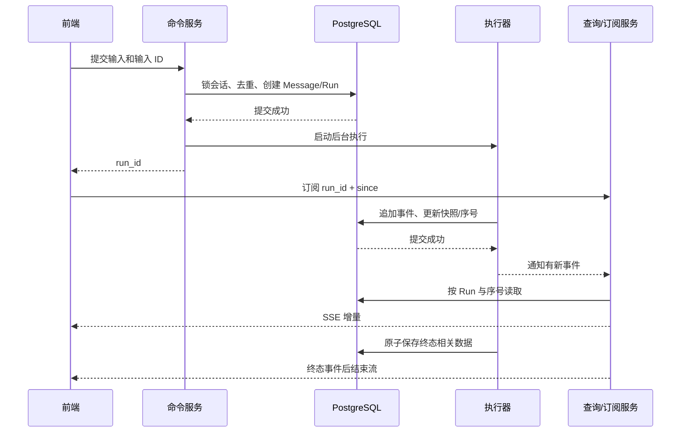

# NiceAgent 简历逐条实现详解与追问

核对日期：2026-09-11；本轮后端代码基线 `8b47df8`，同时核对当前前端与已安装依赖。本文按你给出的七条升级版简历逐项展开，补充早期版本的应用发布、多端接入与部署。只整理文档，没有运行模型、沙箱、数据库联调或性能测试。

你独立完成项目开发，框架提供的能力与平台自己实现的部分需要分开讲。本文的“回答示例”可以用第一人称；异常时序例子用于解释机制，不自动视为真实事故。真实经历见[演进与技术决策复盘](/D:/spring_project/py/my-dify/docs/NiceAgent-从零到一演进与技术决策复盘.md)。

记忆专题补充核对：2026-09-11，以 `e0e8544` 之后的当前工作区实现为准。旧结构化条目与兼容导入代码已移除；本次补充不改变其他专题各自注明的历史基线。

## 阅读方法与简历措辞校准

每条简历按“这句话承诺了什么 → 代码怎样执行 → 为什么这样设计 → 连续追问 → 可直接讲述的回答”展开。先练习一分钟回答，再对照流程和源码回答更深一层的问题。不要只记住某个类名。

| 简历中的关键词 | 能经得起追问的准确含义 |
| --- | --- |
| 统一装配 | 将已授权配置解析成模型/工具对象，再组合 Backend、持久化与图；不是把任意配置直接传给框架 |
| 参数校验 | 消息工具调用格式、工具 Schema、业务权限分层校验；自定义消息中间件不负责所有语义校验 |
| 调用次数限制 | 当前图中间件的运行限制；不能直接解释为主/子 Agent 全局成本预算 |
| 任务恢复 | 事件补取与明确暂停点续跑；不承诺任意进程崩溃后工具恰好执行一次 |
| Skills 版本校验 | 内置包版本与应用绑定匹配，同版本摘要会刷新；不是不可变制品版本仓库 |
| 独立只读挂载 | 主/子 Agent 具有不同技能路径和权限；不表示每个子 Agent 都有独立 OS 沙箱 |
| 长期记忆 | Store 中按作用域保存的虚拟文件；不是模型训练，也不是把完整历史全文每次注入 |
| 增量回写 | 识别内容变化，只向权威工作区提交变化文件；当前仍会读取远端文件，不是块级差量传输 |
| 沙箱池 | Daytona 的进程内会话租约池；不是跨 Worker 的全局资源调度平台 |
| 混合检索 | 语义召回与关键词召回通过 EnsembleRetriever 融合；不是已接入 BM25＋Cross-Encoder |
| 验收修正 | 独立测评图使用 Rubric 驱动有上限修订；当前生产 Agent 主链路没有统一接入这一循环 |
| 调用追踪 | 本地 Callback 与平台遥测关联 Run；远程子 Agent 内部用量不一定完整回流 |

## 第一条：Agent 运行时

> 基于 DeepAgents / LangGraph 统一装配模型、工具、Skills 与持久化资源，支持任务规划、同步及远程异步子 Agent；按子 Agent 配置模型、工具与技能权限，通过中间件实现参数校验、选择性重试和调用次数限制。

### 1. 先讲清框架分工

LangChain 提供模型、消息、BaseTool 和中间件接口。LangGraph 承担状态图执行、检查点、暂停与恢复。DeepAgents 在这套基础上提供规划、文件操作、Skills 和子 Agent 等任务执行能力。项目没有重新实现通用大模型推理框架，而是把原生能力接入应用配置、身份、资源和产品协议。

早期 LangGraph Agent 到 DeepAgents 的升级，保留了知识库、工具、工作流等可复用能力；主要变化发生在运行时装配、任务状态、资源生命周期和前端任务展示。

### 2. “统一装配”到底装了什么？

```text
AgentInvocation（可信身份、输入、入口、运行选择）
  → AgentDefinitionService.load：确定草稿/发布/内置定义
  → AgentModelService：默认模型、显式覆盖、连接权限、思考强度
  → AgentAssemblyService：解析工具、知识库、Skills、子 Agent 绑定
  → AgentRuntimeAssembler：创建 Workspace、Skill/Memory 路由、Sandbox
  → build_deep_agent：注入模型、工具、中间件、Backend、Saver、Store
  → AgentExecutor：消费图事件，提取结果，关闭运行资源
```

这条边界的意义是：Core 接收可执行的模型和已授权工具，不需要到处查询 App 表、读取 Flask request 或重新判断账号权限。业务服务负责“允许用什么”，Core 负责“怎样组合并执行”。

例如用户要求“生成本周报告”，模型由当前应用默认配置或本轮显式选择决定；知识库工具已经绑定允许访问的库；技能包来自应用启用的目录；子 Agent 不能自行指定其他用户的连接或技能路径。请求中传了一个资源 ID，不意味着已经获得资源权限。

### 3. 模型默认值与显式覆盖为什么要区别？

“跟随默认模型”和“用户明确选择模型 A”即使当前都解析到 A，也不是同一种意图。前者应随有效默认配置解析，后者需要记录覆盖、校验连接并恢复选择。否则页面只是显示了默认模型，下一次提交却可能把这个显示值固化为覆盖，造成默认模型修改不生效。

已发布子 Agent 的模型来自其发布配置；自定义跟随父模型的子 Agent 使用本轮父模型。模型目录发现、模型可调用和支持 tools/结构化输出等能力也不是同一事实，不能仅凭模型出现在列表中就推断全部能力。

### 4. 规划、同步子 Agent、异步子 Agent 的执行区别

| 能力 | 实际机制 | 要讲清的边界 |
| --- | --- | --- |
| 规划 | 原生 todo 能力维护计划，平台按开关和事件展示 | todo 是计划状态，不是平台自建队列里的调度任务 |
| 同步子 Agent | 配置转为原生 SubAgent spec，通过原生 task 委派 | 同步指父委派等待结果，不等于不能有并行子任务 |
| 异步子 Agent | 配置转为 AsyncSubAgent spec，包含 graph_id、URL、headers 等协议连接信息 | 有独立任务生命周期，不是把同步函数改成 async 关键字 |

同步子 Agent 的 spec 显式包含 `tools`，即使为空也传 `[]`，避免原生缺省继承父工具。技能权限由独立 sources 与 permissions 给出，替换父规则；共享工作区仍开放读写，因此多个子任务同时写同名文件需要处理冲突。

异步委派还要处理目标应用、调用身份和远端生命周期。项目内部调用使用限定作用域的签名令牌；它与用户登录 JWT 是不同协议。远端执行不意味着平台能在任意时刻撤销其已经发生的外部副作用。

### 5. 三层参数校验不要混在一起

| 层次 | 校验内容 | 示例 |
| --- | --- | --- |
| 消息协议 | tool_call 的 name/id 非空、args 是对象，旧原始 arguments 能解析为 JSON | 拒绝 `args="随便搜索一下"` 或损坏的历史消息 |
| 工具 Schema | 字段类型、必填项、枚举及工具声明的结构 | `k` 必须满足工具定义；必填 query 不能缺失 |
| 业务校验 | 资源归属、启停、发布状态、访问范围 | 结构合法的 dataset_id 仍可能不属于当前账号 |

`ToolCallValidationMiddleware` 在模型调用前检查恢复的历史，在模型返回后检查新消息，避免损坏的 tool_call 流入供应商序列化或被当作正常完成。它不会猜测并修复写操作参数，也不能判断“这个工具是不是用户真正想调用的”。

### 6. 选择性重试与调用限制

当前主图装配使用模型重试、工具重试及调用限制中间件。模型最多配置两次重试，选择超时、连接故障、408/409/429 与 5xx 等瞬时失败；认证或明显参数错误不会一概重试。只读内置工具 `ls/read_file/glob/grep` 对 TimeoutError、ConnectionError 重试。

为什么写工具不能自动重试？假设“上传报告”的远端已成功，但返回结果前网络中断。平台看到的是超时，重试可能再次上传甚至重复通知。没有幂等键、状态查询或业务去重，就无法仅凭异常判断是否安全。

当前主图模型调用限制配置为 10，工具调用限制为 40，分别采用 `end` 与 `continue` 的框架退出策略。这里要强调作用域：不能据此证明同步子图、远程任务、SDK 内部重试都合计受同一个全局预算约束。若要全局预算，需要跨执行域的共享计数和额度预占设计。

### 7. 连续追问

**Q1：为什么不直接复用一个全局 Agent 实例？**

每次运行的身份、能力、Observer、文件资源与输入不同。项目创建一次性执行器，避免可变回调状态和资源混用；Saver/Store 连接池等适合共享的基础资源由进程管理。复用连接池和复用带用户状态的执行器是两回事。

**Q2：多 Agent 为什么可能更慢、更贵？**

拆分增加规划、委派、上下文传递和汇总调用。只有子任务有足够独立性，隔离上下文或并发收益才可能抵消额外成本。任务短、共享状态多、反复交互时单 Agent 可能更合适。

**Q3：技能写了 allowed-tools 就安全了吗？**

声明不能代替运行时授权。应检查实际装配的 tools、Backend 权限与可用执行入口。读取一份 Skill 不应自动扩大工具权限；有 shell 能力时还需要理解 OS 隔离和宿主权限，不能只靠提示词。

**Q4：模型调用上限是否代表任务一定成功结束？**

不代表。限制用于约束执行，不证明结果满足需求。框架停止、Run 终态和用户验收通过要分别判断。

**一分钟回答：**

> 我把运行时拆成业务解析和图装配两层。业务层确定应用版本、模型连接以及授权工具和技能，Core 再组合文件 Backend、Checkpointer、Store 和 DeepAgents 图。规划与委派复用原生能力，平台给每个同步子 Agent 显式绑定工具和技能范围，并适配远程异步协议。可靠性上分消息格式、工具 Schema、业务权限三层校验，只重试明确的瞬时错误和只读工具。调用限制是当前图的保护措施，还不是跨远程 Agent 的全局预算。

代码：[业务装配](/D:/spring_project/py/my-dify/internal/service/agent/agent_assembly_service.py)、[资源装配](/D:/spring_project/py/my-dify/internal/core/agent_v2/assembly/runtime_assembler.py)、[构图](/D:/spring_project/py/my-dify/internal/core/agent_v2/assembly/graph/deep_agent_factory.py)、[中间件与重试](/D:/spring_project/py/my-dify/internal/core/agent_v2/assembly/graph/platform_middleware.py)、[子 Agent 适配](/D:/spring_project/py/my-dify/internal/core/agent_v2/assembly/graph/subagent_spec_adapter.py)、[消息校验](/D:/spring_project/py/my-dify/internal/core/agent_v2/middleware/tool_call_validation_middleware.py)。

## 第二条：任务控制与恢复

> 分离会话、Run 与事件模型，通过 PostgreSQL Checkpointer 保存执行状态，结合事件持久化与 SSE 实现断线补取、提交去重和任务取消；基于 interrupt / Command(resume) 实现表单提问与人工补充后继续执行。

### 1. 五种状态载体各解决什么问题？

| 对象 | 保存什么 | 为什么不能用其他对象替代 |
| --- | --- | --- |
| Conversation | 对话归属和多轮组织 | 不足以描述一次任务的执行权和终态 |
| Message | 用户可见的问题/回答及统计 | 只有回答不能恢复图的下一执行位置 |
| AgentRun | 单次任务状态、快照、执行者、心跳、事件序号 | Run 摘要不含全部事件与框架执行细节 |
| AgentRunEvent | 按 Run 顺序追加的协议事件 | 重放事件只是恢复展示，不是重新执行图 |
| Checkpoint | 框架图状态、待执行与暂停信息 | 内部状态不适合作为所有 UI 查询的产品协议 |

长期记忆 Store 是跨会话资源，另见第四条。一个数据库里保存这些对象，不意味着能把它们作为同一份状态任意替代。

### 2. 创建 Run 的事务顺序

`start_run` 先锁定会话，检查输入是否已提交、是否存在冲突任务，创建用户消息与 Run，提交事务后才启动后台执行。这里的会话锁让同一会话的启动/恢复操作有统一竞争顺序；数据库约束提供最后一道防线。

当前模型中，`(conversation_id, input_message_id)` 对非空输入 ID 唯一；另一个部分唯一索引限制同一会话最多一个 `queued/running/cancelling` Run。`waiting_input` 不在该索引里，因此是否允许启动新任务还需要命令服务规则控制，不能说数据库索引独自覆盖所有交互状态。

重复请求应返回既有任务或明确冲突，不再创建第二个执行。输入去重只能保证平台没有因为同一个提交 ID 再次启动；无法自动证明远端工具内部没有重复执行。

### 3. 执行、落库、推送如何串起来？



通知发生在提交之后；本地通知负责降低读取等待，数据库事件负责恢复。当前事件主键为 `(run_id, sequence)`。客户端绑定固定 Run，按游标补取，去重处理；前端不应该在重连时再次提交同一个模型任务。

批量落库减少逐 token 事务开销。当前一般批次大小 8，首个公开文本/推理增量、工具/状态事件、消息结束边界可立即刷新；普通文本在新事件到达时检查 0.1 秒阈值。没有独立定时器，所以不能说“任何事件都严格 100ms 内发送”。

还有一个影响实时性的配置：开启输出内容审核时，执行器会暂存本轮事件，通过审核后再公开。此时即使模型原生流式生成，用户也可能看不到逐 token 实时输出；应先检查审核配置，再定位 SSE 缓冲或网络问题。

### 4. 三种“恢复”必须区分

| 情况 | 当前处理 | 不代表什么 |
| --- | --- | --- |
| 浏览器断线 | 根据 Run 与已读序号重放持久事件 | 不需要重新运行模型 |
| 主动等待用户 | Checkpointer 保存暂停状态，校验答案后 Command(resume) | 不是 HTTP 线程一直等待用户输入 |
| 执行者失联 | 心跳过期，后台扫描撤销执行权并收敛失败/取消 | 不是任意步骤自动重试至成功 |

业务租约约 120 秒，旧执行者写事件或终态时需要匹配 executor_id。这样已经失去执行权的实例不能覆盖后来收敛的结果。扫描周期和调度延迟会影响最终收敛时间，120 秒不是端到端恢复 SLA。

### 5. 表单提问是怎么暂停的？

`ask_user` 使用 Pydantic 表单定义，调用 `interrupt(form)`；框架暂停图并保存状态。平台把它投影为待填写表单，Run 进入 waiting_input，执行资源释放。主 Agent 汇总必要信息，避免子 Agent 各自弹出互相竞争的表单。

用户提交后，`respond_input` 校验当前身份、会话和 Run、表单与答案结构、重复响应以及应用定义指纹，再将运行重新排队，使用 `Command(resume=...)` 把值送回暂停点。恢复后 `interrupt()` 返回该值，工具再校验答案并继续。

应用定义指纹避免在用户填写期间模型/工具配置被改动后，悄悄按另一套定义恢复。指纹是配置一致性检查，不是快照了所有外部系统数据。

原生恢复可能重新进入包含 interrupt 的节点。暂停之前的代码应可重复执行，外部副作用不能随意放在其前面。表单“暂不提供”“无法提供”“允许代选”也有不同语义；代选某个字段不等于授权所有后续操作。

### 6. 取消如何处理？

运行中任务先进入取消请求链路，通过取消信号与图协作停止收敛结果。当前执行器可以请求图在后续 superstep 边界 drain；不应描述为强杀任意 Python 线程。已经发往远端的请求可能仍在执行。

待填写任务没有活跃执行线程，可以直接原子取消待填状态。重新打开表单只恢复交互，不立即启动图，也不领取执行租约。取消后的部分结果、审核策略与最终展示需要一起处理。

### 7. 连续追问

**Q1：SSE 不可靠，为什么不用 WebSocket？**

此处客户端命令走 HTTP，服务端增量单向推送，SSE 满足交互。可靠性来自事件落库、游标、身份和终态协议；换 WebSocket 不会自动获得这些机制。若需要持续双向媒体流，才需要重新评估协议。

**Q2：读到了终态但浏览器还在转圈，查哪里？**

先区分数据库终态、SSE 终态、SDK 消费结束、UI 状态四层。项目历史曾在终态回调 hydrate 干扰消费，且异步迭代器没有持久 EOF 状态；最终移除干扰并增加 ended 标记。不能把这个案例说成模型耗时优化。

**Q3：过滤了某些事件后，游标是否只跟最后一个展示事件走？**

扫描游标与公开事件游标要有清楚协议。如果一批全是不可展示事件还不推进扫描位置，就会反复扫描同一批。项目内部 EventBatch 保留扫描进度，不应把内部扫描状态简单当成 UI 最后一条事件。

**Q4：连接断开是不是任务被取消？**

不是。网络连接与后台执行生命周期分离。只有显式取消命令或执行控制逻辑才改变任务；否则断线后仍能补取已完成结果。

**Q5：数据库提交成功，线程池启动失败怎么办？**

不能假装没创建任务。应按已持久化 Run 走启动失败收敛，释放本地执行槽位并保存失败状态；如果进程在该窗口崩溃，由租约/后台扫描兜底。若要更强投递保证，后续可设计事务 outbox，但当前不能说已实现。

**一分钟回答：**

> 我把会话、任务、消息、持久事件和图检查点分开。启动时在会话锁内去重并创建 Run，提交后执行；运行事件落库再通知，前端先拿到 run_id 再订阅，重连只补取这次任务。人工补充使用 interrupt 和 Command(resume)，恢复前校验身份、表单和配置指纹。取消与失联也有独立状态和执行权检查。这里保证的是明确暂停点续跑和可恢复展示，不是外部工具的 exactly-once。

代码：[命令服务](/D:/spring_project/py/my-dify/internal/service/agent/agent_workbench_service.py)、[Run 与事件模型](/D:/spring_project/py/my-dify/internal/model/agent_run.py)、[事件落库与租约](/D:/spring_project/py/my-dify/internal/service/agent/agent_workbench_run_service.py)、[事件缓冲](/D:/spring_project/py/my-dify/internal/service/agent/agent_workbench_event_buffer.py)、[只读订阅](/D:/spring_project/py/my-dify/internal/service/agent/agent_workbench_query_service.py)、[输入工具](/D:/spring_project/py/my-dify/internal/core/agent_v2/tools/ask_user.py)、[前端传输](/D:/spring_project/py/my-dify-ui/src/services/workbench-sse-fetch.ts)。

## 第三条：Skills 与工具复用

> 实现技能包版本校验、应用绑定及主/子 Agent 独立只读挂载，封装指令、脚本和参考资料；统一适配 Builtin、OpenAPI、MCP 及已发布工作流为 BaseTool，供 Agent 按授权调用。

### 1. Skill、Tool、Workflow 是三种不同对象

Skill 是完成某类任务的方法包，例如 SKILL.md 写周报步骤，scripts 放处理脚本，references 放格式说明。Tool 是模型可以调用的函数接口，具有名称、描述、参数 Schema 和执行方法。Workflow 是一个编译后的步骤图，可以再作为 Tool 暴露。

例如“生成周报”Skill 告诉 Agent 何时检索、按什么结构写；知识库 Tool 返回材料；已发布 Workflow 可以负责固定格式转换。读取 Skill 文本本身不会神奇地执行脚本，脚本还要通过实际执行能力运行。

### 2. 内置技能包怎样变成运行资源？

```text
扫描内置目录
  → 校验目录名、SKILL.md/frontmatter、文件类型/大小、路径与符号链接
  → 读取指令/脚本/资料，计算稳定摘要，生成 Catalog
  → App 保存 name/version/digest/enabled 绑定
  → 运行时核对版本，解析已启用包
  → 主 Agent /skills/；子 Agent /subagent_skills/<name>/
  → SkillBackend 只读路由＋原生 Skills 发现/读取
```

当前包读取按 UTF-8 文本处理，限制文件数和总大小，拒绝符号链接。不要声称已经支持任意二进制资产的公共技能市场。

版本不匹配会拒绝；同版本摘要会刷新到当前 Catalog 的摘要。因此这里可以说“版本匹配与包摘要校验”，不能说“发布后字节永远固定、历史版本可随时重现”。需要不可变制品时，应以 digest 寻址并保留历史内容，这是后续方案。

主 Agent 的本轮选择与子 Agent 配置分别生成路径；子 Agent 只能选应用已启用的 Skills。实现上主 Agent 本轮未指定 selected skills 时使用已启用集合，不能把空列表解释成一定关闭全部技能。

### 3. “只读挂载”怎样生效？

文件 Backend 拒绝修改技能内容，原生权限规则限制读取路径。子 Agent 使用自己的 sources 和替换父级的权限集合。沙箱中的技能副本还有提供方相关的只读保护。

“独立”在这里指技能视图与授权范围，不是所有子 Agent 的工作区和进程完全隔离。只读文件权限、普通用户 shell 和隔离沙箱的安全性质也不同；不能仅因执行 chmod 就宣称不可信脚本永远无法修改可控文件。

### 4. BaseTool 如何统一四类工具？

| 来源 | 适配工作 | 实际调用去哪里 |
| --- | --- | --- |
| Builtin | 已有 Python 能力声明名称、描述、args_schema | 本地工具实现 |
| OpenAPI | 解析接口描述，建立参数与请求位置、HTTP 请求映射 | 外部 HTTP API |
| MCP | 持久化 Server 配置、发现远程工具，通过适配库获得 BaseTool | MCP stdio 或 HTTP 连接 |
| 已发布 Workflow | 开始节点输入生成动态 Pydantic Schema，Workflow 继承 BaseTool | 编译后的 StateGraph |

模型只看到规范化的工具描述；业务侧在装配前完成资源存在性、归属和状态校验，Core 再检查重名及原生保留名称冲突，避免用户工具覆盖 task/read_file 等框架工具。

### 5. MCP 的同步与异步问题怎样讲？

项目使用 `langchain-mcp-adapters` 的 MultiServerMCPClient 发现工具，并适配 stdio 与 HTTP 配置。目录缓存以 Server ID 和更新时间关联，配置更新可使缓存失效；凭据由服务处理加密存储，运行时解密用于连接。

同步边界没有运行中的 event loop 时用 `asyncio.run`；已有 loop 时在另一个线程运行协程再等待，避免同一线程嵌套 asyncio.run。这个桥接仍会等待结果，不是完全非阻塞的异步 Web 服务。具体工具进入 Agent 后的同步/异步调用还依赖适配库与执行器路径，不能把目录发现成功等同于所有工具联调成功。

### 6. 连续追问

**Q1：统一为 BaseTool 后，能否通用重试所有工具？**

不能。统一的是接口，远端副作用和幂等语义仍各不相同。项目自动重试范围保持保守。

**Q2：MCP 与 OpenAPI 的区别只是 JSON 格式吗？**

不是。OpenAPI 描述 HTTP 接口；MCP 还定义初始化、工具发现与调用等交互，可能有连接/会话生命周期。适配后模型入口相近，底层协议和故障形态仍不同。

**Q3：为什么工作流可以被 Agent 调用？**

发布工作流有稳定的名称、描述和入口参数。Workflow 从开始节点生成 args_schema，内部运行编译图，对外符合 BaseTool 接口。发布时校验图，调用时仍需校验输入和业务授权。

**Q4：Skill 更新后，运行中的任务一定立即使用新内容吗？**

不能一概保证。Catalog 缓存、应用绑定、运行时文件投影和远程沙箱副本有各自生命周期；版本策略和刷新时点决定可见性。当前是内置包绑定机制，不是跨所有运行实例的实时热更新平台。

**一分钟回答：**

> Skills 负责方法和资料，Tool 负责执行接口。我把内置技能包做成可校验的目录，应用保存绑定，运行时分别投影到主 Agent 和子 Agent 的只读路径。工具侧统一为 BaseTool，Builtin 走 Python、OpenAPI 走 HTTP、MCP 通过适配库发现，工作流则把开始节点转成参数 Schema。统一接口方便装配，但权限、超时和副作用仍按来源处理；技能版本匹配也不等于不可变历史制品。

代码：[技能包读取](/D:/spring_project/py/my-dify/internal/repository/builtin_skill_repository.py)、[绑定校验](/D:/spring_project/py/my-dify/internal/service/skill/skill_service.py)、[主/子挂载](/D:/spring_project/py/my-dify/internal/core/agent_v2/assembly/context/skill_context.py)、[MCP 运行时](/D:/spring_project/py/my-dify/internal/core/mcp/runtime/mcp_runtime_manager.py)、[OpenAPI 模型](/D:/spring_project/py/my-dify/internal/core/tools/api_tools/entities/openapi_schema.py)、[Workflow Tool](/D:/spring_project/py/my-dify/internal/core/workflow/workflow.py)。

## 第四条：记忆与工作区

> 基于 LangGraph Store 实现账号与应用隔离的文件式长期记忆，并在模型调用前刷新；通过 CompositeBackend 路由记忆、技能和工作区，支持文件产物管理、沙箱增量回写及版本冲突检测。

### 1. 文件式记忆并不等于写在服务器本地目录

当前 namespace 为 `("mydify", "agent-memory", account_id, app_id)`。StoreBackend 将记录映射成 Agent 可操作的虚拟文件；`AGENT_MEMORY_BACKEND=postgres` 时使用 PostgreSQL 持久化，`memory` 模式仅保存在进程内。分类目录包括 preferences、background、experience，每份文件描述一个主题。同账号同应用的不同会话共享记忆，模型名称不参与 namespace。

account_id 由服务端入口确定，不由模型填写。不同账号和应用进入不同 namespace；若扩展到匿名访客或第三方终端用户，需要确认入口如何映射身份，不能仅看 principal_id 字段就宣称所有终端场景都完全隔离。

长期记忆保留稳定偏好、背景和经验；本轮临时指令优先，不应自动固化为永久偏好。模型根据提示决定是否保存、如何归类和合并，调用文件工具后才发生写入；没有独立的逐轮总结模型调用。系统没有为文件记忆配置 Embedding 或向量召回，按目录和 `ls/glob/grep/read_file` 查找。

例如用户说“以后回答简洁一点”，模型先查已有偏好，使用 `write_file` 新建主题文件或 `edit_file` 修改原文；用户要求删除时调用 `delete_memory_file`。提示要求不保存凭据和临时状态，但当前不能把这描述成确定性的内容分类或敏感信息拦截。

### 2. 每次模型调用前刷新什么？

`ReloadingMemoryMiddleware` 继承原生 MemoryMiddleware，重读当前作用域文件目录与自动注入内容；构图显式 `memory=None` 避免同时装默认记忆中间件造成重复注入。

自动注入的是只读动态索引 `.index.md` 和预算允许的短偏好全文。索引目录以 3,500 UTF-8 字节为阈值，单份偏好最多 900 字节，偏好追加后总计不超过 3,600 字节；溢出提示另占少量字节，面试可概括为约 3.6 KB。其余正文由 Agent 用 `read_file` 按需读取，未进入索引的文件仍可通过 `ls` 查找。字节预算不是 Token 预算，也不限制后续工具读取正文的上下文开销。

当前列表和索引生成均为纯读取。旧结构化条目实体、仓储、中间件、Schema 和导入模块已经移除，不再自动转换旧 catalog 或维护导入标记。同步子 Agent 的显式文件权限不开放父图 `/memories/`。

例如用户在界面把“周报用条目式”改成“先写结论”，下一次模型调用前刷新可以读到新内容；它不会改变已经发出的模型请求，也不能把旧工具结果和历史 Checkpoint 中的文字自动擦除。

### 3. 为什么既有事务锁，又有正文摘要？

事务锁保护读→改→写过程。PostgreSQL 作用域锁使用 namespace 哈希映射的 `pg_advisory_xact_lock`，在同一数据库事务中执行，锁等待上限配置为 5 秒；HTTP 与 Agent 文件操作共用机制。内存 Store 只用进程锁，不能提供跨进程保证。

正文 SHA-256 保护“用户基于哪个内容编辑”。用户打开文件后过了很久再保存，即使保存时获得锁，也可能覆盖期间其他会话的更新；传入旧摘要让后端识别冲突。锁解决同时修改，摘要解决基于旧内容修改，两者互补。

Agent 写入沿用文件工具语义：新建不能静默覆盖已有文件，编辑要求精确匹配内容。默认每个空间最多 100 个文件、总计 1 MiB，单文件最多 64 KiB。没有候选审批、暂停、历史修订或撤销，但仍有并发保护。记忆文件摘要与工作区整数 revision 不是同一套历史版本系统。

### 4. CompositeBackend 路由到哪里？

| 虚拟路径 | 无沙箱时 | 启用沙箱时 |
| --- | --- | --- |
| `/memories/` | Store 文件记忆 | 保留专用 Store 路由 |
| `/skills/`、`/subagent_skills/` | SkillBackend 只读投影 | 保留专用路由，并按执行需求准备沙箱副本 |
| `/workspace/` | 持久工作区适配 | 交给沙箱文件系统，结束时同步到权威工作区 |
| 其他框架内部临时路径 | StateBackend | default/root 指向沙箱，仍受权限约束 |

启用沙箱时移除直接 `/workspace/` 路由，使 read_file/write_file 与 execute 操作同一个执行文件系统，否则可能出现“工具写了文件，脚本却找不到”的分裂状态。较长前缀的记忆/技能路由继续生效。

### 5. 工作区回写的具体时序

```text
开始：权威工作区导出一致快照
      report.md：revision=5，sha256=A
      将文件播种到沙箱，保存 baseline manifest

执行：沙箱写 report.md，内容摘要变为 B
      同时用户在平台编辑，权威文件变为 revision=6

回写：发现 B != A → 尝试写入 expected_revision=5
      当前 revision=6 → 冲突，不覆盖用户的新内容
```

当前同步会枚举并下载沙箱文件，比较 SHA-256 后仅回写变化文件；新增以预期版本 0 表示，删除也带基线版本校验。下载缺失/失败不能误当成文件被删除，需要先拒绝不完整读取结果。

没有变化的文件不回写，因此即使用户在平台更新了它，沙箱原样文件也不应覆盖用户变化。整个流程按文件提交，多个文件可能部分成功，没有整目录原子事务。

### 6. COS 与数据库如何保持一致？

对象存储保存正文，数据库保存归属、路径、版本和对象 key。写入先生成新对象，再按预期版本更新元数据；元数据失败尝试删除新对象，成功替换后清理旧对象。

新对象 key 避免先覆盖旧正文而数据库更新失败。补偿删除仍可能失败，留下孤立对象，因此这是带补偿的一致性设计，不是跨 COS/数据库的原子提交。后续可通过对象对账清理孤立资源，但不能声称当前已有完整对账平台。

### 7. 连续追问

**Q1：为什么不把所有记忆一次塞给模型？**

增加上下文开销、延迟与无关信息干扰。索引让模型知道有哪些资料，按需加载正文；代价是多一次工具读取，并可能因选择不当漏用记忆。

**Q2：有摘要是否就不需要长期记忆？**

摘要服务当前会话上下文预算，长期记忆服务跨会话稳定信息；压缩还可能丢失细节。两者不能互相替代。

**Q3：删除文件能让模型彻底遗忘吗？**

会阻止后续从该 Store 文件读取，但历史消息、摘要或检查点可能已包含内容。彻底清除需要明确处理范围，当前不能承诺全链路擦除。

**Q4：为什么不采用最后写入覆盖？**

报告文件可能包含用户手工编辑，静默覆盖会损坏交付。版本冲突优先保留新内容；代价是调用方需要处理冲突，而不是所有写入都无感成功。

**Q5：主/子 Agent 共享工作区为什么不会冲突？**

共享不保证不冲突。可以通过任务分配不同输出路径减少冲突，最终版本检测保护权威数据。若要求并行分支自动合并，需要额外合并语义，当前不能说已实现。

**一分钟回答：**

> 长期记忆用 PostgresStore 中的虚拟文件，账号和应用决定 namespace。模型调用前刷新有限索引与短偏好，正文按需读取；用户编辑通过事务锁和正文摘要避免覆盖新内容。CompositeBackend 将记忆、技能和工作区路由到不同后端，启用沙箱时让文件工具和命令看到同一份执行文件。回写根据基线摘要识别变化，携带预期版本检测冲突。当前保证到文件级，跨文件和 COS/数据库仍通过分步提交与补偿处理。

代码：[记忆刷新](/D:/spring_project/py/my-dify/internal/core/agent_v2/middleware/reloading_memory_middleware.py)、[记忆事务](/D:/spring_project/py/my-dify/internal/core/agent_v2/persistence/memory_file_transaction.py)、[记忆规则](/D:/spring_project/py/my-dify/docs/file-memory.md)、[路径组合](/D:/spring_project/py/my-dify/internal/core/agent_v2/backends/composition/composite_backend_factory.py)、[沙箱同步](/D:/spring_project/py/my-dify/internal/core/agent_v2/backends/sandbox/sandbox_workspace_sync.py)、[对象存储协调](/D:/spring_project/py/my-dify/internal/repository/workspace_file_store.py)。

## 第五条：沙箱执行

> 统一接入 Bubblewrap 与 Daytona 等沙箱后端，实现远程沙箱按需初始化、技能包压缩上传，以及 Daytona 会话独占租约、TTL 回收和容量淘汰，避免普通问答触发不必要的沙箱创建。

### 1. 为什么要统一 Backend，而不是在业务里判断供应商？

Agent 需要的是执行命令、读写文件、上传下载和关闭资源。统一到 SandboxBackendProtocol 后，业务图依赖这些能力，供应商差异集中在 Backend factory 与具体适配器。

Bubblewrap 在本地 Linux 上使用 namespace 和挂载隔离，Daytona 使用远端托管环境；两者部署与故障形态不同，但任务仍使用 `/workspace` 等稳定虚拟路径。Windows 开发有 LocalShell 方案，不能把它描述为与生产沙箱等价的隔离。

### 2. 延迟初始化并不是“所有文件操作都创建沙箱”

LazySandboxBackend 创建时只保存工厂和权威工作区，不连接供应商、不上传文件。启动前，针对 `/workspace` 的读写和附件操作走权威工作区，列出虚拟根也不触发创建。

首次 execute，或需要访问非本地可处理路径的操作，才创建远程沙箱并播种工作区与 Skills；之后文件工具统一使用沙箱，防止命令生成的新内容在 read_file 中不可见。启动前写入的文件会在首次播种时一起带入。

首次初始化由实例锁合并，避免同一 Backend 的并发首调创建多个环境。失败保留错误状态，不无限重试一个资源归属已不确定的创建过程。关闭时如果从未初始化，只需关闭本地工作区。

这里的延迟策略目前用于 Daytona/LangSmith 等远程后端；Bubblewrap 有自己的即时创建路径。任务只生成文本或仅操作权威工作区时，可以完全不创建远程执行环境。

### 3. 会话池为什么需要 busy、generation、TTL？

| 字段/机制 | 解决的问题 | 例子 |
| --- | --- | --- |
| 会话键与凭据作用域 | 区分资源归属和提供方连接 | 不能让不同凭据的环境误复用 |
| busy | 同一会话沙箱独占 | 第二个并发借用立即失败，不共享正在执行的目录 |
| generation | 旧定时回调不能回收新租约 | 上次空闲定时器触发时，资源已经被下一 Run 借走 |
| TTL | 空闲环境不能无限保留 | 到期后释放远端资源 |
| max_idle | 限制池内保留的空闲数量 | 当前默认最多保留 3 个空闲资源 |
| reusable | 同步/状态有效才能回池 | 文件同步失败的实例应销毁而非继续复用 |

资源创建采用“锁内预留槽位→锁外慢网络创建→锁内核对是否仍有效”的顺序。否则一个供应商创建慢，就会阻塞其他会话获取资源。实例的首次创建锁和整个池的锁是不同作用域，不要把二者混淆。

TTL 管的是空闲租约，不是整次 Agent 任务时限；命令 timeout、Run 心跳租约、供应商自动停止也是不同机制。空闲容量上限不能当成全部活跃沙箱的全局配额。

### 4. Skills 压缩上传与路径适配

大量小文件逐个上传会产生多次网络往返。项目将校验过的文本技能包打包上传并解压，减少请求开销；仍需限制包大小、检查路径并准备只读副本。压缩不代表 CPU、网络和解压在所有文件规模下都更快，没有样本数据就不写提速百分比。

Daytona 默认用户的可写目录与 Agent 约定虚拟根不同，Backend 将 `/workspace` 映射为 `/home/daytona/workspace` 等位置，读写与返回结果统一转换。历史曾因直接在根目录 mkdir 无权限而失败，这个修复是路径适配，不是提高用户权限。

### 5. Bubblewrap 的隔离点具体是什么？

当前实现通过 user/PID/IPC/UTS 等 namespace 与只读系统挂载，提供可写工作区、只读 Skill 挂载；默认网络隔离可配置。命令有 timeout 和输出大小限制，超时处理对应进程组。

它不是虚拟机，仍共享宿主内核。namespace、只读挂载、超时/输出限制不能自动等同于完整 CPU/内存 cgroup 配额、内核攻击防御或已完成安全审计。面试时解释已经实现的控制和仍需部署侧约束的部分。

### 6. 资源释放为什么也是难点？

装配可能创建了 Workspace 和 Skill Backend 后，在沙箱创建、附件写入或图编译时失败。AgentRuntimeAssembler 使用 ExitStack 按创建进度登记清理；组合 Backend 接管资源后撤销重复登记，再把所有权交给一次性执行器。

执行器结束会关闭事件流与运行资源；清理失败应保留原始执行错误，不能让后续 close 异常掩盖最初问题。关闭组合 Backend 时按对象身份去重，防止 default 与根路由指向同一沙箱却关闭两次。

### 7. 连续追问

**Q1：复用沙箱会不会残留上次任务状态？**

会有这种可能，复用本来就保留执行环境。平台用会话归属、独占租约、工作区同步和失败销毁约束风险；如果业务要求每次全新环境，就应关闭复用或设计重置策略。不能说复用与一次性环境完全等价。

**Q2：为什么进程内池不能直接部署多个 Worker？**

每个 Worker 看不到其他池的 busy 和容量。需要全局租约、资源注册或明确的会话调度归属，否则可能重复创建和回收冲突。这是当前扩展边界。

**Q3：如果供应商已创建成功，但响应超时，能否直接再建一个？**

可能创建重复资源。需要结合供应商幂等创建或查询机制恢复，并保留资源标识用于清理。当前实现不能只因使用 stable name 就宣称端到端创建恰好一次。

**Q4：沙箱执行成功，文件回写失败，任务算成功吗？**

命令 exit_code=0 只证明命令完成；产物交付还依赖同步与持久化。项目清理/同步错误会进入执行结果处理，面试应明确交付失败边界，不能把日志中的成功命令当最终成功。

**一分钟回答：**

> 我用统一 SandboxBackend 接入本地 Bubblewrap 和远程 Daytona。远程后端先使用权威工作区，执行命令时再初始化，让普通问答避开冷启动。Daytona 按会话独占复用，配合 generation 防旧回收回调、TTL 与空闲容量控制资源。初始化还要做路径映射和技能上传，结束时完成文件同步再决定是否回池。当前池是进程内实现，隔离和资源配额也需要区分应用代码与部署环境的责任。

代码：[延迟初始化](/D:/spring_project/py/my-dify/internal/core/agent_v2/backends/sandbox/lazy_sandbox_backend.py)、[会话租约池](/D:/spring_project/py/my-dify/internal/core/agent_v2/backends/sandbox/session_sandbox_pool.py)、[Daytona 适配](/D:/spring_project/py/my-dify/internal/core/agent_v2/backends/sandbox/daytona_sandbox_backend.py)、[Bubblewrap 适配](/D:/spring_project/py/my-dify/internal/core/agent_v2/backends/sandbox/bubblewrap_sandbox_backend.py)、[技能上传](/D:/spring_project/py/my-dify/internal/core/agent_v2/backends/sandbox/sandbox_skill_upload.py)。

## 第六条：RAG 与工作流

> 实现文档解析、切片、索引及语义/全文/混合检索，校验跨知识库向量模型一致性；将前端 DSL 编译为 StateGraph，支持多类型节点、自然语言生成工作流草稿及发布后工具化复用。

### 1. RAG 索引链路与查询链路分开讲

```text
索引侧：创建文档记录与处理规则 → Celery 文档构建任务
        → 解析正文 → 清理/切片与片段记录 → 提取关键词/维护关键词表
        → 向量写入与完成状态 → 后续启停/修改维护

查询侧：输入 query + 授权知识库集合
        → 归属与向量绑定检查 → 检索策略选择
        → 候选合并/截断 → Document 内容与来源元数据
        → 查询/命中记录 → Tool 或 Workflow 消费
```

切片的目标是在语义完整性、上下文大小和召回粒度间平衡。块太大容易混入无关内容，块太小容易丢失条件；重叠可保留边界上下文，但增加存储和重复结果。具体采用多少字符、是否重叠，应以当前配置为准，不能把某组参数说成普遍最优。

片段级修改不只是更新 SQL 正文，还涉及向量、关键词和状态；这些存储间没有天然原子事务。缓存锁用于减少重复处理或竞争，也不能代替失败重试、补偿和索引一致性检查。原简历的“缓存锁”需要按具体操作说明，不能泛化成所有索引操作都绝对一致。

**对应到代码：** DocumentService.create_documents 校验知识库和上传文件归属，保存 ProcessRule、批次及 Document，再用 `build_documents.delay(document_ids)` 投递；IndexingService 记录 parsing/splitting/indexing/completed 或 error 阶段，让前端能够显示处理进度。这里是 Celery 的文档后台任务，和当前 Agent Run 的线程池不是同一执行链。

**缓存锁的两种实际实现不能混说：** 文档启停先检查 Redis 状态标记，更新 SQL 后 setex，再异步更新向量属性和关键词表，任务 finally 删除标记；片段启停使用 `redis.lock(...)` 包围相关更新。前者的“先 get 再 setex”不是原子抢锁，存在并发窗口；后者也受锁过期与跨存储部分失败影响。面试可准确称为“处理状态标记与片段操作互斥”，不把它说成已经完成跨数据库强一致分布式锁方案。

例如文档在 SQL 已停用，但异步索引更新尚未结束，会有状态传播窗口。当前存在错误状态/部分补偿逻辑，不等于任意故障都能完整回滚三个存储。更严格的查询侧有效性过滤、可靠投递和索引对账可以作为后续改进。

代码补充：[文档提交与启停](/D:/spring_project/py/my-dify/internal/service/dataset/document_service.py)、[索引阶段](/D:/spring_project/py/my-dify/internal/service/dataset/indexing_service.py)、[片段操作](/D:/spring_project/py/my-dify/internal/service/dataset/segment_service.py)。

### 2. 向量模型一致性为什么比维度重要？

两个 Embedding 模型即使都输出 1024 维，同一个坐标轴也未必对应相近含义，不能把 A 模型索引与 B 模型查询直接算相似度。项目给知识库保存 embedding 配置和 fingerprint，检索时要求本次库集合指纹一致，并用对应配置初始化查询向量能力。

向量集合按 fingerprint 区分；缓存也带模型指纹作用域，避免把同一文本旧模型的缓存向量当成新模型结果。模型升级或配置变化需要重建/迁移索引；指纹能检查已知配置一致，不会识别供应商在相同型号名后静默替换权重的所有情况。

注意当前实现：知识库指纹检查在检索策略分支之前执行，所以选择 full_text 也会经过该检查。理论上关键词检索不需要向量，这里是当前公共入口的实现边界；若问如何改善，可以提出按策略拆分校验，不能说已经拆好。

### 3. 三种检索究竟是什么算法？

**semantic：** Weaviate 相似检索，限制授权 dataset_ids，并过滤 document_enabled/segment_enabled，使用 k 和 score_threshold 等参数，返回内容与来源字段。相似度高不等于事实可靠，还需要判断来源和是否支持回答。

**full_text：** 当前通过 Jieba 提取查询关键词，查知识库关键词表，累计匹配词对应片段 ID 的次数，按 Counter 结果取前 k。它不包含标准 BM25 的词频饱和、逆文档频率和长度归一化，简历可以保留产品策略名 full_text，但解释时必须说清实际算法。

**hybrid：** 使用 EnsembleRetriever，语义/关键词权重各 0.5。当前安装依赖采用加权倒数排名融合（RRF），不是把两个不可比的原始相似分相加：

```text
融合分数(document) = Σ weight_i / (c + rank_i(document))
当前依赖默认 c = 60，rank 从 1 开始。
```

例如 A 在语义结果排第 1、关键词排第 3，分数贡献是 `0.5/61 + 0.5/63`；B 只在一路排第 1，只获得该路贡献。融合对多路共同认可的候选有利，但不保证所有查询效果都更好。

项目未配置 EnsembleRetriever 的 id_key，当前依赖默认按 page_content 合并重复项。相同正文的不同片段可能被合并，因此不能声称当前严格按 segment_id 去重且保留所有来源。若需要改进，应明确统一片段标识和引用保留策略。

### 4. 必须诚实说明的当前检索边界

关键词路径读 Segment 时没有与语义路径完全相同的启停过滤，不能把“统一过滤所有停用片段”写成已经确认的能力。需要核对关键词表维护及最终候选过滤，补齐验证后才能作更强结论。

跨知识库匹配的是授权范围与模型配置，不是承诺检索质量；没有业务评测集与对照实验，就不写召回率、准确率提升。重排模型、查询改写、多跳检索都可以作为后续方案，不能自动列入已实现。

### 5. 检索如何同时给 Agent 和 Workflow 用？

检索服务接收 query、dataset_ids、account_id、策略等配置，返回 LangChain Document。封装 Tool 时把知识库范围与身份绑定在闭包里，模型主要提供 query，避免模型随意扩大检索范围。Workflow 检索节点消费同一服务，复用归属与算法逻辑。

这种设计将“检索怎样做”与“谁决定什么时候检索”分开：Agent 通过工具选择决定，Workflow 通过固定节点决定。

### 6. DSL 到 StateGraph 的编译分几步？

DSL 是前端画布保存的节点、边、输入输出和配置数据。它不是任意 Python 源码，后端应先把不可信配置变成经过校验的 WorkflowConfig。

1. 校验节点 ID、类型、开始/结束节点、边两端和输入输出定义。
2. 构建邻接表、反向邻接表、入度/出度，检查连通性与流程起止。
3. BFS 检查可达性；Kahn 拓扑处理检测环。若处理节点数小于总节点数，说明还有无法消去的环依赖；不是“有环就一定某节点入度大于 1”。
4. 校验变量引用：引用节点/输出是否存在、是否来自合法上游、类型是否适配。
5. 节点类型映射为 LLM/检索/工具/HTTP/代码/意图分类/模板/起止节点实例。
6. 普通依赖用 add_edge，条件跳转用 add_conditional_edges，最后 compile 成执行图。

图校验的 BFS/Kahn 部分约为 O(V+E)，其他引用检查与运行时调用要单独分析，不能把整个工作流系统都说成线性复杂度。

### 7. 为什么条件分支与并行汇聚不同？

```text
并行：Start → A、B → Merge，A/B 都会执行，Merge 可以等待全部。
条件：Start → 判断 → A 或 B → Merge，只有一路执行，不能等待两路。
```

LangGraph 的列表来源边可表达等待多个来源的汇聚，但若把互斥分支也这样连接，就可能等待永远不会执行的节点。当前 Workflow 对直接条件分支后的汇聚做了区分，仍是针对现有结构的规则；不能声称支持任意多层嵌套分支与循环语义。

WorkflowConfig 当前拒绝环，说明平台提供的是 DAG 工作流。LangGraph 库本身支持更丰富图能力，并不表示画布编译器已经开放全部能力。

### 8. 自然语言生成为什么只形成草稿？

模型可以输出符合画布格式的候选节点和边，但可能引用不存在的工具、参数或模型。候选必须进入草稿校验与调试，确认后再发布；“生成了 JSON”不代表流程语义正确或执行效果达标。

发布工作流使用校验后的图配置，开始节点生成工具参数 Schema，编译图作为 BaseTool 被 Agent 调用。代码节点仍使用云函数执行链路，AST 检查用于限制/检查代码结构，不等于单靠 Python AST 就提供沙箱隔离。

### 9. 连续追问

**Q1：混合检索为什么不用原始分数平均？**

向量相似分与关键词次数量纲不同，简单平均依赖归一化。RRF 使用排名减少分数量纲影响，代价是不利用原始分数差距。当前固定权重只是实现选择，不是经过所有任务最优化的结论。

**Q2：文档更新了，向量没更新会怎样？**

召回依据与展示正文可能不同步。需要明确处理状态、索引更新和失败修复；不能只依赖 SQL 保存成功。可以通过版本化索引或最终一致性任务改善，需区分当前与后续设计。

**Q3：有向图无环是否说明工作流一定可执行？**

不说明。还要检查参数、引用、权限和节点运行环境；无环只解决依赖不会循环等待的一部分问题，外部 HTTP 或模型仍可失败。

**Q4：检索不准时先换向量模型吗？**

先分类：解析丢信息、切片断裂、候选漏召回、过滤不一致、排序差、上下文拼装或模型没使用证据。用固定查询与相关片段标注评估 Recall@k、MRR 等，再决定改算法还是数据处理。评估方法不代表当前已有相应分数。

**一分钟回答：**

> RAG 我拆成文档索引和查询两条链路，知识库保存向量绑定，跨库检索要求指纹一致。当前语义检索走 Weaviate，关键词检索是 Jieba 加匹配计数，混合使用等权 RRF，没有把它写成 BM25 或模型精排。工作流把画布 DSL 校验为 WorkflowConfig，检查可达性、无环和变量引用后构建 StateGraph，发布后可转成 Tool。难点在多存储索引一致性和图的分支语义，不只是把模型接到节点上。

代码：[检索业务](/D:/spring_project/py/my-dify/internal/service/dataset/retrieval_service.py)、[语义检索](/D:/spring_project/py/my-dify/internal/core/retrievers/semantic_retriever.py)、[关键词检索](/D:/spring_project/py/my-dify/internal/core/retrievers/full_text_retriever.py)、[向量缓存绑定](/D:/spring_project/py/my-dify/internal/service/dataset/embeddings_service.py)、[向量集合](/D:/spring_project/py/my-dify/internal/service/dataset/vector_database_service.py)、[图与引用校验](/D:/spring_project/py/my-dify/internal/core/workflow/entities/workflow_entity.py)、[图编译](/D:/spring_project/py/my-dify/internal/core/workflow/workflow.py)、[工作流发布](/D:/spring_project/py/my-dify/internal/service/workflow/workflow_service.py)。

## 第七条：验收与可观测性

> 基于 RubricMiddleware 实现按用户标准评分、修正及迭代上限控制；通过 Callback 采集主/子 Agent 调用、Token、重试、耗时和错误，以 Run ID 关联持久化，支持执行追踪与瓶颈分析。

**建议收紧简历首句：** “基于 RubricMiddleware 构建独立验收流程，支持按用户标准评分、修订及迭代限制。”这样不会让面试官误以为所有生产 Agent 任务都自动进入验收修订循环。

### 1. 验收与观测解决的是不同问题

观测回答“调用了什么、何时发生、花费多少、哪里失败”；验收回答“交付内容是否满足标准”。调用链完整不意味着答案正确，裁判通过也不意味着性能达标或远程操作没有副作用。

项目有两种测评：历史评分查看冻结的任务和最终回答，不重跑生产工具；独立执行验收使用冻结模型/提示词/审核规则，在临时环境生成与修订。后者使用 StateBackend、InMemorySaver 和受限工具，不接入生产 MCP、知识库、Skills、子 Agent、长期记忆或原历史附件。

### 2. 从用户标准到多轮修订怎样走？

```text
提交测评 → 冻结材料、标准、模型引用和配置 → 持久化记录 → Celery 投递记录 ID
  → 条件认领任务 → 工作模型生成候选
  → 从实际 state 提取答案与临时文件，计算 candidate_hash
  → 裁判 inspect_candidate 读取本轮真实候选与确定性检查
  → 按 C1...Cn 逐项判断并给出 gap
  → 未满足且允许继续：原生 Rubric 跳回模型修订
  → 通过/达到上限/评分错误：停止循环
  → 最终状态再次提取候选，哈希匹配后才允许 accepted
```

提交冻结是为可追溯：应用之后修改，不应悄悄改变正在测评的材料。Celery 只传记录 ID，凭据不直接写进队列消息。认领与进度状态检查用于应对重复投递和迟到结果。

### 3. 为什么必须主动取证，不能只相信模型说“文件生成了”？

工作模型可能声称写了 report.md，但真实 state 中不存在该文件。`candidate_snapshot` 从实际消息和文件状态提取候选，裁判只能通过 inspect_candidate 获取；确定性检查包括指定文本、虚拟文件存在且非空、JSON 必需字段等。

程序可以判断文件是否存在，不能仅凭存在就证明内容正确。LLM 裁判负责更开放的标准判断，仍可能误判；确定性规则与模型判断互补。

每轮开始清空上一轮 evidence 和评分结果，防止第二轮引用第一轮证据。要求裁判覆盖全部 C 标准，缺项或通过结论与程序检查矛盾时不放行。无法取得证据不应该编造成通过或随意给零分。

### 4. candidate_hash 解决什么竞态？

裁判评的是候选 A，评分后图又修改成 B，如果仅检查最后 verdict=satisfied，就可能把没有被评过的 B 当作通过。哈希绑定答案与文件的确定内容，最终再次提取并比较，确保交付对象就是被验收对象。

哈希提供内容一致性，不证明语义正确，也不是身份签名。排序字段后稳定序列化是为避免仅因字典顺序不同产生不同哈希。

### 5. 原生 Rubric 与平台适配各做了什么？

原生 RubricMiddleware 负责评分后返回修订反馈与循环控制。平台 EvidenceRubricMiddleware 负责本轮候选冻结、取证、标准覆盖检查、记录和安全终态适配。当前针对 DeepAgents 0.6.12 的内部状态字段做了集中适配，升级依赖时需要复核这一兼容边界。

评分回调只收集原始结果，进度落库在原生回调之外执行，避免框架内部处理回调异常后平台误以为结果已可靠保存。工具边界同时过滤模型可见工具与实际调用，防止隐藏工具名仍被伪造调用。

修订上限、模型/工具调用限制、任务截止时间分别限制不同层面；没有任何一个单独等于精确费用上限。

### 6. Callback 观测数据怎样形成？

每次 Run 创建 PlatformAgentRunObserver，挂到框架 Callback。模型/工具开始结束提供调用 ID 和父 ID，建立 Span 关联；Workspace/Sandbox 通过 AgentTelemetry 补充初始化、上传、回写等平台阶段。最终生成 usage 和 observability 快照，分别进入消息统计与 Run 记录。

| 数据 | 含义 | 不能这样推断 |
| --- | --- | --- |
| usage | 规范化用量与调用汇总 | 不从截断的 spans 反算全部用量 |
| spans | 模型/工具单次调用关系与耗时 | 单个失败 Span 不等于整个 Run 失败 |
| stages | 装配、首字交付等阶段 | 后端记录首字不等于浏览器已经渲染 |
| events | 沙箱/工作区诊断事件 | 不是默认无限保存正文的日志仓库 |

当前上限为 500 spans、100 stages、200 events，超出计入 dropped；汇总计数独立于明细截断。元数据提取保持有界，不默认保留完整输入输出正文。

### 7. Token、重试、耗时为何容易讲错？

缺失 usage 通过 usage_present 与真实零值区别。缓存 Token、推理 Token 是细分，不应再叠加到已经包含它们的总数。同步子 Agent 与摘要模型在同一回调范围内可计入，远程子 Agent 内部用量未必回传；费用只能依据已记录用量和计价计算。

重试次数只来自 on_retry 回调，不能因同名模型或工具出现两次就推断重试：它可能是新一轮推理或再次检索。SDK 内部未上报重试也不可见。

后端 `delivery.first_text` 记录首个非空公开文本批次成功处理后的耗时，不把工具、空增量或推理当正文。它还不是浏览器端 TTFT：客户端感知还包含网络传输、解析与渲染。实际端到端 TTFT 应从用户提交到首段可见文本另做测量。

统计页按有回复消息计算，无法直接覆盖全部失败/取消 Run，因此不能拿回复数做完整成功率分母。平均回复耗时包含工具与等待，不能说是纯模型推理耗时。

### 8. 连续追问

**Q1：裁判与工作模型分开就客观了吗？**

不一定。两者仍可能共享偏差，裁判也可能被候选内容影响。通过独立提示、真实取证、确定性规则、标准覆盖和人工抽查降低问题，不能宣称绝对客观。

**Q2：用户要求检索最新价格，独立验收能验证价格真实吗？**

当前独立环境不接生产检索工具，因此不能证明真实外部价格。应限制可评范围或标注证据不足。不能因为回答格式通过就给真实世界正确性背书。

**Q3：Celery 重复投递如何避免两次评分？**

记录状态通过条件认领控制，只有成功认领者执行。提交幂等还要核对同一个键对应原始请求，不能复用幂等键却换标准。涉及任意外部副作用时仍需独立幂等设计。

**Q4：有 Span 就能直接优化性能吗？**

先找瓶颈段，再设计固定任务、同配置、相近环境的对照测量。例如区分沙箱创建与复用、模型输出与工具等待；没有样本数量和分位数，不能据一条慢请求推断全局瓶颈。

**Q5：最值得补的测评能力是什么？**

如果目标是验证真实 Agent，下一步应构建可控的工具/知识库测试环境，记录真实工具证据与副作用，再做任务级评测。直接把生产工具全开放给裁判并不是充分的评测设计。

**一分钟回答：**

> 我把验收和运行观测分开实现。独立验收冻结用户标准与配置，工作模型生成候选，裁判读取真实答案和临时文件，再结合确定性规则逐项评分，原生 Rubric 驱动有上限修订。最终用候选哈希防止评过的内容与交付内容不一致。观测则通过每 Run 的 Callback 关联模型、工具和平台阶段，区分缺失用量、重试与调用错误。当前测评是隔离能力，不是生产全工具链回放，远程子 Agent 的用量也不能保证全部回流。

代码：[测评业务](/D:/spring_project/py/my-dify/internal/service/agent_evaluation/agent_evaluation_service.py)、[隔离执行](/D:/spring_project/py/my-dify/internal/service/agent_evaluation/agent_evaluation_runtime.py)、[Rubric 适配](/D:/spring_project/py/my-dify/internal/core/agent_v2/middleware/evidence_rubric_middleware.py)、[实际候选核验](/D:/spring_project/py/my-dify/internal/core/agent_v2/execution/evaluation_evidence.py)、[工具边界](/D:/spring_project/py/my-dify/internal/core/agent_v2/middleware/evaluation_tool_middleware.py)、[Observer](/D:/spring_project/py/my-dify/internal/core/agent_v2/observability/run_observer.py)、[指标口径](/D:/spring_project/py/my-dify/internal/core/agent_v2/observability/README.md)。

## 补充：旧版简历中的应用生命周期、多端接入与部署

这部分仍属于你的独立开发经历，但七条升级版没有展开。面试官若根据项目介绍追问，可以这样连接到当前架构。具体早期演进见配套复盘，不将旧运行时行为直接当成当前行为。

### 1. 草稿与发布配置

草稿支持编辑和调试，发布配置为外部应用提供明确的运行来源。配置字段包括模型、提示词、审核、开场白、建议问题、记忆、工具、知识库、工作流及后续子 Agent/Skills；并非每个字段都直接传给图，部分只用于 UI 或业务控制。

编辑时校验结构和资源引用，发布/运行时还要确认资源归属与有效状态；已发布配置不代表引用的远端服务永远可用。Debug、WebApp、OpenAPI 等入口通过定义服务确定取哪份配置。辅助 Agent 创建应用或生成工作流是配置生成能力，产物仍进入业务校验。

**追问：发布是复制所有资源吗？** 不应这样回答。发布的是应用配置/引用的稳定来源，不意味着复制向量库、冻结外部 API 内容或镜像全部模型供应商。

**追问：关闭某个工具后，已发布应用会怎样？** 要结合入口配置与装配时有效性检查，不凭“已发布”推断永远可以用；失效资源应返回明确错误或按既定回退策略处理。

### 2. OAuth、JWT、OpenAPI 和内部协议认证

OAuth 解决外部身份提供方授权登录；平台再建立自己的用户会话/访问令牌。JWT 是令牌格式与验证机制，不等于 OAuth；OpenAPI 访问还需要应用发布与调用范围校验。

当前登录服务用第三方返回的 code 换 access token，再读取第三方用户资料，按 provider＋openid 查绑定；首次登录进入账号创建/绑定分支，之后更新登录信息并签发平台 JWT。第三方 token 用于访问身份提供方，平台 JWT 用于后续平台请求，不能将两者混用。若追问邮箱自动关联的可靠性，需要继续核对提供方邮箱验证与账号绑定策略，不能仅凭同邮箱就泛化为所有提供方都安全可信。

内部异步 Agent 协议使用限定账号、父/目标应用和有效期的签名凭证，不要把它笼统称作 JWT。所有入口都要将客户端提交的标识解析成可信调用上下文，再到模型、文件和知识库层保持同一权限范围。

**追问：前端隐藏别人的文件就够了吗？** 不够。查询、下载、修改和 Agent 工具调用都要在服务端使用可信作用域，路径或 UUID 不是授权证明。

### 3. STT/TTS

STT 把音频转成文本供对话入口消费，TTS 将输出文本合成为音频。项目接入语音识别服务与 Edge-TTS 等能力，不是自行训练语音模型。文本任务流、语音合成分片、播放生命周期需要分别理解。

**追问：这是不是实时端到端语音 Agent？** 不能自动这样说。上传识别→文本 Agent→语音合成的链路，与低延迟持续双向音频、打断和端点检测系统不同。

### 4. Docker Compose、Nginx 与执行承载

Compose 编排 API、Celery、Nginx 和前端等服务；Nginx 负责 HTTPS 终止与反向代理。SSE 要关闭代理缓冲，超时配置应适配长连接；HTTP 请求服务和后台 Agent 执行不能混为一谈。

当前交互 Run 在 API 进程内有界线程池执行，Celery 用于独立测评与后台任务。增加 Nginx 或 HTTP 线程并不自动提高模型吞吐；还受执行槽位、数据库池、模型并发与沙箱配额影响。

**追问：为什么不能直接加多个 API Worker？** 本地通知、执行登记和沙箱池不是全局共享。应先解决跨进程执行权、消息通知、资源租约和会话路由，再扩 Worker。单进程可靠性机制不等于分布式扩容已经完成。

代码：[配置校验](/D:/spring_project/py/my-dify/internal/service/app/app_config_service.py)、[入口定义](/D:/spring_project/py/my-dify/internal/service/agent/agent_definition_service.py)、[OAuth](/D:/spring_project/py/my-dify/internal/service/account/oauth_service.py)、[内部签名认证](/D:/spring_project/py/my-dify/internal/service/agent_protocol/internal_auth.py)、[语音服务](/D:/spring_project/py/my-dify/internal/service/audio/audio_service.py)。

## 用一个任务把七条简历串起来

示例任务：“从已授权知识库整理本周项目进展，信息不足先问我，按周报 Skill 生成 Markdown 文件。”这是讲解用例，不保证一次实际运行必然调用所有能力。

| 阶段 | 你应能解释的关键动作 | 对应简历 |
| --- | --- | --- |
| 配置 | 选对草稿/发布定义，解析本轮模型和授权资源 | Agent 运行时、应用生命周期 |
| 提交 | 锁会话、输入去重、持久化 Run，再启动执行 | 任务控制 |
| 规划 | 根据开关使用 todo；必要时 task 委派 | 规划与多 Agent |
| 读取方法 | 发现周报 Skill，按权限读取参考资料 | Skills |
| 检索资料 | 在固定知识库范围内检索，保留来源 | RAG |
| 补充信息 | interrupt 暂停，答案校验后恢复 | 人工输入 |
| 使用记忆 | 调用前加载索引/短偏好，按需读主题文件 | 长期记忆 |
| 生成文件 | 文件工具操作工作区；需要命令才初始化远程环境 | 工作区与沙箱 |
| 交付 | 检测变化、检查预期版本、落库与同步 | 文件一致性 |
| 展示 | 事件先落库后 SSE，终态结束，断线可补取 | 流式协议 |
| 诊断 | 查看本次 Run 调用/阶段，定位检索或沙箱耗时 | 可观测性 |
| 另行测评 | 选择历史评分或限定能力的独立验收 | Rubric；不是默认生产后置步骤 |

## 准备到什么程度，才算这一条能写进简历？

每条都尝试不看文档回答下面六问：

1. 这项能力解决哪个具体问题？
2. 输入从哪里来，经过哪几个模块，最后保存到哪里？
3. 框架替你做什么，你自己补了什么？
4. 一个并发、超时或失败场景下会发生什么？
5. 你为什么选这个方案，放弃了什么？
6. 哪项结果有真实证据，哪项只是当前设计保证，哪项仍未完成？

如果能背出名词却讲不清其中两三项，先把简历措辞收窄，再按代码入口复习。不要用“生产级”“高可用”“全自动恢复”“全链路追踪”等词替代具体机制。

继续练习：[60 道深入问答](/D:/spring_project/py/my-dify/docs/NiceAgent-面试深入问答与故障推演.md) · [真实问题与方案决策](/D:/spring_project/py/my-dify/docs/NiceAgent-从零到一演进与技术决策复盘.md) · [模拟面试与七天计划](/D:/spring_project/py/my-dify/docs/NiceAgent-模拟面试与七天复习计划.md)。
