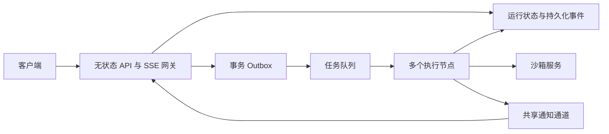

# NiceAgent 面试深入问答与故障推演

整理日期：2026-09-11。配套主文档：[核心技术亮难点与面试准备](/D:/spring_project/py/my-dify/docs/NiceAgent-核心技术亮难点与面试准备.md)。练习安排：[模拟面试与七天复习计划](/D:/spring_project/py/my-dify/docs/NiceAgent-模拟面试与七天复习计划.md)。

本文进一步准备技术追问，覆盖框架原理、Python 后端、数据库、流式协议、文件一致性、沙箱、RAG、工作流、评测和系统扩展。

若从简历逐项复习，先读[简历逐条实现详解与追问](/D:/spring_project/py/my-dify/docs/NiceAgent-简历逐条实现详解与追问.md)，其中给出七条描述对应的调用链、具体参数含义、边界与一分钟回答，再用本文练习扩展问题。

个人经历与真实方案选择另见：[从零到一演进与技术决策复盘](/D:/spring_project/py/my-dify/docs/NiceAgent-从零到一演进与技术决策复盘.md)。其中依据 Git 和历史 Codex 任务整理实际问题；本文的故障推演仍按假设场景理解。

记忆专题补充核对：2026-09-11，以 `e0e8544` 之后的当前工作区实现为准。旧结构化条目与兼容导入代码已移除；本次补充不改变其他专题各自注明的历史基线。

## 阅读约定

- **项目实现**：当前代码中可对应到的机制，不等于已在线上完成压测或所有部署已生效。
- **原理解释**：用于解释技术背景，不自动代表项目实现了该项能力。
- **扩展设计**：面试中的后续方案，应使用“如果需要，我会……”表述。
- **故障推演**：基于执行时序的分析，不能当作已经发生或已经通过测试的事故案例。

每道题先用两三句话给出结论，再根据追问讲机制、例子和边界。不要一开始就把所有内部类名背出来。

## 第一部分：60 道深入问答

### A. Agent 框架、规划与多 Agent

#### Q01. LangChain、LangGraph、DeepAgents 在项目里分别做什么？

**回答：** LangChain 提供模型、工具及中间件等通用接口；LangGraph 表达状态、节点、执行和持久化；DeepAgents 在此基础上提供规划、文件操作、Skills 和子 Agent 等任务执行能力。项目利用这些能力构图，再实现应用装配、业务状态、授权、资源管理和协议展示。

**追问重点：** 不要只说“DeepAgents 更高级”。可以举例：框架可以调用子 Agent，但“子 Agent 绑定哪个已发布应用、用谁的模型连接、能访问哪些 Skill”由平台确定。

#### Q02. ReAct 与 Function Calling 是互斥的两种 Agent 吗？

**回答：** 不完全是。ReAct 描述推理、行动和观察交替的执行方式；Function Calling 是模型以结构化形式表达工具调用的接口能力，两者可以结合。当前项目的主入口已迁移到 DeepAgents，不应继续把旧版“自动切换 Function Calling / ReAct”作为当前最主要成果。

**追问重点：** 工具调用 JSON 合法只说明参数结构可解析，不说明工具选择正确、调用有授权或结果满足任务。

#### Q03. 任务规划真的能保证 Agent 按计划完成吗？

**回答：** 计划提供显式任务分解和进度信息，但并不自动保证执行符合计划。可靠性还取决于工具反馈、调用预算、停止条件、人工输入和验收。项目接入原生规划能力，不能把计划列表当成强约束的事务流程。

**选型思路：** 步骤固定、输入输出明确的场景优先工作流；步骤依赖运行时信息的场景使用 Agent。也可以让 Agent 调用已经验证的工作流。

#### Q04. 什么情况下值得拆子 Agent？

**回答：** 子任务目标清晰、输入边界明确、可以独立执行且结果易于汇总时适合拆分，比如分别研究多个主题。必须共享大量上下文、频繁修改同一文件或每一步都依赖上一结果时，拆分收益可能很小。

**成本模型：** 总耗时不只是子任务时间，还包括委派、上下文装配和汇总；并行任务的主路径接近最慢分支加协调成本。总 Token 往往会增加，需要测量质量收益是否值得。

#### Q05. 同步子 Agent 与远程异步子 Agent 的区别？

**回答：** 同步子 Agent 在当前框架运行结构中完成子任务；远程异步 Agent 通过协议在独立运行环境中启动和读取状态。后者增加认证、网络故障、取消传播和独立观测问题。

**项目边界：** 平台适配 SubAgent／AsyncSubAgent，并提供内部已发布 Agent 的短期作用域凭证。不能因此宣称已实现跨平台通用 A2A 协议，也不能假定主 Run 的 Token 包含所有远程调用内部用量。

#### Q06. Middleware 的顺序为什么重要？

**回答：** 中间件会影响同一次模型或工具调用的输入、重试、预算与输出。比如预算放在重试层不同位置，可能改变计数；上下文统计在注入之前采集，会漏掉最终请求内容。项目按固定顺序装配，并把上下文采集放在能够看到已装配请求的位置。

**深入方向：** 修改顺序后要验证实际调用次数、重试计数、审核是否绕过、工具参数错误如何传播，不能只确认中间件都在列表里。

### B. 状态、记忆与上下文

#### Q07. AgentState、业务 Run 和前端时间线为什么不合成一种状态？

**回答：** 它们服务不同消费者。AgentState 支持图执行，Run 支持业务生命周期与权限，时间线支持用户理解过程。分开可以控制公开内容、避免前端依赖框架私有结构，并使 Run 终态与消息交付独立校验。

**代价：** 需要明确投影和提交顺序，避免三套状态各自更新。项目在服务层统一业务状态与事件的落库边界。

#### Q08. thread_id、conversation_id、run_id 有什么区别？

**回答：** conversation_id 标识业务会话；run_id 标识一次业务运行；thread_id 是框架持久化查找执行状态的标识。同一个业务会话可以有多次 Run，不能简单每轮换一个完全独立 thread_id，否则中断和上下文衔接会出问题。

**项目实现：** 框架会话配置由可信服务端上下文生成，合并调用参数时覆盖外部传入的关键标识。不能允许客户端随意指定别人的 thread_id 来读取状态。

#### Q09. Checkpointer 保存状态，为什么还需要 Store？

**回答：** Checkpointer 面向特定图会话的执行连续性；Store 面向应用主动组织的跨会话数据。用户偏好需要在新会话使用，却不应该把旧任务的未完成工具状态一并带过去，所以长期记忆单独保存。

**追问重点：** 删除会话不必等于删除长期记忆，具体生命周期由产品规则决定。当前记忆开关关闭后保留已有数据。

#### Q10. 为什么记忆要每次模型调用前刷新？

**回答：** 同一任务中 Agent 或用户可能修改记忆，如果只在创建图时读取一次，后续模型请求仍会使用旧目录。刷新让请求看到当前授权范围内的新记忆，同时通过目录预算与按需读取避免全量注入。

**取舍：** 刷新增加存储读取成本。可按版本或变更标识减少无效读取，但必须保持跨会话修改可见；这属于优化设计，不能直接说当前已有增量缓存。

**展开追问：当前记忆链路能具体讲到哪一步？**

| 追问 | 回答要点 |
| --- | --- |
| 谁决定保存什么？ | 模型依据明确要求、纠正和已验证经验调用工具；没有独立的逐轮总结调用 |
| 文件实际存在哪里？ | Store 记录映射为虚拟文件；PostgreSQL 模式持久化，内存模式重启丢失 |
| 检索用向量吗？ | 当前采用目录及文件工具查找，没有记忆 Embedding 或语义排序 |
| 为什么换模型仍能记住？ | namespace 只含账号和应用，不包含模型名或会话 ID |
| 为什么下一次模型调用能看到修改？ | 重读动态索引，短偏好按预算注入，其他正文按需读取；不会改写已经发出的请求 |
| 读目录还会隐式写入吗？ | 不会；已移除旧 catalog 导入、旧条目模块和独立导入标记 |
| 删除后绝不会再记起吗？ | 文件已删除，历史消息或 Checkpoint 仍可能含原文；不重新创建由提示规则约束，没有删除墓碑 |
| 子 Agent 可以读父记忆吗？ | 同步子 Agent 的文件权限只开放授权 Skill 与共享 Workspace；远程目标由自身运行配置决定 |

代码与完整口述见[长期记忆专题](D:/spring_project/py/my-dify/docs/NiceAgent-核心技术亮难点与面试准备.md)。

#### Q11. Token 预算怎样计算才不会说错？

**回答：** 单次模型请求的输入包括系统提示、技能信息、记忆、历史消息、工具定义及多模态内容，还需要考虑模型输出容量。估算 Token、供应商实际输入 Token 和整轮累计用量必须分开。

**项目边界：** 记忆目录预算使用 UTF-8 字节，不是精确计费 Token；切片计数使用的 tokenizer 也未必与所有供应商一致。图片不能按 base64 字符串长度直接当成 Token。

#### Q12. 上下文压缩会带来什么风险？

**回答：** 摘要可能丢失限定条件、精确数字和失败原因，反复压缩还可能累积偏差。适合把较久远对话压缩为摘要，关键文件与用户确认约束保留可重新读取的来源。

**项目与原理：** 项目观察框架摘要／压缩过程，并做文件式记忆管理；不要声称自研了无损压缩算法。验证时应检查长任务中的事实保持、工具参数约束和压缩后任务成功率。

### C. 幂等、恢复、取消与执行权

#### Q13. 一次请求的幂等键应该代表什么？

**回答：** 它应标识同一次逻辑操作，而不是每次 HTTP 尝试。网络超时重试应复用同一键，用户修改输入或主动新建任务应使用新键。还需要限定账号、应用或会话作用域，避免不同用户碰撞。

**项目实现：** Run 使用会话和输入消息标识约束重复启动；测评按账号、应用和 request_id 构造记录身份，并检查重试内容是否一致。

#### Q14. 并发请求都先查“没有记录”，怎么避免创建两份？

**回答：** 单纯先查再插存在竞态，需要数据库约束或受保护的事务。项目用会话锁串行化同会话操作，ORM 同时声明输入消息唯一约束和活动 Run 部分唯一索引，数据库约束作为最后一道防线。

**注意：** waiting_input 不在活动 Run 部分索引中，必须由业务冲突检查保护。且 ORM 声明不证明生产数据库已经迁移完成。

#### Q15. 为什么要在状态写回时再核验 executor_id？

**回答：** 运行开始时拿到授权不代表一直拥有执行权。长网络调用回来时，租约可能已失效、任务可能已取消或被收敛。每次写回验证执行身份和终态，可以拒绝迟到线程。

**术语边界：** 这是应用侧对失效执行者的写入隔离，不等于下游外部系统也验证了 fencing token。外部工具已经造成的副作用不会被它撤销。

#### Q16. 用户填写表单时，服务端为什么不一直占用线程等回答？

**回答：** 用户等待时间不可预测，长期保留执行线程与资源浪费大。通过 interrupt 保存图状态，业务记录 waiting_input 后结束当前执行资源生命周期；答案到达时重新鉴权、装配并 resume。

**易错点：** 中断恢复不一定从函数中间像操作系统线程那样继续，框架可能重新进入相关节点。中断前后的外部副作用要按框架重放语义设计。

#### Q17. 取消为什么要经过 cancelling 状态？

**回答：** 请求停止与已经停止是两件事。正在等待模型、工具或同步文件时，系统可能需要协作退出和清理。cancelling 表示已接受取消意图，cancelled 表示业务运行已经收敛。

**项目边界：** 当前调用 drain 并抑制取消后的公开增量。不能保证所有外部 HTTP 立即断开，也不能自动回滚已完成的写操作。

#### Q18. Checkpoint 恢复为什么不等于 exactly-once？

**回答：** 外部服务执行成功到本端保存状态之间存在故障窗口。重放可能重复写，不重放可能留下结果不确定。要解决业务结果唯一，需要外部接口幂等键、可查询操作状态或补偿协议。

**举例：** 创建一条飞书记录已成功，但本端超时。下一步应按业务标识查询或使用幂等机制确认，而不是只因为 Checkpoint 没有成功结果就再次创建。

### D. PostgreSQL、SQLAlchemy 与 Celery

#### Q19. 行锁、advisory lock 和乐观版本各保护什么？

**回答：** 行锁保护已经存在的数据库行；advisory lock 可以保护逻辑作用域，例如整个工作区的配额计算；乐观版本检查判断编辑者基于的旧状态是否过期。

**项目实现：** Workspace 先取得作用域事务锁，再锁文件行、检查 revision 与总配额；记忆使用 namespace 派生的事务锁。文件首次创建没有现存行可锁，不能只依赖 SELECT FOR UPDATE。

#### Q20. 为什么固定“先锁会话，再锁 Run”？

**回答：** 不同路径锁顺序不一致可能形成循环等待：A 持有会话等 Run，B 持有 Run 等会话。固定顺序降低这类死锁风险，并让业务事务更容易审查。

**边界：** 固定顺序不能保证系统绝不死锁，其他索引更新、跨资源路径仍可能发生锁竞争。应保持短事务，并记录和识别数据库死锁异常。

#### Q21. SQLAlchemy Session 与数据库连接是一回事吗？

**回答：** Session 是 ORM 工作单元和对象身份映射，不等于一条始终独占的连接；实际连接由操作和事务从池中取得。commit、rollback、close 的职责不同，不能只因为 Python 对象还在就认为连接一定占用或已经释放。

**项目重点：** 模型调用、对象下载和 SSE 等待前结束不必要的事务；独立工作区读取后关闭自有 Session，使已加载数据可在网络阶段使用而不持续占连接。

#### Q22. 为什么锁后还使用 populate_existing？

**回答：** ORM 身份映射可能保留已经加载的旧字段。拿到数据库锁不代表内存对象自动刷新，因此锁定查询还要确保读取当前状态，避免用过期 revision 或 Run 状态决策。

**延伸：** Session 不应该被多个并发线程随意共享。Flask app context、请求身份和 ORM Session 都需要清楚的生命周期，不能用一个全局可变用户变量代替。

#### Q23. Celery 的“投递成功”意味着测评一定完成吗？

**回答：** 不意味着。消息到 broker、Worker 收到、成功领取、模型返回和结果落库是不同阶段。项目把记录状态放在业务库，Worker 用 queued→running 条件更新防止重复领取，并设置时限与超时状态收敛。

**取舍：** 当前记录已是 running 后不会因为重复消息重新执行，因此更接近一次领取加失败显式呈现，不是无限重试直到成功。不要把它称为端到端 exactly-once。

#### Q24. 数据库成功但消息没发出去，怎么处理？

**项目实现：** 测评投递抛错后尝试将 queued 记录结束为错误；若进程在数据库提交后、投递前直接崩溃，仍可能留下悬挂记录，后续超时规则负责收敛。

**扩展设计：** 在同一数据库事务内写业务记录和 outbox，独立发布器可靠重试投递；消费端继续幂等。Outbox 解决可靠投递，不自动让模型调用和所有副作用只执行一次。

### E. Python 并发、SSE 与前端状态

#### Q25. Python 有 GIL，为什么还用线程池？

**回答：** 当前交互执行大量时间在等待模型、数据库和网络 I/O，线程可以在等待期间让其他任务推进。GIL 对 Python CPU 密集计算影响更明显，这类计算应考虑进程、原生库或沙箱服务。

**项目边界：** 线程池加 BoundedSemaphore 控制本进程执行量，并不等于支持任意并发。真正可承载量取决于模型限流、连接池、内存和任务耗时。

#### Q26. 把函数改成 async def 就是异步了吗？

**回答：** 不是。函数内部若直接调用阻塞 SDK，仍会阻塞事件循环。需要真正异步 I/O 或明确在线程执行阻塞调用；跨线程还要正确传递上下文并释放资源。

**项目联系：** MCP 适配包含同步到异步的桥接；部分向量调用包装为 async 但内部仍是同步调用，因此不要声称项目是全链路非阻塞架构。

#### Q27. 为什么 SSE 事件要先落库再通知？

**回答：** 如果先通知，客户端可能已经看到某事件，但数据库提交失败，刷新后无法恢复。先提交再通知可以把“用户可见的持久化历史”建立在数据库事实上。

**剩余窗口：** 提交后通知前崩溃，会让即时通知缺失，但重连仍可读数据库。这个顺序选择了可补偿的失败方向，并没有消除所有延迟。

#### Q28. 一个网络 chunk 等于一条 SSE 事件吗？

**回答：** 不等于。HTTP 流可能把一条事件拆成多个 chunk，也可能将多条事件放进一个 chunk。客户端需要流式 UTF-8 解码、保留未完成片段，并按空行识别事件边界。

**项目实现：** 前端观察完整 SSE 帧再提取 id／seq，多行 data 合并处理。直接对每个 chunk 做 JSON.parse 会被拆包、多字节字符或合包打断。

#### Q29. 重连是否要把 last_event_id 全局保存在一个变量里？

**回答：** 不应全局共用。游标属于具体 Run 和订阅范围，新任务不能继承旧任务的序号；筛选通道和命名空间也可能影响订阅身份。

**项目实现：** 前端将游标关联订阅参数与 AbortSignal，并结合 Run 身份恢复；历史投影按事件身份去重。仅有一个数字而没有所属 Run，可能跳过新任务事件。

#### Q30. 后端已经逐条生成，前端为什么还是一大段出现？

**排查顺序：** 先看 Agent 是否真的输出增量，再看平台缓冲和审核策略、数据库批次、反向代理缓冲、网络链路、浏览器解析与 UI 更新。

**项目联系：** Nginx 代理配置关闭 buffering 并设长读超时；输出审核开启时，执行器可能缓存整轮事件，审核后才交付。两种原因的处理方向完全不同，不能只调前端刷新频率。

### F. 沙箱、文件与资源生命周期

#### Q31. 为什么抽象 CompositeBackend，而不是工具里直接读文件？

**回答：** 文件工具需要看到统一的虚拟路径，但这些路径背后可能是持久化工作区、只读 Skill、长期记忆或沙箱。路由使上层保持统一文件接口，底层分别控制权限、存储和生命周期。

**取舍：** 路由边界与命令执行需要一致。沙箱启用后，文件工具与 execute 不能操作两份不同的 Workspace，否则会读到陈旧结果。

#### Q32. 懒初始化最容易出现什么竞态？

**回答：** 两个工具同时首次调用，可能重复创建沙箱；初始化读取文件时，另一个线程可能正在上传附件，导致播种快照不一致；关闭与首次创建也可能交错。

**项目实现：** 锁保护本地文件操作、首次初始化与关闭，合并首次创建；创建成功后远程调用不一直持有同一把本地锁。失败状态保留，避免重复访问已被清理的资源。

#### Q33. 沙箱池为什么先占位，再在锁外创建？

**回答：** 锁内占位阻止同会话重复获取；锁外创建避免慢网络阻塞所有其他会话。创建失败时只清除属于该次创建的槽位，防止误删后来建立的资源。

**追问：** 创建期间会话被删除怎么办？资源返回后再次检查失效状态，必要时立刻释放，不能只在网络请求前检查一次。

#### Q34. Bubblewrap 能隔离什么，不能直接保证什么？

**回答：** 它利用 Linux 命名空间和挂载控制进程可见资源，项目控制工作区、只读 Skill、环境变量和网络。它与完整虚拟机、cgroup 资源配额或完整网络访问治理不是同一层能力。

**面试表达：** 说清实际配置边界和依赖平台，不用“绝对安全执行任意代码”。同理，Python AST 校验属于格式或有限策略检查，不构成恶意代码隔离。

#### Q35. 为什么用唯一对象 key，再更新文件元数据？

**回答：** 如果直接覆盖旧对象，数据库更新失败后，旧元数据可能指向已被替换的内容。唯一 key 保留旧版本对象，只有元数据提交成功才切换引用，失败时清理新对象即可。

**项目实现：** WorkspaceFileStore 先写 COS 对象，再按 revision 提交元数据；失败尽力删除新对象，成功清理旧对象。清理失败可能产生孤儿对象，需要监控或后续对账，不能说全程强事务。

#### Q36. 文件配额为什么需要作用域锁？

**回答：** 两个不同文件并发写入，都可能看到“剩余空间足够”，分别提交后总量超限。只锁单个文件行无法保护整个工作区的总量约束。

**项目实现：** 以 Workspace 作用域取得事务级 advisory lock，在同一临界区读取总文件数和字节数、计算覆盖净增量，再保存元数据。代价是同一作用域写入被串行化，但不同作用域仍可并发。

### G. 模型、工具契约与身份边界

#### Q37. JSON Schema 校验和权限校验为什么分开？

**回答：** Schema 检查输入结构和类型，权限检查当前主体是否能使用具体资源。一个合法 UUID 仍可能属于别人，一个参数完整的工具调用也可能未经授权。

**项目实现：** 服务层解析可信身份和授权工具，Core 再校验工具参数；模型可填写任务参数，但不能随意决定 account_id、连接密钥和内部会话身份。

#### Q38. 工具错误该原样返回给模型和用户吗？

**回答：** 应保留模型能修正的错误，例如缺少字段或资源不存在；供应商内部堆栈、认证信息和连接详情不应直接公开。业务错误、可重试瞬时错误和未知故障需要区分。

**扩展思路：** 可定义稳定错误码、可重试标识和工具调用 ID，但不能凭一个 retryable 标志就自动重试外部写操作，仍需副作用判断。

#### Q39. 多模型适配为什么要保存“参数来源”？

**回答：** 发现接口声明、用户手工配置和平台兼容默认的可信程度不同。明确来源可以防止把通用编辑选项当成模型官方能力，也方便切换服务后判断哪些参数需要重新核对。

**项目实现：** 可选参数不默认发送，统一内部名称再映射供应商字段；最大输出、思考强度和采样参数都按当前契约检查，而不是看到某品牌就套模板。

#### Q40. “默认模型”和“用户显式选择的模型”为什么要区分？

**回答：** 默认模型应随当前应用配置变化；显式覆盖代表用户希望固定本次或历史选择。如果把页面展示的默认值当成显式选择保存，会让会话意外锁定旧模型。

**当前工作区实现：** 历史模型恢复集中到 AgentModelService，只恢复明确的覆盖。旧连接失效时回退当前默认，不把旧模型思考强度直接套给新模型；具体可用等级仍需再次校验。

#### Q41. OAuth、JWT、API Key 各负责什么？

**回答：** OAuth 登录用于与第三方完成授权并获取身份信息；JWT 是平台可验证的一种凭证格式；API Key 用于程序调用的接入身份。认证完成后仍必须校验会话、应用和文件归属。

**原理追问：** JWT 签名不等于加密；撤销、轮换、过期、issuer／audience 校验需要单独设计。当前 JwtService 固定 HS256 解码，不能据此声称已实现完整令牌轮换、刷新和细粒度 RBAC。当前前端公开登录入口与后端历史 Provider 类也应区分。

#### Q42. 内部子 Agent 请求为什么也要认证？

**回答：** 内部 URL 不是权限证明。请求仍需限定由哪个账号、哪个父应用调用哪个目标应用，避免普通配置伪造内部身份。

**项目实现：** 内部协议使用短期 HMAC 签名载荷，包含账号、父应用、目标应用和有效期；使用恒定时间比较校验签名，并移除配置中伪造的内部 Token Header。这个自定义凭证不能直接称为标准 JWT，也不自动提供一次性防重放。

### H. RAG、向量与检索评估

#### Q43. chunk_size 和 overlap 怎么选？

**回答：** 大片段上下文完整但容易混入无关内容，小片段更精确但可能丢失限定条件；overlap 缓解边界切断，同时增加索引体积和重复召回。应按文档结构、目标问题和检索评测选择。

**项目实现：** 使用 RecursiveCharacterTextSplitter 和配置化分隔符、大小、重叠，索引链路传入 Token 计数函数。代码中 chunk_size 的单位依赖 length_function，不能一概说是字符或精确供应商 Token。

#### Q44. Embedding 缓存 key 需要考虑什么？

**回答：** 除文本内容，还要考虑能改变向量输出的模型、端点和参数，避免同名模型实际切换服务后复用旧向量。账号和连接的访问隔离也需要明确，不能只看缓存命中率。

**项目实现：** 运行时模型实例以账号与 binding fingerprint 组织，Redis embedding 缓存 namespace 使用 fingerprint，文本由 Blake2b 编码；集合按 fingerprint 区分。是否满足更严格的租户隔离，需要结合 fingerprint 生成规则与部署策略确认。

#### Q45. 向量库为什么既要分集合又要按 dataset_id 过滤？

**回答：** 集合划分主要维护向量模型空间兼容性，dataset_id 过滤限定本次获准检索的业务资源。模型空间一致不意味着用户有权读取其中所有文档。

**项目实现：** 向量集合名与 fingerprint 关联，检索服务先按账号取得知识库，再对语义检索施加知识库及启停过滤。权限过滤不应在结果返回后才补做。

#### Q46. 向量相似度、BM25、RRF、reranker 分别解决什么？

**原理解释：** 向量相似度衡量语义表示接近程度；BM25 基于词项统计排序；RRF 等融合方法组合多个结果的名次；reranker 对候选与查询重新打分。它们处于不同阶段，不能互相当同义词。

**项目边界：** 当前是语义检索、关键词匹配次数排序和 EnsembleRetriever 融合，没有独立 reranker。不同检索器的原始分数未必在同一尺度，不能简单声称把分数平均就是合理融合。

#### Q47. 给一个能在白板上算清楚的检索指标例子。

**示例数据：** 某问题的相关片段为 `{A, B, C}`，系统前 3 个结果为 `[A, D, B]`。

- Precision@3 = 2/3，表示返回结果中相关的比例。
- Recall@3 = 2/3，表示标注相关片段被找回的比例。
- Hit@3 = 1，表示前 3 个中至少命中一条。
- 该问题的 reciprocal rank = 1，因为第一条就是相关结果；MRR 是多个问题该值的平均。

**追问：** Hit 高不等于证据完整；有多个必要证据的任务更要关注召回覆盖和最终答案对证据的使用。

#### Q48. 检索到了正确片段，答案仍错，怎么排查？

**回答：** 检查正确片段是否实际进入最终提示、是否被上下文预算截断、是否混入冲突内容、生成模型是否遵循引用要求，以及答案是否超出证据。将“检索失败”和“生成没用好证据”分开归因。

**实验设计：** 固定生成模型，只替换检索结果；再用人工正确片段替代检索输出。这样能判断问题主要发生在检索阶段还是生成阶段。

### I. 工作流图与执行语义

#### Q49. 前端已经校验连线，后端为什么还校验 DSL？

**回答：** 客户端可绕过，旧版本前端和自然语言生成也可能提交无效结构。后端是最终执行入口，必须独立校验节点类型、边端点、标识、变量引用、可达性和环路。

**项目实现：** Pydantic 负责结构及规则校验，BFS 和 Kahn 算法处理图关系。校验通过仍不代表外部 API 参数和模型行为一定成功，运行时错误要另行处理。

#### Q50. Kahn 判环的复杂度和依据是什么？

**回答：** 建立入度和邻接表，将所有入度为 0 的节点入队，依次删除其出边。若最终处理节点数小于总节点数，剩余部分存在环。时间复杂度 O(V+E)，不应把环错误解释成“必须存在入度至少为 2 的节点”。

**项目联系：** 工作流限定为无环图；Agent 自身的工具迭代循环属于不同执行层。

#### Q51. 图可达是否意味着每个分支都有输出？

**回答：** 静态可达只说明图上存在路径，不说明运行时条件一定选择该路径，也不保证外部节点成功。下游引用某条件分支的输出时，需要考虑该分支未执行的情况。

**扩展设计：** 更严格的编译器可分析支配关系、可选输出、分支类型和汇聚条件。当前前驱引用校验不能宣传成完整的数据流静态证明。

#### Q52. 并行节点更新同一字段，怎么处理？

**回答：** 由 reducer 定义合并语义。列表追加适合积累结果，字典合并适合按节点标识存输出；若两个节点写同一 key，后覆盖可能依赖合并顺序，需明确是否允许。

**回答提升：** 状态字段设计要尽量让不同节点写独立命名空间；需要确定顺序时显式排序或禁止冲突，不能认为使用 LangGraph 就天然没有数据竞争。

#### Q53. Workflow 变成 Tool 的难点在哪里？

**回答：** 需要稳定的名称和描述、可被模型理解的输入 Schema、可序列化输出、运行权限和发布版本。项目从开始节点生成 Pydantic 参数模型，工作流执行结果按结束输出返回。

**追问：** 自然语言生成的草稿不应该直接取得所有工具权限或自动发布；生成的是候选 DSL，必须继续通过同一校验与授权链路。

#### Q54. 工作流和 Agent 出错重试策略一样吗？

**回答：** 不能一概相同。工作流节点有固定依赖，重试时需考虑已成功上游和当前节点副作用；Agent 还会根据观察改变计划。两者都要区分只读、幂等写和不可安全重试写。

**项目边界：** 不因为 Agent 主图配置了 ModelRetryMiddleware，就认为所有工作流节点和远程子 Agent 都获得同样的重试、预算和持久化语义。

### J. 评测、观测与性能

#### Q55. LLM-as-a-Judge 的主要偏差有哪些？

**原理解释：** 可能偏好更长、更流畅的回答，受答案顺序和提示注入影响，对同类模型输出存在偏好，也可能缺少领域事实判断能力。

**项目应对：** 冻结标准与材料，要求证据和完整标准覆盖，加入确定性核验与独立裁判，保存轮次。但还需要人工标注集校准，不能把另一个模型的判断视为真值。

#### Q56. 为什么“证据不足”不能简单记为 0 分？

**回答：** 0 分表示已确认不满足；证据不足表示无法评估。混合会让得分解释失真，也掩盖评测材料缺失。

**示例：** 4 条标准中 3 条可评且全部通过，覆盖率是 75%，已评通过率为 100%，但完整通过率不能据此声称是 100%。项目区分完整成绩与可评项成绩。

#### Q57. 多轮自我修订如何防止无限消耗？

**回答：** 需要轮次、模型／工具调用上限、任务时间限制和终态规则。达到预算但没满足标准，应明确标为耗尽或失败，而不是因为生成过答案就算通过。

**项目实现：** RubricMiddleware 限制迭代，隔离验收图还有调用限制，Celery 设置软硬时限，记录超时规则处理迟到结果。各层预算解决不同问题，软时限的实际效果还与 Worker 执行池有关。

#### Q58. Token、重试与失败次数为什么容易重复统计？

**回答：** 同一调用可能出现在主图、子图和工具调度多个视角；缓存／推理 Token 也可能已经包含在总量中。重试必须依据可观察到的重试回调，工具错误不一定导致整个 Run 失败。

**项目实现：** 汇总与受上限约束的明细分开，缺失用量与零区分；应用有回复消息的统计不等于全部运行成功率。远程根本没上报的用量只能标未知。

#### Q59. 如何估算吞吐和并发，而不拍脑袋？

**原理解释：** 稳态下可用 Little 定律 `L = λW` 理解平均系统内任务数、到达率和停留时间关系。例如每秒 1 个任务、平均停留 20 秒，对应平均约 20 个在系统中的任务；它不是精确容量上限。

**项目取舍：** 当前执行槽位只有 4，慢工具会长期占用；还受模型 RPM／TPM、数据库连接和沙箱配额限制。容量规划必须基于任务分布、排队策略和 P95，而不是简单增加线程数。

#### Q60. 面试官问“你下一步先改什么”，怎么回答？

**回答结构：** 先给目标，再给证据和最小改动。若目标是稳定上线，先建立覆盖失败、中断、重连和文件冲突的固定回归场景；若目标是扩容，先外置运行归属与控制信号；若目标是质量，先建立任务与检索标注集。

**避免：** 一口气罗列 Kubernetes、微服务、Kafka 和多 Agent。每个改动都应对应当前限制、验证方法和回滚路径。

## 第二部分：12 个故障场景推演

使用统一回答顺序：**时间线 → 会损坏的业务事实 → 现有防线 → 仍有的窗口 → 如何验证**。

### 场景 1：用户点击发送后超时，再点一次

**时间线：** 服务端已提交 Run，但客户端没收到响应；重试可能与原请求同时到达。

**现有防线：** 客户端复用同一输入标识，服务端按会话查重复，结合会话锁与唯一约束返回同一 Run。幂等不能靠按钮置灰完成。

**残余窗口：** 如果客户端把每次重试都生成新标识，服务端只能通过活动任务冲突阻止并发，不一定知道两个文本相同请求是不是同一个逻辑操作。

**验证：** 并发发送同一标识，检查 Run 和业务消息数量；原任务已结束后重复请求仍应返回相应历史结果，而不是再执行。

### 场景 2：最后一条事件落库成功，但通知失败

**风险：** 页面停留在旧状态，但数据库已经有终态。

**现有防线：** 公开事件先落库后通知；订阅重建或历史查询按游标读取已提交事件。不能因为通知失败就重复执行模型。

**验证：** 人为丢弃一次通知，刷新或重新订阅，确认终态和最终回答可恢复，且没有产生第二个 Run。

### 场景 3：租约失效后，原模型请求才返回

**风险：** 旧线程把已失败或已取消的任务改回 completed。

**现有防线：** 失联收敛撤销 executor_id，写事件、续租和 finalize 都校验当前执行身份及终态。数据库事务决定最终哪个合法状态提交。

**残余窗口：** 外部调用已经产生的费用或副作用不能撤销。验证应同时检查业务状态和外部调用次数，不能只看前端显示失败。

### 场景 4：用户双击提交人工表单，并同时更换模型配置

**风险：** 恢复两次，或用新图定义解释旧中断状态。

**现有防线：** 锁定会话与对应 Run，验证表单身份、答案和历史提交；恢复前检查定义指纹。完全相同提交复用结果，不同答案不能重复修改已提交表单。

**验证：** 同答案重复、不同答案重复、过期表单、配置变更分别验证。回答应区分“重新展示已取消表单”和“真正恢复图执行”。

### 场景 5：Agent 修改文件期间，用户也保存了同一路径

**时间线：** 沙箱基线 revision=8，用户保存后为 9，Agent 用 expected_revision=8 回写。

**现有防线：** 事务内版本比较拒绝覆盖。摘要只确定 Agent 修改过内容，revision 确定持久化文件是否仍是基线。

**验证：** 确认用户新内容仍在，任务报告同步失败而不是假装已交付。是否保留冲突副本需另外设计，当前不能保证自动合并。

### 场景 6：COS 上传成功，文件元数据事务失败

**风险：** 新对象未被业务文件引用；若上传覆盖旧 key，则旧版本也可能损坏。

**现有防线：** 写唯一对象 key，元数据按版本提交；失败清理新对象，成功才清理旧对象。元数据和对象不是同一事务。

**扩展设计：** 对账任务扫描超期、无引用对象并清理，设置足够宽限期防止误删进行中的上传。当前尽力清理失败时仍可能留下孤儿对象。

### 场景 7：沙箱 TTL 已到，但刚好被新任务借出

**风险：** 旧定时器回调误删正在使用的实例。

**现有防线：** 获取时取消定时器并递增 generation；回收前检查同一资源对象、空闲标记和 generation。远程删除在锁外执行。

**验证：** 用可控时钟和回调顺序推演“旧回调已启动→重新借出→旧回调继续”，不能只验证正常等待 TTL 的情况。

### 场景 8：Celery 领取了测评任务，Worker 中途被杀

**风险：** 记录留在 running；重新投递可能导致重复费用。

**现有机制：** 条件更新只允许 queued 领取，重复消息不重新开始；超时规则将悬挂记录收敛为错误。当前不应承诺自动续跑到最后一个评测轮次。

**扩展设计：** 若要可恢复，需要区分工作模型和裁判的幂等边界、保存检查点及候选版本，并明确重复调用是否可接受，不能简单开启无限 autoretry。

### 场景 9：知识库换了 Embedding 服务，旧向量还在

**风险：** 相同模型名或维度掩盖语义空间变化，检索返回看似有分数但质量失真。

**现有防线：** 配置指纹检查、集合按指纹划分、检索时要求多知识库指纹一致；检测到相关配置变化要求重建索引。

**验证：** 相同模型名但端点变化、不同模型相同维度、旧 legacy 指纹分别检查。是否能识别所有供应商偷偷换权重的情况不能保证。

### 场景 10：条件分支只执行 A，汇聚节点却等待 A 和 B

**风险：** B 永远不运行，汇聚无法推进。

**现有处理：** 区分部分条件来源汇聚与真正并行汇聚，前者使用独立边，后者使用等待多前驱的边。

**边界与验证：** 当前逻辑对直接条件来源进行判断，复杂嵌套、分支中再并行等结构需要单独推演，不能假设所有拓扑都正确。

### 场景 11：裁判通过候选 A，最终状态里却是候选 B

**风险：** 用户收到未经验证的交付物。

**现有防线：** 每轮读取实际状态生成候选哈希，最终 accepted 要求状态为 satisfied 且最终候选哈希与已验收候选一致。

**验证：** 验收后只改一个文件、只改答案、漏掉一条标准、跳过取证分别验证。文件“存在且非空”只证明形式条件，不证明内容正确。

### 场景 12：部署成两个 API Worker 后，取消或实时事件异常

**风险：** Worker A 执行任务，取消请求或 SSE 连接落到 Worker B；内存 Run、信号和沙箱池没有共享。

**当前边界：** README 要求单 Worker，数据库持久化仅解决部分共享状态，不自动共享控制信号。

**扩展设计：** 外置调度、执行归属与取消通知；执行者读取持久化取消意图，客户端事件从持久化日志恢复。粘性会话可以减少错路由，但不能解决进程故障与跨进程资源协调。

## 第三部分：三道系统设计大题

以下均为扩展设计，不是现有实现声明。

### 设计题 1：将当前单 Worker 平台扩展为多执行节点

#### 先问清需求

- 目标同时在线连接数、同时执行任务数、任务平均与 P95 时长分别是多少？
- 允许排队多久？是否需要按账号公平调度和付费等级限制？
- 任务失败后允许自动重跑吗？外部工具是否幂等？
- 状态丢失容忍度、历史事件保留期、地域和部署成本约束是什么？

#### 建议结构



#### 关键契约

1. API 将 Run 与待投递记录在同一事务提交；发布器负责消息投递和重试。
2. 执行者通过条件更新领取 Run，保存执行身份与租约；重复消息不能重复获得同一有效执行权。
3. 取消意图先持久化，通知只加速响应；执行者周期检查，不依赖一条易丢内存消息。
4. 所有事件带 Run 和序号，当前有效执行者才可写；SSE 网关从持久化日志读取，通知负责唤醒。
5. 沙箱按执行作用域租用，保留资源身份、版本与清理责任；不能把本地 dict 直接换成 Redis 就认为已解决全部生命周期问题。
6. 过载时按配额拒绝或排队；排队与执行时限分开，避免长任务饿死短任务。

#### 必须讨论的故障

重复投递、消息迟到、Worker 崩溃、租约误过期、数据库不可用、模型请求已成功但回写失败，以及外部写工具结果不确定。

#### 渐进上线

先外置取消与通知并保持单执行者验证，再引入队列领取和多节点，最后改沙箱协调与配额。用固定回归场景对比，出现异常可退回单执行节点；不要一次同时改协议、数据库和框架版本。

### 设计题 2：让生产 Agent 支持更完整的端到端评测

当前隔离测评没有加载完整生产能力。扩展时先定义要测“任务正确性”“工具行为”还是“最终交付物”，不能只换一个更强裁判。

| 层次 | 检查对象 | 建议方法 |
| --- | --- | --- |
| 配置回归 | 模型、提示词、工具与 Skill 绑定 | 冻结配置引用与可验证制品版本 |
| 决策过程 | 是否调用正确工具、是否越权 | 工具调用轨迹与可接受行为约束 |
| 外部交互 | 请求和响应是否符合预期 | 沙盒 API、受控数据集、可重放只读响应 |
| 文件产物 | 结构、内容和可执行行为 | 格式解析、确定性断言、隔离测试 |
| 文本质量 | 完整性、事实与表达 | 人工标注校准后的模型裁判 |

**避免回放真实副作用：** 创建测试租户或替代写工具，不向生产账号重复发消息、创建订单或改资料。是否允许真实外部操作由测试边界决定。

**可复现性：** 保存输入、附件摘要、配置版本、技能制品、模型标识、工具响应证据及评测器版本。即使温度为零，也不能承诺供应商端完全确定。

**报告：** 同时呈现首次通过率、最终通过率、失败类别、轮次、用量和耗时。按同一任务集合比较版本，防止简单任务占比变化造成假提升。

### 设计题 3：建设可运营的 RAG 知识库

**索引更新：** 将文档解析与索引阶段明确为状态机，给任务和片段稳定标识，区分上传成功、解析成功、向量写入成功与可检索状态。

**版本切换：** 新模型或新切片规则建立新索引版本，完成数量和质量检查后切换读取引用；旧索引保留回滚窗口，再异步清理。不要直接混写新旧向量后希望检索自行兼容。

**质量诊断：** 收集代表性问题与相关片段标注，分别看解析丢字、切片边界、召回、融合、重排和生成使用证据等阶段。

**多租户：** 授权过滤从检索入口到向量查询保持一致；检索日志、缓存、文件下载也要使用相同身份模型。

**成本：** 对已知相同语义空间下的重复文本复用向量，控制批量大小和限流；缓存输出正确性优先于命中率。

## 第四部分：白板伪代码与不变量

以下是教学伪代码，不是可直接替换项目实现的代码，也不应直接执行数据库操作。

### 1. Run 领取与回写

```text
claim(run):
  条件更新：status == queued → running，并写 executor_id、heartbeat
  更新行数不是 1：没有取得执行权，停止

append_events(run, executor, events):
  开事务并锁定 Run
  要求 executor == 当前 executor_id
  要求 Run 未终结
  按 (run_id, sequence) 幂等插入事件并推进游标
  提交事务后通知
```

不变量：任何失效执行者都不能推进公开事件游标；业务终态不会被迟到成功结果覆盖。

### 2. 跨对象存储写文件

```text
读取基线 revision
上传新对象到唯一 key
尝试：锁定作用域与文件，比较 expected_revision，提交新元数据
失败：尽力删除新对象，返回错误
成功：尽力删除旧对象，返回新 revision
```

不变量：元数据提交前旧对象保持可用；失败补偿不应删除其他成功写入的新对象。孤儿对象治理属于额外流程。

### 3. 事件恢复

```text
订阅身份 = Run + 通道/命名空间 + 当前订阅生命周期
收到完整 SSE 帧 → 解析所属 Run、event_id、sequence
只在该订阅内推进游标
断线 → 从持久化数据补取游标之后的事件
终态生命周期已收到 → 正常结束，不无限重连
```

不变量：新 Run 不继承旧 Run 游标；半个网络 chunk 不能被当成完整事件。

### 4. 面试中可主动写出的七个不变量

1. 同一会话不能同时拥有两个合法活动执行者；等待输入也应阻止冲突新任务。
2. 所有任务控制和资源访问均从可信身份派生，客户端字段不能提升权限。
3. 对外通知以已提交事件为依据。
4. 旧租约不允许写入新状态。
5. 文件回写必须验证基线版本，冲突不得静默覆盖。
6. 未成功同步的沙箱不能作为干净实例回池。
7. 最终验收通过的候选必须与实际交付内容一致。

## 第五部分：代码复习路线

| 路线 | 推荐入口 | 看什么 |
| --- | --- | --- |
| 任务启动与恢复 | [agent_workbench_service.py](/D:/spring_project/py/my-dify/internal/service/agent/agent_workbench_service.py) | 锁、重复请求、恢复校验和提交顺序 |
| Run 约束与索引 | [agent_run.py](/D:/spring_project/py/my-dify/internal/model/agent_run.py) | 部分唯一索引与事件组合主键 |
| 持久化与租约 | [agent_workbench_run_service.py](/D:/spring_project/py/my-dify/internal/service/agent/agent_workbench_run_service.py) | executor_id、终态、迟到写入 |
| 模型覆盖 | [agent_model_service.py](/D:/spring_project/py/my-dify/internal/service/agent/agent_model_service.py) | 默认与显式选择、能力与连接归属 |
| 文件存储 | [workspace_file_store.py](/D:/spring_project/py/my-dify/internal/repository/workspace_file_store.py) | 上传顺序、补偿与旧对象清理 |
| 文件事务 | [workspace_file_repository.py](/D:/spring_project/py/my-dify/internal/repository/workspace_file_repository.py) | 作用域锁、revision、配额与 Session |
| 沙箱池 | [session_sandbox_pool.py](/D:/spring_project/py/my-dify/internal/core/agent_v2/backends/sandbox/session_sandbox_pool.py) | 占位、锁外网络、generation、失效 |
| 框架会话身份 | [langgraph_conversation_config.py](/D:/spring_project/py/my-dify/internal/core/agent_v2/assembly/configuration/langgraph_conversation_config.py) | 服务端身份覆盖调用参数 |
| 内部协议身份 | [internal_auth.py](/D:/spring_project/py/my-dify/internal/service/agent_protocol/internal_auth.py) | 作用域签名、有效期与 Header 防伪 |
| Embedding 与切片 | [embeddings_service.py](/D:/spring_project/py/my-dify/internal/service/dataset/embeddings_service.py)、[process_rule_service.py](/D:/spring_project/py/my-dify/internal/service/dataset/process_rule_service.py) | 指纹、缓存和 length_function |
| 异步评测 | [agent_evaluation_service.py](/D:/spring_project/py/my-dify/internal/service/agent_evaluation/agent_evaluation_service.py) | 冻结材料、投递、领取和超时 |
| SSE 部署 | [proxy.conf](/D:/spring_project/py/docker/nginx/proxy.conf) | 代理缓冲、连接头与超时 |

## 第六部分：容易失分的说法与替代表述

| 容易失分 | 更准确的回答 |
| --- | --- |
| 我写了一个完全自研的 Agent 引擎 | 基于 DeepAgents／LangGraph，实现平台装配、业务状态和资源边界 |
| 用了 PostgreSQL，所以任何任务崩溃都能继续 | 支持持久化状态和人工续跑，进程失联当前先收敛状态 |
| Celery 保证只执行一次 | 记录条件更新限制重复领取，外部调用仍有结果不确定窗口 |
| 多 Agent 一定比单 Agent 快 | 独立任务可并行，但有委派、上下文和汇总成本 |
| 有沙箱就能执行所有恶意代码 | 说明命名空间、挂载、权限与资源限制的实际边界 |
| 全文检索用的是 BM25 | 当前是关键词匹配计数，混合检索使用检索器融合 |
| 我们有完整端到端自动验收 | 当前是历史回答与隔离环境中的回答／临时文件验收 |
| 文件同步是事务性的，肯定不会丢 | 逐文件版本校验防覆盖，跨存储采用顺序与补偿，有失败窗口 |
| 增加 Worker 就能水平扩展 | 先处理进程内运行状态、取消、通知与沙箱池的共享问题 |
| 代码里有索引，线上肯定存在 | ORM 定义是设计依据，实际生效要核对数据库迁移 |
| 异常都重试三次就稳定了 | 按副作用、幂等与错误类别决定重试及终止策略 |
| 评测通过率提升了很多 | 给出固定任务集、样本数、版本、分母与真实结果 |
