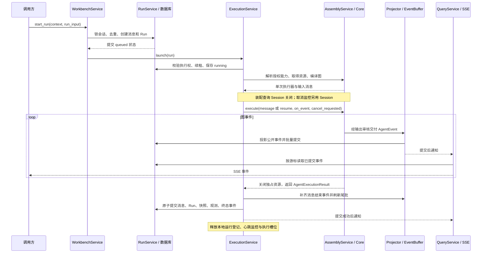

# Agent 运行链路与重构基线

记录日期：2026-09-11。范围：工作台 Agent 的启动、事件交付、终态保存、取消和恢复。以下描述来自代码阅读；实际环境功能验证单列在文末。

## 一次运行

## 输入、输出和所有权

| 步骤与入口 | 输入 → 输出 | 事务、资源与失败处理 |
| --- | --- | --- |
| `AgentWorkbenchService.start_run` | 可信身份、输入 → Run 标识 | 先锁会话，再创建消息与 Run；提交后才能 launch。重复请求复用已有结果。 |
| `AgentWorkbenchRunExecutionService.launch` | WorkbenchRun → 后台任务 | 有界执行池和本地登记；调度失败进入失败收敛。后台使用独立 Flask 上下文。 |
| `AgentAssemblyService.build_agent` | AgentInvocation → 执行器、消息 | 读取配置并授权模型、工具和 Skill；校验恢复指纹，装配结束后释放查询 Session。 |
| `AgentRuntimeAssembler.build` | 已解析配置 → AgentExecutor | 用 ExitStack 登记 Workspace、Skill、Sandbox 等资源；组合成功后转交独占 Backend 所有权，构造失败清理并保留原始错误。 |
| `AgentExecutor.execute` | message 或恢复答案映射 → AgentExecutionResult | Core 构造框架输入，消费图流、处理取消、提取结果并关闭资源。共享 Store / Checkpointer 不随单轮关闭；清理失败不能覆盖已有执行错误。 |
| `AgentEventDelivery` | 原生事件 → 可交付原生事件 | 开启输出审核时缓存整轮；失败或取消丢弃尚未交付事件。与图状态写入审核用途不同。 |
| `AgentProtocolEventProjector` | AgentEvent → WorkbenchEvent 列表 | 维护源序号、公开序号、每个图路径的消息累积；不访问数据库。一次原生事件可产生多个公开事件。 |
| `AgentWorkbenchEventBuffer` | 公开事件 → 已提交批次 | 首段推理、首段正文和阶段边界立即刷新，其余按批量或到达时的时间阈值刷新。先写库，再推进游标并通知。 |
| `AgentWorkbenchRunService.finalize_run` | 结果状态、消息更新、事件和快照 → 是否成功提交 | 锁 Run，校验 executor_id、终态和观测执行标识；一个事务提交全部结果。迟到的执行实例不能覆盖已收敛状态。 |
| `AgentWorkbenchQueryService._stream_events` | 订阅条件、游标 → SSE | 数据库是重连依据，通知只用于唤醒；过滤不阻止扫描游标推进，每批读取后关闭 Session。 |

## 必须保留的行为

### 事件和游标

- 原生事件先消费源序号，即使被过滤也不能接受重复或倒序的源事件。
- 源序号与公开序号分别维护。过滤和相邻增量合并都可能产生序号空洞，不能改成客户端要求连续编号。
- 正文和推理按 namespace 与节点分别累积；工具开始只结束当前图的文本，子图结束只影响对应子树。
- 根图终态不能直接作为平台完成通知。最终消息、快照与生命周期事件需要先落库。
- 框架摘要、原始表单请求和未授权 custom 载荷不进入公开流；公开 custom 内容按白名单 Schema 过滤。
- 终态批次保持“状态 → 待填表单 → 生命周期”的顺序；历史水合复用已提交序号，不推进 SSE 游标。

### 取消和恢复

- 活动运行先在数据库请求取消，再设置本地信号；跨进程取消由独立 Session 轮询。Core 负责协作式排空。
- `waiting_input` 没有活动执行线程时，直接原子取消表单、消息和 Run，保留重新填写所需快照。
- 提交答案先锁会话再锁 Run，验证身份、答案、重复提交及配置指纹；答案与新执行租约提交后才恢复图。
- 重新填写只恢复最近取消的表单，不启动图、不领取执行租约。不能绕过其他入口后来创建的 Run。
- 心跳从装配开始持续续租，失去执行权后停止旧执行。恢复多次执行时，保留历史答案以及用量合并、去重规则。

### 错误和资源

- 图执行失败、尾批失败、资源关闭失败可能同时发生；保留最先产生的执行错误用于排障。
- 尾批失败可将原本成功的执行转为失败；终态提交后通知失败不能改写已经提交的结果。
- Backend 清理只尝试一次。失败持续可见，不能重试已释放沙箱的同步流程。
- 未知异常详情只进入日志或内部错误字段，对外使用固定错误信息。

## 状态与排障入口

| 场景 | 预期状态/数据 | 已有排障入口 |
| --- | --- | --- |
| 启动成功 | Run `queued → running`，消息与 Run 已存在 | `agent_assembly_timing` 的配置、模型、工具、资源与构图阶段 |
| 首段交付 | 已提交正文或推理增量，游标推进 | `agent_delivery_timing`，`delivery.first_text` / `delivery.first_reasoning` |
| 等待用户 | `waiting_input`、pending_inputs、表单事件；不设置最终完成时间 | Run 的 state_snapshot、观测快照与事件历史 |
| 恢复 | 同一 Run 新 executor_id，保留 input_history | state_snapshot、Run 租约、按执行合并的观测数据 |
| 完成/取消/失败 | Run、消息、快照、终态事件一致 | Run 的 status / finished_at / last_event_sequence |
| 尾批或提交异常 | 原始异常保留，本地登记最终释放 | 刷新 Agent 事件批次失败、后台失败收敛相关日志 |
| PostgreSQL 异常 | 内部记录错误，对外固定失败提示 | `Agent PostgreSQL 持久化失败` 与 checkpoint_pool_stats |

## 实际环境功能验证

按仓库约定由用户进行功能测试，不新增测试文件。下列场景每次完成相关阶段后人工确认；内存差分验证不能代替数据库和浏览器验证。

- [ ] 普通对话：正文逐步显示，结束后刷新页面仍保留完整回答。
- [ ] 推理与工具：推理、正文、工具开始/结束顺序正确，缺少 finish 分片时仍能结束消息。
- [ ] 并行子 Agent：一个子任务结束不会截断其他子任务的输出。
- [ ] 输出审核：开启后未通过的正文与事件不公开，失败或取消能释放缓存。
- [ ] 待填与恢复：一次多表单、重复提交、恢复完成、取消后重新填写，已有答案不丢失。
- [ ] 取消：装配期间、执行期间和等待填写期间取消，最终状态与历史一致。
- [ ] 断线重连：从中间游标恢复，包括存在序号空洞、通道过滤及 namespace 过滤的情况。
- [ ] 失败：模型失败、尾批落库失败、终态提交失败、提交后通知失败，检查原始错误和终态一致性。
- [ ] 执行权失效：旧执行实例不能写入新结果，恢复后的用量不会重复累计。
- [ ] 微信兼容入口：保存本轮回答与用量；失败、取消或无法继续的暂停不标记为成功，无本轮回答时不回填上一轮回答。

对应规划：[agent-platform-refactor-plan.md](agent-platform-refactor-plan.md)。
