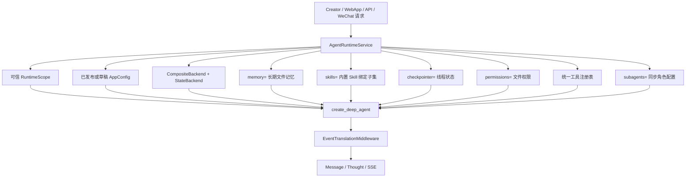

# DeepAgents V2 Harness 总体升级方案

> 文档类型：总体架构决策与执行路由。
>
> 适用版本：my-dify 当前工作区，DeepAgents 0.6.12。
>
> 本文只保留已经拍板的总体方向，不重复领域实现细节。当前完成度以 `02-implementation-progress-and-roadmap.md` 为准；上下文、记忆与压缩以 `03` 为准；Skill、文件系统、Backend 与权限以 `04` 为准；同步多 Agent 以 `05` 为准。

## 1. 后续 Agent 的阅读和执行顺序

后续 Agent 开始实现前必须按以下顺序建立事实：

1. 读取仓库根目录 `AGENTS.md`，确认项目硬约束。
2. 读取本目录 `README.md`，确认文档职责和冲突优先级。
3. 读取 `02-implementation-progress-and-roadmap.md`，区分已完成、开发中和未开始。
4. 根据任务领域读取 `03`、`04`、`05`，这些领域规范覆盖本文的概览描述。
5. 检查当前代码、迁移、测试和 `git status`；规划文档不能替代代码现状核对。

文档与代码不一致时，不得自行选择更复杂的方案。先确认差异属于“目标尚未落地”还是“文档已经过期”，再按框架原生优先原则处理。

## 2. 总体目标

本轮升级不是给旧 Agent 外面增加一层包装，而是把运行主轴收敛到 DeepAgents：

- 使用 `create_deep_agent` 构建主 Agent 和同步 SubAgent。
- 使用 DeepAgents 原生 Backend、Filesystem、Skills、Memory、Todo、SubAgent 和 Summarization 能力。
- 使用 LangGraph checkpoint 保存线程内短期工作状态。
- my-dify 只负责身份、租户、App 配置、工具注册、权限适配、业务持久化和事件翻译。
- 所有 Creator、WebApp、OpenAPI、WeChat、Workflow 等入口复用同一个运行时装配服务。

目标不是一次性增加所有高级能力。同步、最小权限和可恢复性优先于异步、递归委派和自由代码执行。

## 3. 项目硬约束

### 3.1 框架原生优先

能力选择顺序固定为：

1. DeepAgents 原生参数、中间件、Backend 和 Memory。
2. LangChain/LangGraph 原生 Middleware、Checkpoint、Store、Interrupt 和 Callback。
3. 只为业务数据模型实现窄协议适配、权限隔离和持久化边界。
4. 只有前三层均无法满足，且有明确缺失能力、方案评估和自动化测试时，才允许新增自有组件。

禁止维护第二套摘要器、token 裁剪器、checkpoint、通用文件系统、Skills 加载器、Todo、SubAgent 调度器或向量基础设施。

### 3.2 默认拒绝

- 未声明的工具、路径、Skill、脚本、网络、环境变量和跨租户访问全部拒绝。
- 模型只看到虚拟路径，不看到宿主机路径、对象存储 key 或数据库作用域字段。
- 线上默认 Backend 不实现 `SandboxBackendProtocol`，不向模型开放通用 `execute(command)`。
- Workspace 内容始终视为不可信数据，不能成为命令、脚本、模块、Hook、Skill 或工作流定义的执行入口。
- 子 Agent 的权限只能是父 Agent 已授权能力的子集。

### 3.3 单一事实来源

每类数据只能有一个业务权威来源：

| 数据 | 权威来源 |
|---|---|
| 当前实现状态 | 代码、迁移、测试和文档 `02` |
| 线程短期状态、Todo、中断、摘要状态 | LangGraph checkpoint |
| 原始用户和助手消息 | PostgreSQL `conversation` / `message` |
| 用户长期记忆 | DeepAgents `/memories/` + LangGraph `StoreBackend` |
| 内置 Skill 正文和脚本 | 部署镜像内公共、版本化、只读目录 |
| App/Agent 的 Skill 选择 | 已发布 AppConfig 的绑定引用 |
| 会话文件和正式产物 | 作用域 Workspace/Artifact Backend |
| 知识库文档 | 现有 Weaviate Dataset 集合 |

长期记忆由 Store namespace 隔离；项目不引入 `memory_facts`、pgvector 或第二套
长期事实权威源。

## 4. 目标运行架构

`AgentRuntimeService` 只装配，不重写 DeepAgents 行为。`EventTranslationMiddleware` 是 DeepAgents/LangGraph 事件到现有 QueueEvent/SSE 的唯一翻译边界。

## 5. 子系统拍板结论

### 5.1 上下文、记忆与压缩

- 身份与租户作用域来自服务端鉴权和数据库关联，不能接受模型或客户端覆盖。
- checkpoint 是当前线程的短期工作记忆；原始消息只在线程无 checkpoint 时用于冷启动和灾难恢复。
- DeepAgents 的摘要和大工具结果由原生 State/Backend 管理，不映射为 MyDify
  的业务 `conversation_history` 文件。
- `/memories/AGENTS.md` 是长期文件记忆入口，由 LangGraph `StoreBackend`
  按服务端 namespace 隔离，不维护第二套业务事实表。
- 压缩只使用 DeepAgents 原生 Summarization，不保留自定义阈值、窗口计算器或手工裁剪。
- Workspace 文件不会自动晋升为长期记忆；长期记忆只通过 `/memories/` 文件路径
  和 Store namespace 管理。

完整实现和删除语义见 `03-context-memory-compression-implementation.md`。

### 5.2 Skills、文件系统与 Backend

- V1 只支持平台内置 Skill 包。
- 内置 Skill 正文保存在公共只读目录；Creator 只能绑定或解绑，不能上传、编辑或替换正文。
- Web Creator 必须能查看内置 Skill 的名称、版本、描述、digest、是否包含登记脚本和当前挂载状态，并可把 Skill 挂载到主 Agent。
- SubAgent 只能从主 Agent 已挂载的集合中选择自己的 Skill 子集；发布版本同时固化主 Agent 绑定和各 SubAgent 子集。
- DeepAgents 原生 Skills 负责发现和懒加载；`SKILL.md` 不是权限授权文件。
- 非 Sandbox 模式下 `CompositeBackend.default` 使用 DeepAgents 原生
  `StateBackend`，承载线程内临时文件和框架内部文件；业务目录通过显式 route
  接入。
- `/workspace/` 可读写；启用官方 Sandbox 时文件工具和原生 `execute` 访问同一隔离文件系统。
- 未启用 Sandbox 时由 DeepAgents 原生 `FilesystemMiddleware` 根据 Backend 能力隐藏 `execute`；Harness Profile 只关闭隐式 `general-purpose` worker。`permissions=`、Backend ACL 和 Sandbox 是不同安全层，不能相互替代。

完整方案见 `04-skill-filesystem-backend-permission-plan.md`。

### 5.3 Todo 与同步多 Agent

Todo 可以驱动委派决策，但不能把计划状态和执行器合并：

1. 主 Agent 使用原生 `write_todos` 创建或更新计划。
2. 主 Agent 根据依赖、状态和当前上下文选择可执行 Todo。
3. 需要委派时，主 Agent 调用 DeepAgents 原生同步 `task(description, subagent_type)`。
4. SubAgent 返回最终结果后，主 Agent 负责验证、综合，并更新 Todo 状态。

`write_todos` 本身不创建 SubAgent，也不绕过 `task` 的角色、工具、Skill 和文件权限。V1 不实现独立确定性调度器；调度决策由主 Agent 模型完成，Todo 是计划与状态事实。

同步多 Agent 采用深度为 1 的 Coordinator 拓扑：

- 只允许显式配置的 SubAgent；线上关闭默认 `general-purpose`。
- `mode` 只接受 `sync`，`context_passing` 只接受 `NONE`。
- SubAgent 只收到自包含 `task.description`，不复制父对话、父 Todo 或父摘要。
- SubAgent 不获得 `task`，不能递归委派。
- 工具、Skill 和文件权限都是显式子集；空工具列表必须传 `tools=[]`。

完整方案见 `05-synchronous-multi-agent-implementation.md`。

### 5.4 业务工具与 WorkflowTool

- BaseTool 和 WorkflowTool 都从同一个服务端工具注册表解析。
- 主 Agent 只能获得 AppConfig 已绑定且当前调用主体有权使用的工具。
- SubAgent `tools` 只能引用主 Agent 已授权工具的子集；未知名称直接导致运行时构建失败。
- WorkflowTool 内部节点不得扩大父调用权限。文件写入、联网、代码执行、外部副作用和敏感数据读取都要按节点重新门控。
- 工作流不能通过配置或输入动态生成宿主机命令，也不能把 Workspace 文件当成可执行定义。
- 没有完成嵌套权限清单和执行期门控的 WorkflowTool，不得授权给线上 SubAgent。

### 5.5 HITL 边界

HITL 暂不属于 V1 交付范围。本轮不实现对话接管、消息级修正、暂停注入、审批 UI 或对应业务事件；工具权限使用 `allow/deny` 和静态策略完成，无法交互处理的请求直接拒绝。

现有 checkpoint、事件和 RuntimeService 设计不得阻断以后接入 LangGraph 原生 Interrupt/Resume，但当前验收不能要求或宣称 HITL 已可用。

### 5.6 异步边界

异步 Agent 当前未开放。后续必须先核对届时 DeepAgents/LangGraph 的原生异步能力，再决定平台需要补充的任务注册、查询、取消、恢复、配额和事件适配。

在能力核对完成前，不预设 Redis TaskRegistry、远端 Graph SDK、自建 SSE 转发器或第二套调度状态机，也不在 API 中接受异步字段后静默忽略。

## 6. 用户业务主流程

### 6.1 Creator 配置与发布

1. Creator 配置主 Agent 模型、提示词、业务工具和工作流。
2. 从平台内置目录选择 Skill 绑定，不上传或编辑 Skill 正文。
3. 配置同步 SubAgent 的角色、说明、模型、工具子集和 Skill 子集。
4. 草稿调试使用统一 RuntimeService；发布时固化 AppConfigVersion。
5. 发布校验失败时拒绝发布，不能降级扩大工具或文件权限。

### 6.2 终端用户运行

1. 服务端完成 account/app/conversation/end-user 鉴权，生成不可变 RuntimeScope 和稳定 thread ID。
2. RuntimeService 装配 Backend、权限、Skills、Memory、工具、SubAgent 和 checkpointer。
3. 无 checkpoint 时从 PostgreSQL 原始消息冷启动；有 checkpoint 时直接恢复线程状态。
4. 主 Agent 可直接调用工具，也可用 Todo 规划并通过 `task` 同步委派。
5. 大内容写入受控 Workspace/Artifacts；模型只能使用虚拟路径。
6. DeepAgents 在需要时压缩上下文并管理内部外置文件。
7. EventTranslation 产生统一事件，业务层保存 Message 和 Thought 并向客户端推流。
8. 成功对话可以继续写入长期记忆文件；记忆写入失败不影响本轮对话。

## 7. 分阶段交付

| 阶段 | 目标 | 当前状态来源 |
|---|---|---|
| R0 | DeepAgents 主图、统一 Runtime、checkpoint、事件翻译 | 文档 `02` |
| R1 | Workspace、显式 Backend 路由、权限和生产安全 | 文档 `02`、`04` |
| R2 | 内置 Skills、长期文件记忆、原生压缩闭环 | 文档 `02`、`03`、`04` |
| R3 | 同步多 Agent、Todo 事件和委派轨迹 | 文档 `02`、`05` |
| R4 | 安全、监控与上线门禁 | 文档 `02`、`04` |

阶段状态不得从本文推断。实现前必须读取 `02` 的最新验证记录。

## 8. 允许的自定义组件

以下组件属于必要业务边界，不视为重复造轮子：

- `AgentRuntimeService`：运行作用域和原生参数装配。
- `RuntimeContextMiddleware`：模型调用时追加运行时间。
- `EventTranslationMiddleware`：事件协议翻译。
- `SkillCatalogBackend`、`MyDifyWorkspaceBackend`、`StoreProvider`：
  窄 Backend 适配和强制作用域。
- 统一工具注册表与业务权限门控。
- 官方 Sandbox provider 生命周期适配器：只负责创建、上传、回收和
  Workspace 同步，不注册自定义脚本执行工具。
- PostgreSQL 模型、服务、API、审计和清理任务。

这些组件不能复制 DeepAgents 的文件工具、Skills 解析、MemoryMiddleware、Todo、SubAgent 或 Summarization 实现。

## 9. 生产验收门禁

只有同时满足以下条件，整体方案才能标记为生产就绪：

1. 后端完整回归、迁移升降级、前端生产构建和 `git diff --check` 通过。
2. 所有运行入口复用同一 RuntimeService，并有契约测试。
3. 稳定 thread 的连续对话、冷启动、压缩、历史恢复和删除语义通过真实 PostgreSQL 验证。
4. 默认 Backend 拒绝未路由路径且不暴露通用执行；Windows 生产执行关闭。
5. Workspace 路径、租户、配额、并发版本和不可信文件测试通过。
6. 内置 Skill 目录只读，绑定子集、digest 和脚本清单可验证。
7. 长期记忆 Store namespace 隔离、文件读写和删除语义通过。
8. 同步 SubAgent 的零历史继承、工具子集、Skill 子集、只读默认和单层拓扑通过真实模型测试。
9. Todo、委派、工具和结束事件可追踪到同一 Message/Conversation。
10. 异步能力未完成时，API、配置和 UI 均明确拒绝异步字段。

## 10. 明确不做

- 不恢复旧 FunctionCall/ReACT Agent 主实现。
- 不新增自定义摘要、token 窗口或对话裁剪机制。
- 不把原始对话、框架摘要、Workspace、Skills 和长期文件记忆混为同一类数据。
- 不引入 pgvector、`memory_facts` 或第二套长期事实权威源。
- 不开放用户上传 Skill、用户脚本、任意 shell、任意 Python 或远程 Skill。
- 不让 Todo 写操作直接产生绕过权限的执行副作用。
- 不支持 `SUMMARY`、`RECENT_K` 父上下文复制。
- 不支持递归 SubAgent、Swarm 或未验证的异步任务体系。
- 当前版本不实现 HITL；不得只增加前端开关或占位事件冒充可用能力。
- 不为 Agent、SubAgent、Todo 或 Plan 新建平行主表，除非后续业务事实确实无法由 AppConfig、checkpoint 和现有轨迹表表达。
