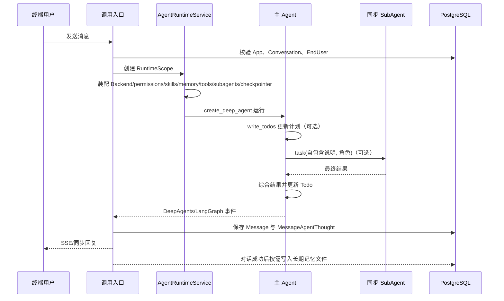

# DeepAgents V2 业务流程与数据库改造方案

> 文档类型：业务流程与数据契约。
>
> 适用版本：my-dify 当前工作区，DeepAgents 0.6.12。
>
> 本文区分“当前数据库事实”和“目标改造”。当前完成度以 `02-implementation-progress-and-roadmap.md` 为准；领域行为分别以 `03`、`04`、`05` 为准。表名、字段和迁移在实施前必须再次与模型代码和迁移链核对。

## 1. 业务对象与归属

| 对象 | 业务归属 | 说明 |
|---|---|---|
| Account | 平台租户 | 所有 App、资源和运行数据的第一隔离边界 |
| App | Account | 对外应用和 Creator 配置入口 |
| AppConfig | App | 草稿配置；保存主 Agent、工具、工作流、Skill 绑定和 SubAgent 配置 |
| AppConfigVersion | App | 已发布和历史配置快照 |
| EndUser | Account + App | 终端用户身份；长期记忆必须按该作用域隔离 |
| Conversation | App + 调用主体 | 对话容器，对应稳定 thread 的业务定位信息 |
| Message | Conversation | 原始用户输入和助手回复；用于展示、审计和冷启动 |
| MessageAgentThought | Message | 工具、Todo、委派和 Agent 运行轨迹 |
| WorkspaceFile | Account + App + Conversation | 会话文件、产物和框架历史外置内容的业务存储记录 |
| Long-term memory | Account + App + EndUser | `/memories/AGENTS.md` 对应的 Store namespace |
| Builtin Skill | 平台 | 部署镜像内公共、版本化、只读内容 |

任何 Handler、Service、Backend 或后台任务都必须从服务端 RuntimeScope 获取作用域，
不能信任模型或客户端提供的 account/app/conversation/end_user 标识。

## 2. Creator 业务流程

### 2.1 创建和编辑应用

1. Creator 创建 App，系统创建或关联草稿 `AppConfig`。
2. 配置主 Agent 模型、提示词、业务工具和工作流。
3. 在 Web 平台浏览内置 Skill 目录，并把选中的 Skill 挂载到主 Agent；Creator 不能上传、编辑或覆盖 `SKILL.md` 和脚本。
4. 配置零个或多个同步 SubAgent：角色名、职责、system prompt、模型、工具子集，以及从主 Agent 已挂载集合中选择的 Skill 子集。
5. 草稿调试和正式运行都调用统一 `AgentRuntimeService`，只在配置版本和调用主体上不同。

### 2.2 发布

发布前必须完成以下校验：

- 所有工具和 WorkflowTool 都存在于当前 App 的授权工具注册表。
- SubAgent 工具是主 Agent 工具的子集，Skill 是 App 已绑定 Skill 的子集。
- SubAgent `mode=sync`、`context_passing=NONE`，不存在异步和父历史复制字段。
- Skill 的 name、version、digest 与公共只读目录一致。
- 文件权限最后存在兜底 deny，不允许物理路径和通用 execute。
- 模型配置、Harness Profile 和 checkpointer 配置可构建。

校验通过后创建 `AppConfigVersion` 快照，并让 `App.app_config_id` 指向已发布版本。禁止发布时动态读取 Creator 尚未发布的内容。

### 2.3 Creator 资源体验

Creator 可以：

- 查看平台内置 Skill 的名称、版本、描述、digest、脚本能力和挂载状态，并挂载/卸载到主 Agent 或同步 SubAgent；不能修改正文和脚本。
- 管理 App 发布资源和测试输入。
- 查看 Workspace/Artifacts 的受控文件列表、版本和审计信息。
- 查看同步委派树、Todo 状态、工具调用和失败原因。
- 查看长期记忆诊断信息；默认不能静默改写终端用户记忆文件。

长期记忆是否允许 Creator 管理属于产品权限决策；运行时仍只通过服务端
Store namespace 访问，不能由模型或客户端指定租户路径。

## 3. 终端用户对话流程



运行规则：

1. 使用稳定 `thread_id = account_id:app_id:conversation_id:agent_id`。
2. 有 checkpoint 时恢复短期线程状态；无 checkpoint 时才从原始 Message 冷启动。
3. 长期记忆通过 `/memories/AGENTS.md`、StoreBackend 和 `memory=` 投影，
   不直接拼接到 system prompt。
4. DeepAgents 原生 Summarization 负责压缩，内部外置文件留在框架默认
   StateBackend 或官方 Sandbox 中。
5. Workspace 文件是数据，不是执行入口。
6. 所有运行事件经过 `EventTranslationMiddleware` 翻译后再持久化和推流。

## 4. Todo 与 SubAgent 调度职责

Todo 是计划与状态事实，可以驱动委派决策；真正的执行入口是 DeepAgents 原生 `task`：

```text
主 Agent 拆解任务
  -> write_todos 保存计划
  -> 选择依赖已满足的 Todo
  -> 直接调用业务工具，或调用 task 委派同步 SubAgent
  -> 校验返回结果
  -> write_todos 更新 completed / failed / revised
```

强制边界：

- `write_todos` 只修改 Todo state，不直接创建 SubAgent。
- 主 Agent 模型负责 V1 的选择和委派决策，不新增自建 Todo 调度器。
- `task` 调用必须重新经过角色、工具、Skill、文件和租户权限校验。
- Todo 中的文本不能声明新工具、物理路径、命令或更高权限。
- Todo 和 SubAgent 运行状态由 checkpoint 保存；不新增 `plans`、`todos` 或 `subagent_tasks` 业务表。
- `TODO_UPDATE` 从 DeepAgents Todo state 变化翻译为业务事件，并按现有 Thought 机制持久化。

以后若产品需要跨请求的确定性调度、重试或异步恢复，应新增独立调度层，但仍不得把执行副作用塞进 `write_todos`。

## 5. 父子 Agent 工具和工作流选择

### 5.1 统一工具注册表

主 Agent 和 SubAgent 都只能从同一个服务端工具注册表解析能力：

| 工具类型 | 主 Agent | SubAgent |
|---|---|---|
| BaseTool | AppConfig 已绑定且调用主体有权使用 | `subagents[].tools` 显式引用的父工具子集 |
| WorkflowTool | 与 BaseTool 相同，注册为具名工具 | 只有通过 SubAgent 安全校验后才能进入子集 |
| DeepAgents `task` | 有显式团队时由原生中间件提供 | 禁止，保持单层拓扑 |
| 文件工具 | DeepAgents 原生提供，受 permissions 和 Backend ACL 限制 | V1 默认只读且只见授权目录 |
| 官方 Sandbox + 原生 `execute` | 仅 `AGENT_SANDBOX_PROVIDER=langsmith` 时提供 | Sandbox provider 不可用时失败关闭 |
| 自定义脚本工具 | 不提供 | Skill 包内脚本使用 DeepAgents 原生 `execute` |

### 5.2 WorkflowTool 嵌套权限

WorkflowTool 可以被 SubAgent 调用，但必须满足：

1. 工作流已经绑定到当前 AppConfig 版本。
2. SubAgent 的 `tools` 显式包含该工作流工具名。
3. 发布阶段生成工作流能力清单，至少标记读文件、写文件、联网、代码执行、外部副作用和敏感数据访问。
4. 工作流每个节点在执行时重新进行权限门控；父工具通过不代表内部节点自动通过。
5. 工作流节点的能力并集不能超过主 Agent 和当前调用主体的授权范围。
6. 包含任意代码、动态命令、未声明外部调用或不可信定义加载的工作流，V1 不得授权给线上 SubAgent。

## 6. AppConfig 数据契约

### 6.1 同步 SubAgent

`app_config.subagents` 和 `app_config_version.subagents` 是 JSONB 数组，配置随发布版本固化：

```json
[
  {
    "name": "researcher",
    "description": "搜索并归纳资料",
    "system_prompt": "你是严谨的研究员。",
    "mode": "sync",
    "context_passing": "NONE",
    "tools": ["web_search", "workflow:collect_sources"],
    "skills": ["research"],
    "model": "openai:gpt-5.4"
  }
]
```

只允许以下字段：

| 字段 | 规则 |
|---|---|
| `name` | App 内唯一稳定路由键，小写字母开头，最多 64 位 |
| `description` | 给主 Agent 的角色说明和委派场景 |
| `system_prompt` | SubAgent 角色约束，不包含父历史 |
| `mode` | V1 只接受 `sync` |
| `context_passing` | V1 只接受 `NONE` |
| `tools` | 统一工具注册表中的父工具子集；空数组表示无业务工具 |
| `skills` | 当前 App 已绑定内置 Skill 的子集 |
| `model` | 可选 DeepAgents 模型覆盖；省略时使用主模型 |

`graph_id`、`url`、`headers`、`k`、`timeout_seconds`、`max_concurrent_per_conversation` 及其他异步字段必须拒绝，不能忽略。

### 6.2 内置 Skill 绑定

目标是在 `AppConfig` 和 `AppConfigVersion` 中保存绑定引用，不保存正文：

```json
[
  {
    "name": "csv-analysis",
    "version": "1.0.0",
    "digest": "sha256:...",
    "enabled": true
  }
]
```

该数组表示主 Agent 的挂载集合。SubAgent 只能在 `subagents[].skills` 中按名称引用这个集合的子集。公共目录中的 Skill 包是正文权威来源；数据库不得保存同一 Skill 的第二份权威正文。

Web/API 契约固定为：

1. `GET /apps/{app_id}/skills` 从 `BuiltinSkillCatalog` 返回可见内置目录元数据和当前草稿挂载状态，不返回可编辑正文。
2. Skill 挂载通过现有 AppConfig 草稿保存/发布流程写入 `app_config.skills`，不通过创建 Skill 内容的 POST 接口完成。
3. SubAgent 挂载通过 `subagents[].skills` 保存，后端校验它是主 Agent 挂载集合的子集。
4. 发布后的运行严格使用 `AppConfigVersion` 中固化的 name、version 和 digest；目录版本或 digest 不匹配时拒绝构建 Agent。
5. Web 平台不提供新增、编辑正文、上传包或删除内置 Skill 的入口。

## 7. 当前相关数据库表

以下是当前模型代码中的真实表名，不代表所有目标字段已经完成：

| 表 | 当前用途 | 本轮处理 |
|---|---|---|
| `app` | App 与草稿/发布配置引用 | 复用 |
| `app_config` | 草稿模型、工具、工作流、SubAgent 等配置 | 复用并补齐 Skill 绑定 |
| `app_config_version` | 发布和历史配置快照 | 复用并补齐 Skill 绑定 |
| `conversation` | 会话元数据 | 复用 |
| `message` | 原始问答、token、价格、状态 | 复用 |
| `message_agent_thought` | 现有 Agent 工具和运行轨迹 | 复用并增加多 Agent 追踪字段；表名是单数 |
| `end_user` | App 范围终端用户 | 复用并固定外部用户唯一性 |
| `workspace_files` | 版本化 Workspace 文件 | 复用并完成命名空间、配额和 ACL |
| LangGraph Store | 长期文件记忆 | 通过 `StoreProvider` 复用，不创建业务事实表 |
| `skills` | 当前开发中的数据库 Skill 正文 | 不进入 V1；移除内容 CRUD 和未发布迁移 |

LangGraph checkpoint 使用框架 saver 管理，不新增 my-dify 自定义 `agent_checkpoints` 模型。

## 8. 目标字段调整

### 8.1 `message_agent_thought`

这是现有表，后续通过 `ALTER TABLE` 增加字段，不创建复数新表：

| 字段 | 类型建议 | 语义 |
|---|---|---|
| `agent_id` | String(64), nullable | 当前产生事件的 Agent 路由键；主 Agent 使用稳定值 `main` |
| `agent_type` | String(16), nullable | `main` 或 `subagent` |
| `parent_agent_id` | String(64), nullable | SubAgent 的父 Agent；主 Agent为空 |
| `delegation_id` | String(128), nullable | 同步委派使用 DeepAgents tool call id，关联 delegate/end |
| `task_id` | String(128), nullable | 预留后台异步任务 ID；同步阶段为空 |

同步阶段不能把 `task_id` 当作 DeepAgents tool call id。前端按 `delegation_id` 关联委派树。

推荐索引：

- `(message_id, position)`：沿用现有顺序访问。
- `(conversation_id, delegation_id)`：定位一次同步委派。
- `(conversation_id, agent_id, created_at)`：按角色展示轨迹。
- `task_id` 非空时的部分索引：仅在异步阶段真正启用后增加。

### 8.2 LangGraph Store

长期记忆不再使用 `memory_facts` 业务表。DeepAgents 只看到稳定的虚拟文件：

```text
/memories/AGENTS.md
```

Store namespace 由服务端运行上下文生成：

```text
("mydify", account_id, app_id, end_user_id_or_account)
```

同一个逻辑路径在不同 namespace 下是不同 Store item，因此不会把多个租户
写入同一个文件。Store 的具体持久化由 `AGENT_MEMORY_BACKEND` 选择：
生产使用 `PostgresStore`，开发可以使用 `InMemoryStore`，关闭时不声明长期
记忆能力。项目不实现事实抽取、向量检索、事实 CRUD 或第二套记忆投影。

### 8.3 `workspace_files`

继续使用当前版本化表，服务层必须保证：

- `account_id + app_id + conversation_id + path + version` 的作用域和版本一致性。
- 版本分配使用事务锁、唯一约束或原子序列，不能依赖无锁 `latest + 1`。
- 逻辑路径只允许 `/workspace`、`/artifacts` 等已注册命名空间。
- 内容、文件数、扫描量、结果数和写入频率有配额。
- 物理路径、存储 key 和租户 ID 不进入模型上下文。
- Workspace 文件不可作为命令、代码模块、Skill、Hook 或工作流定义执行。

### 8.4 `skills`

V1 不保留数据库 `skills` 正文表。当前实现规则：

1. 运行时停止从该表读取 Skill 正文。
2. Creator UI 和 `GET /apps/{app_id}/skills` 改为读取 `BuiltinSkillCatalog`，只提供查看和挂载状态。
3. 移除 Creator Skill 正文的 create/edit/enable/delete API、Service、模型和前端编辑器。
4. 历史文件名 `d_v2_005_create_skills` 仅增加 AppConfig/AppConfigVersion 的 Skill 绑定 JSON，不创建 `skills` 表或保存正文。
5. Skill 绑定直接随 AppConfig/AppConfigVersion 版本化，不另建绑定表。

以后如开放平台管理员上传包，必须设计独立的签名、扫描、审核和发布仓库；不能恢复当前租户可编辑正文表作为执行来源。

## 9. 当前迁移链与整改方式

当前工作区迁移链为：

| Revision | 当前内容 | 处理结论 |
|---|---|---|
| `d_v2_001_drop_agent_checkpoints` | 删除旧自建 checkpoint 表 | 保留；使用 LangGraph saver |
| `d_v2_002_create_workspace_files` | 创建 `workspace_files` | 保留并验证升降级 |
| `d_v2_003_create_memory_facts` | 历史版本创建旧表 | 保留以保证迁移链可回放 |
| `d_v2_004_add_subagents` | 给 AppConfig/Version 增加 `subagents` | 保留 |
| `d_v2_005_create_skills` | 增加 AppConfig/Version 的内置 Skill 绑定 | 保留；不创建数据库 Skill 正文表 |
| `d_v2_006_finalize_memory` | 补齐 Memory 来源、状态和 EndUser 约束 | 保留；不包含 pgvector/embedding |
| `d_v2_007_subagents_array` | 把 SubAgent 配置规范化为数组 | 保留，确保只接受同步 schema |
| `d_v2_008_agent_trace_fields` | 增加 Agent/委派字段和 Todo 快照 | 保留；同步 `task_id` 为空 |
| `d_v2_009_remove_memory_facts` | 删除旧业务长期记忆表 | 保留；长期记忆改由 LangGraph Store 承载 |

这些 revision 的维护规则：

1. 不得重新加入 vector 扩展、embedding 列或数据库 Skill 正文表。
2. 已进入共享或生产环境的迁移不得改写历史，必须新增向前清理 revision。
3. revision ID 必须连续、唯一且没有悬空依赖。
4. 每次迁移必须验证 PostgreSQL upgrade、downgrade、索引、约束和存量 JSON 兼容。

## 10. 不新增的表和字段

当前方案明确不新增：

- `agents`、`subagents`、`agent_members`：角色配置随 AppConfig 版本化。
- `plans`、`todos`：Todo state 在 checkpoint 中。
- `subagent_tasks`：同步阶段使用 Thought 轨迹和 delegation ID。
- 自建 `agent_checkpoints`：使用 LangGraph saver。
- 单独的 conversation summary 权威表：摘要属于 checkpoint/压缩状态，原始 Message 保持完整。
- `memory_facts`、embedding 或 pgvector 相关表。
- `skill_scripts`：V1 内置脚本来自受信只读 Skill 包清单。

异步阶段若原生框架仍缺少业务任务注册，是否新增异步任务表必须单独设计，不能提前复用同步 `task_id` 字段冒充完整生命周期。

## 11. 删除与清理语义

| 操作 | 必须处理的数据 |
|---|---|
| 删除 Conversation | 原始消息、Thought、对应 checkpoint、会话 Workspace/Artifacts；长期 Store 记忆不随会话删除 |
| 删除 EndUser | 按 Store namespace 删除当前 App 范围的长期记忆文件 |
| 删除 App | AppConfig/Version、绑定、会话、Workspace 和 Store namespace 按异步清理流程处理 |
| 解绑 Skill | 新运行立即不可见；历史 AppConfigVersion 仍保留引用和 digest 供审计 |

删除流程必须幂等，并记录失败重试和 Store namespace 清理状态。

## 12. 数据层实施顺序

1. 通过 `d_v2_009` 删除旧 `memory_facts` 表，初始化和运行时只使用 LangGraph Store。
2. 给 AppConfig 和 AppConfigVersion 增加或确认内置 Skill 绑定快照，更新序列化、发布和回滚。
3. 删除数据库 Skill 正文模型、CRUD、未发布迁移和前端编辑器；Creator 改为浏览并挂载公共目录条目。
4. 已通过 `d_v2_008` 给现有 `message_agent_thought` 增加同步委派追踪字段、Todo 快照和索引。
5. 已统一 TODO_UPDATE、SUB_AGENT_DELEGATE、SUB_AGENT_END 的持久化、SSE 字段和前端分组。
6. 完成 Workspace 作用域、版本、配额、审计和不可信内容约束。
7. 验证所有运行入口和 Store namespace 的租户过滤。

每一步都必须先更新模型和迁移，再更新 Service/API/UI，最后补自动化测试；不能只改 JSON schema 或只改前端表单。

## 13. 数据层验收门禁

- 模型表名、Alembic revision、Service 查询和文档一致。
- PostgreSQL 全链 upgrade/downgrade 通过，且没有 vector 扩展依赖。
- AppConfig 草稿、发布、历史回滚后，SubAgent 和 Skill 绑定完全一致。
- 未配置团队时不出现 `task`；非法同步字段在 API 层明确拒绝。
- Todo state 可恢复，TODO_UPDATE 与最终状态一致，且没有第二份 plans/todos 数据。
- 同步委派可通过 `delegation_id` 关联开始、结束和角色轨迹。
- 长期记忆 Store namespace 的租户隔离、文件读写和删除语义通过。
- Workspace 路径穿越、跨租户、并发版本、配额和不可执行约束通过。
- Skill 正文只能来自公共只读目录，数据库不能覆盖它。
- WorkflowTool 和其内部节点均不能扩大父 Agent 或 SubAgent 权限。
