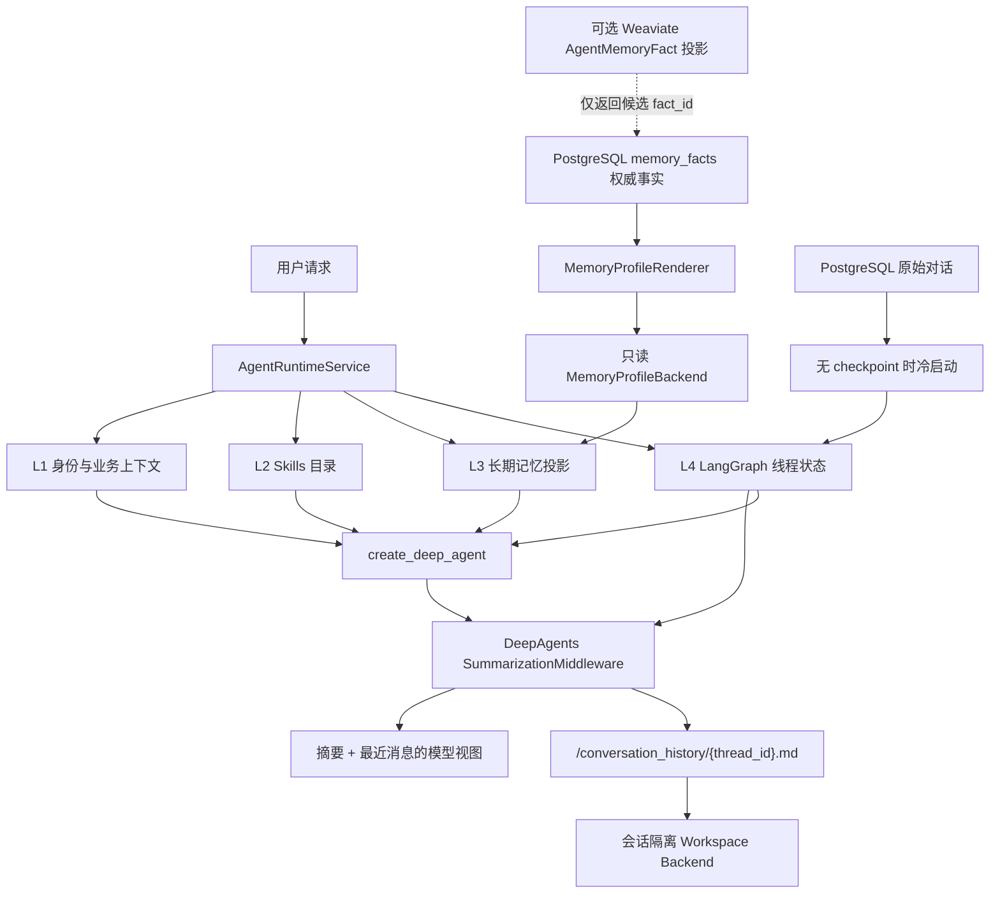

# 上下文装配、记忆机制与压缩机制完整实现规范

> 本文是后续实现的目标规范。凡与本文冲突的旧实现，以本文和仓库根目录 `AGENTS.md` 的“框架原生优先”约束为准。
>
> 本文只定义最终形态，不保留过渡方案和废弃设计。

## 1. 目标与完成标准

本次改造要统一解决三个相互依赖的问题：

1. **上下文装配**：每次运行只装入当前请求真正需要的身份、Skills、长期记忆、线程状态和业务约束。
2. **记忆机制**：区分原始对话、短期线程状态、长期用户事实、任务工作文件与知识库，避免一份数据承担多种职责。
3. **压缩机制**：由 DeepAgents 原生摘要中间件控制上下文窗口，在保留原始记录和线程状态可恢复性的前提下，为模型生成受控视图。

完成标准如下：

- 所有 Agent 入口都通过同一套运行时装配服务构建 DeepAgents 参数。
- 短期状态使用 LangGraph checkpoint；原始对话历史只用于冷启动和审计恢复。
- 长期记忆以 PostgreSQL 业务事实为权威源，通过 DeepAgents `memory=` 和 Backend/Store 投影给模型。
- 压缩只使用 DeepAgents `SummarizationMiddleware`，不保留第二套 token 估算、裁剪或摘要实现。
- Weaviate 只在召回质量评估证明有必要时，作为可重建的长期记忆检索投影；不得引入 pgvector。
- 删除会话、消息或用户数据时，同步清理 checkpoint、工作区历史和派生索引，不产生幽灵上下文。
- 上述行为均有单元、集成、恢复、权限和回归测试。

## 2. 项目硬约束

实现顺序固定为：

1. DeepAgents 原生参数、中间件、Backend、Memory 和工具。
2. LangChain / LangGraph 原生 Middleware、Checkpoint、Store、Interrupt 和 Callback。
3. 只为 my-dify 业务模型增加最小协议适配、权限隔离和持久化投影。
4. 只有框架确实缺失能力时才新增自有组件，并在实现前记录缺口、评估过的原生替代方案、失败原因和自动化验收测试。

明确禁止：

- 自研摘要器、token buffer、上下文窗口计算器或模型窗口配置表。
- 自研 checkpoint 生命周期或在持久化失败时静默退化为内存 saver。
- 直接把长期记忆文本拼进 system prompt，绕过 DeepAgents `memory=`。
- 把仓库根目录 `AGENTS.md`、共享文件或 Skills 当作用户业务记忆权威源。
- 同时维护 pgvector、自定义余弦检索与 Weaviate 多套向量基础设施。
- 为改名、加日志或埋点包装 DeepAgents 已有组件。

## 3. 总体架构



核心原则是“**权威数据不等于每轮都直接进模型上下文**”：数据库保存完整、可管理的数据，运行时只通过框架原生接口投影当前轮需要的受控视图。

## 4. 数据与职责分层

| 层级 | 数据 | 权威存储 | 如何进入 Agent | 生命周期与用途 |
|---|---|---|---|---|
| M0 | 当前线程执行状态、Todo、摘要状态 | LangGraph checkpoint | `checkpointer=` | 短期工作记忆；支持续跑和失败恢复；HITL 暂不开放 |
| M1 | Human/AI 原始消息、业务元数据 | PostgreSQL conversation/message 表 | 仅在线程无 checkpoint 时冷启动 | 完整审计记录、历史展示、灾难恢复输入 |
| M2 | 用户偏好、稳定事实、约束 | PostgreSQL `memory_facts` | `memory=` + 只读 Backend/Store | 长期语义记忆；可由用户查看、修改、删除 |
| M3 | 任务产物、历史卸载文件、临时工作文件 | 会话隔离 Workspace Backend | `backend=` | 情节性工作记忆与大内容外置，不自动提升为用户事实 |
| M4 | 应用说明、领域流程、工具使用方法 | Skills 版本库 | `skills=` | 应用能力和操作知识，不属于用户记忆 |
| K | 数据集文档和 RAG 内容 | Weaviate `Dataset` 集合 | 知识检索工具 | 外部知识，不写入用户长期记忆 |

不得把 M1、M2、M3、M4、K 合并成单一“memory”概念。它们的来源、权限、更新方式、删除语义和上下文预算均不同。

## 5. 上下文装配机制

### 5.1 L1：身份与业务上下文

`ProjectContextMiddleware` 负责注入经过服务端校验的运行身份：

- `account_id`
- `app_id`
- `conversation_id`
- `agent_id`
- `end_user_id`（终端用户入口）
- 当前调用入口、权限范围和必要的应用配置

这些字段只能来自鉴权结果、数据库关联和服务端运行参数，不能信任模型输出、客户端 prompt 或工具参数中的同名字段。所有 Backend、Store、数据库服务和 Weaviate 过滤条件都从该上下文派生租户边界。

### 5.2 L2：Skills 装配

装配路径固定为：

```text
BuiltinSkillCatalog -> 已发布 AppConfig 绑定 -> BuiltinSkillBackend -> /skills/ -> skills=
```

规则：

- Skill 正文只来自部署镜像中的公共、版本化、只读目录；数据库只保存 App/Agent 的绑定引用。
- 只投影当前已发布 AppConfig 绑定的 Skill，以及 SubAgent 获准的绑定子集。
- Skill 内容通过 DeepAgents 原生 Skills 机制发现和按需读取，不全文拼入 system prompt。
- Skill 版本和缓存键必须包含绑定版本、digest、应用、Agent 与发布版本信息。
- Skill 只描述能力、步骤和工具约束，不保存终端用户偏好或对话事实。

### 5.3 L3：长期记忆装配

装配路径固定为：

```text
MemoryFactService
  -> MemoryProfileRenderer
  -> MemoryProfileBackend
  -> /memories/profile.md
  -> create_deep_agent(memory=[...])
```

`MemoryProfileBackend` 是只读、按请求作用域生成的框架适配器。它将 PostgreSQL 中当前用户、当前 App 可见的有效事实渲染成稳定的 Markdown 视图。模型通过 DeepAgents 原生 MemoryMiddleware 读取该文件。

禁止继续保留 `recalled_facts -> system prompt` 的直接注入路径，否则同一批事实会同时经过业务 prompt 和框架 Memory 两条路径，产生重复、排序漂移和权限旁路。

### 5.4 L4：短期线程状态装配

所有入口使用稳定线程标识：

```text
thread_id = account_id:app_id:conversation_id:agent_id
```

若产品允许同一会话切换 Agent 且要求共享状态，应显式设计共享粒度，不能仅删除 `agent_id`。线程 ID 的生成必须集中在一个服务中，并用于：

- LangGraph checkpoint 配置；
- 压缩历史外置路径；
- 工作区会话隔离；
- 删除和恢复定位；
- 可观测性关联。

### 5.5 最终装配顺序

每轮运行按以下顺序完成：

1. 校验账户、App、会话、Agent 和终端用户的关联关系。
2. 生成稳定 `thread_id` 和会话隔离的运行作用域。
3. 解析已发布 Skills，并创建 `/skills/` 目录投影。
4. 查询可见长期事实，并创建只读 `/memories/profile.md` 投影。
5. 创建会话隔离 Workspace Backend。
6. 获取持久化 checkpointer，并判断是否需要原始历史冷启动。
7. 解析主 Agent 和 SubAgent 配置。
8. 调用 `create_deep_agent`，传入原生 `backend=`、`skills=`、`memory=`、`subagents=`、`checkpointer=`。
9. 执行时由 DeepAgents 中间件完成文件、Skills、Memory、Todo、SubAgent 和压缩行为。
10. 仅在边界层将 LangGraph/DeepAgents 事件翻译成 QueueEvent/SSE。

必须增加中间件顺序契约测试，防止升级 DeepAgents 后 Memory、Summarization、业务中间件的相对顺序发生静默变化。

## 6. 短期工作记忆与原始对话历史

### 6.1 为什么两者都保留

短期工作记忆可以从原始对话历史中恢复一部分语义，但不能完整替代 checkpoint。原始 Human/AI 消息通常不包含：

- Todo 和计划状态；
- 工具调用中间状态及已完成副作用；
- SubAgent 执行状态；
- DeepAgents 摘要事件和运行私有状态；
- 未完成回合的图执行位置。

因此使用“checkpoint 优先、原始历史冷启动”的双层策略。

### 6.2 正常运行

- **存在 checkpoint**：只提交当前新增用户消息，由 LangGraph 从 checkpoint 恢复线程状态。不得再次加载全部数据库历史，否则会重复消息并破坏摘要状态。
- **不存在 checkpoint**：从 PostgreSQL 加载已完成的 Human/AI 原始消息，按原顺序作为初始历史，再附加当前消息；首次成功运行后由 checkpointer 接管。
- **新会话**：只提交当前消息，创建第一个 checkpoint。

### 6.3 checkpoint 损坏或不可用

- checkpoint 记录不存在但数据库历史完整时，允许按冷启动路径重建一个新线程状态。
- checkpoint 读取失败时必须暴露可观测错误；禁止静默切换到进程内 MemorySaver。
- 原始历史只能恢复已落库的消息，不能声称恢复未完成工具调用、HITL 中断点或运行中状态。
- 对恢复后的第一轮添加恢复标记和审计事件，以便排查状态差异。

### 6.4 删除语义

删除会话或用户数据必须是跨存储的一致业务操作，至少覆盖：

- conversation/message 原始记录；
- 对应 thread checkpoint；
- `/conversation_history/{thread_id}.md`；
- 会话 Workspace 文件和版本；
- 属于删除范围的 `memory_facts`；
- 可选 Weaviate 投影记录。

如果无法事务性跨存储删除，使用数据库删除任务或 outbox 驱动幂等清理，并在完成前标记数据不可见。不得让已删除内容因旧 checkpoint 或历史文件再次进入模型。

## 7. 长期记忆机制

### 7.1 PostgreSQL 权威事实

`memory_facts` 保存业务可管理的结构化事实，不保存向量。核心字段至少包括：

- `id`
- `account_id`
- `app_id`
- `end_user_id`
- `fact_type`
- `content`
- `normalized_key`
- `source_type`
- `source_conversation_id`
- `source_message_id`
- `importance`
- `status`
- `created_by`
- `created_at`
- `updated_at`
- `expires_at`
- `deleted_at`

`normalized_key` 用于同一作用域下的幂等更新和去重。`status` 至少区分待确认、有效、已拒绝和已过期。软删除字段用于审计和跨存储清理。

### 7.2 Profile 投影与预算

`MemoryProfileRenderer` 根据当前请求生成有限、稳定、可测试的 Markdown：

1. 用户手工创建或编辑的有效事实优先。
2. 高重要度事实优先。
3. 与当前请求关键词或显式主题相关的事实优先。
4. 同等条件下按最近更新时间排序。
5. 使用 `AGENT_MEMORY_RECALL_K` 控制最大事实条数，而不是控制向量 top-k。
6. 超过单条长度限制的事实在入库阶段拒绝或规范化，不在渲染阶段任意截断语义。

投影只包含模型需要的事实文本、类别和必要约束，不暴露数据库 ID、租户字段、审核字段、内部评分或来源隐私。

### 7.3 记忆写入

记忆写入分为两类：

- **用户显式写入**：通过终端用户记忆 API 直接创建、编辑、确认或删除 PostgreSQL 事实。
- **自动提取**：成功对话落库后，通过 Celery 异步提取候选事实，再按规则去重、审核和写入。

自动提取必须排除：

- 密码、令牌、密钥、身份证件、支付信息等敏感数据；
- 一次性命令、临时任务参数和短期状态；
- 助手推测、未被用户确认的结论；
- 低置信度或低重要度内容；
- Skills、知识库内容和工具输出中的第三方事实。

自动提取失败不得影响主对话成功。重复任务必须依靠规范化键和来源唯一约束实现幂等。

### 7.4 权限模型

- 终端用户只能管理自己在当前 App 范围内的长期记忆。
- Creator/管理员可以查看诊断信息和删除违规事实，但默认不替终端用户静默改写个人事实。
- Agent 运行态只有读取 profile 投影的权限；除非产品明确提供“记住这个”工具，否则模型不能直接写数据库。
- 所有读取、写入、投影和索引任务都必须包含 `account_id`，并校验 App 与用户归属。

### 7.5 可选 Weaviate 投影

默认先使用 PostgreSQL 过滤、优先级和关键词召回。只有离线评估证明在真实数据规模下召回不足，才启用 Weaviate：

- 使用独立集合 `AgentMemoryFact`，不得复用知识库 `Dataset` 集合。
- PostgreSQL 事务写入事实和 outbox；异步消费者更新 Weaviate。
- Weaviate 保存检索所需文本、作用域和 `fact_id`，不成为事实权威源。
- 查询必须过滤账户、App 和终端用户，只返回候选 `fact_id`。
- 运行时回查 PostgreSQL，重新校验状态、权限、过期时间和最新内容后再渲染。
- 索引不可用时退化为 PostgreSQL 召回，不能影响记忆 CRUD。
- 支持从 PostgreSQL 全量重建索引和核对漂移。

不得添加 `pgvector` 依赖、向量列、维度校验服务或自定义余弦检索路径。

## 8. 上下文压缩机制

### 8.1 唯一实现

压缩只由 DeepAgents 原生 `SummarizationMiddleware` 负责。my-dify 不再维护：

- `context_window_calculator.py`；
- 自定义 `summary_trigger`、`keep_ratio` 或每模型窗口映射；
- 自定义 token buffer、消息裁剪器和摘要 prompt 包装器；
- 关闭框架摘要后由业务层自行压缩的开关。

### 8.2 触发与保留策略

默认沿用 DeepAgents 根据模型 profile 的原生策略：

- 接近最大输入窗口的 85% 时触发摘要；
- 摘要后保留约 10% 的最近上下文；
- 模型 profile 不提供窗口信息时，使用框架自身的后备逻辑，不在项目内复制配置表。

如果未来确需改变策略，只通过 DeepAgents 公开配置能力调整，并记录版本、原因和回归测试；不得重新实现算法。

### 8.3 单轮压缩流程

1. 完成身份、Skills、Memory、checkpoint 和当前消息装配。
2. DeepAgents 评估本轮模型输入规模。
3. 在摘要前按框架策略处理过旧工具调用参数，避免大参数先耗尽窗口。
4. 将需要保留但不应继续常驻上下文的历史外置到会话工作区。
5. 生成摘要，并构造“摘要 + 最近消息”的模型可见视图。
6. 保持原始数据库消息不变；checkpoint 记录框架需要的摘要事件和线程状态。
7. 若模型仍返回上下文溢出错误，使用 DeepAgents 原生溢出压缩和重试路径。

### 8.4 非破坏性原则

压缩不是删除：

- PostgreSQL 原始 Human/AI 消息继续完整保存。
- 模型只看到压缩后的运行视图。
- 历史大内容可以外置为 `/conversation_history/{thread_id}.md`。
- checkpoint 保存能够继续运行的框架状态。
- UI 历史展示读取原始消息表，不读取摘要替代原文。

### 8.5 历史外置文件

DeepAgents 写入的 `/conversation_history/{thread_id}.md` 必须通过会话隔离的 Workspace Backend 持久化：

- 路径不可由客户端任意指定。
- Backend 自动绑定 account/app/conversation/thread 作用域。
- 主 Agent 与获授权的 SubAgent 可以读取；其他会话不可见。
- 文件版本、大小和保留时间沿用 Workspace 规则。
- 删除会话时必须一并清理。

不得新建第二套“摘要归档表”复制这份文件；业务审计仍以原始消息表为准。

### 8.6 多次压缩与恢复

长会话会发生多次增量压缩。测试必须证明：

- 第二次压缩基于已有摘要状态继续工作，不重复装入完整数据库历史。
- 服务重启后从持久化 checkpoint 继续，摘要状态不丢失。
- 从数据库冷启动的新 checkpoint 可以重新摘要，但不会篡改原始消息。
- 外置文件已存在时写入是框架兼容且幂等的，不跨线程覆盖。

## 9. 运行时组件设计

### 9.1 `AgentRuntimeBundle`

目标字段：

```python
@dataclass
class AgentRuntimeBundle:
    checkpointer: BaseCheckpointSaver
    backend: BackendProtocol
    permissions: list[FilesystemPermission]
    skill_sources: list[str]
    memory_sources: list[str]
    subagent_contexts: dict[str, SubAgentContext]
```

删除 `recalled_facts` 字段和任何直接注入 prompt 的消费路径。`memory_sources` 通常包含 `/memories/profile.md`；无可见事实时可为空列表，Backend 仍应安全返回空视图。

### 9.2 `AgentRuntimeService`

该服务只负责装配，不重写框架行为：

- 校验业务作用域并创建稳定线程 ID；
- 从公共只读目录解析已发布 AppConfig 的 Skill 绑定；
- 创建 Workspace、Skill 和 Memory 的 Backend 路由；
- 生成带兜底拒绝的文件权限；
- 获取持久化 checkpointer；
- 决定是否执行原始历史冷启动；
- 解析 SubAgent 的权限和上下文；
- 返回原生 `create_deep_agent` 所需参数。

Memory Profile 渲染、数据库查询和 Backend 协议适配应拆成窄组件，避免 RuntimeService 同时承担召回算法和文本格式细节。

### 9.3 Agent 工厂

目标调用形态：

```python
agent = create_deep_agent(
    model=model,
    tools=tools,
    system_prompt=system_prompt,
    middleware=business_middleware,
    backend=runtime.backend,
    permissions=runtime.permissions,
    skills=runtime.skill_sources,
    memory=runtime.memory_sources,
    subagents=subagents,
    checkpointer=runtime.checkpointer,
)
```

业务中间件只保留框架没有提供的边界能力：

- `ProjectContextMiddleware`：可信身份和租户上下文。
- 审核/权限中间件：当前只执行静态 allow/deny；HITL 暂不开放。
- 必要的模型兼容中间件：仅修复已确认的供应商协议差异。
- `EventTranslationMiddleware`：翻译 QueueEvent/SSE，不改变执行语义。

Filesystem、Skills、Memory、Todo、SubAgent 和 Summarization 继续由 DeepAgents 原生实现。

### 9.4 统一入口

以下入口必须复用同一 RuntimeService 和 Agent 工厂：

1. Creator 调试运行。
2. Creator 正式运行。
3. 终端用户同步运行。
4. 终端用户流式运行。
5. 后台任务或计划任务运行。

入口差异只体现在鉴权主体、事件输出和允许的工具/审批策略，不得各自维护 Skills、Memory、历史加载或摘要逻辑。

### 9.5 SubAgent 上下文

- 默认继承主 Agent 的 account/app/conversation/thread 作用域。
- 只继承配置中授权的 Skills、工具、Memory 和工作区路径。
- 不允许通过 SubAgent 名称或 prompt 扩大租户和文件权限。
- SubAgent 需要独立 checkpoint 时使用确定性的子线程标识，并记录与主线程的父子关系。
- SubAgent 返回主 Agent 的内容受结果预算限制；大结果写入 Workspace 并返回引用。

## 10. 配置项收敛

保留：

| 配置 | 用途 |
|---|---|
| `AGENT_CHECKPOINT_BACKEND` | 选择受支持的持久化 checkpointer，生产环境不得使用进程内实现 |
| `AGENT_AUTO_EXTRACT_MEMORY` | 是否启用对话后异步事实提取 |
| `AGENT_MEMORY_RECALL_K` | Memory Profile 最大事实条数 |

删除或禁止新增：

- 项目自定义摘要触发比例、保留比例和模型窗口覆盖配置。
- 项目自定义 summarizer provider/model/prompt 开关。
- `PGVECTOR_*`、embedding 维度和自定义相似度阈值。
- checkpoint 失败后静默使用 MemorySaver 的配置。

所有配置必须在启动时验证；生产环境发现不安全配置应直接失败，而不是带警告继续运行。

## 11. 代码变更清单

### 11.1 必须删除

- 自定义 `context_window_calculator.py` 及其测试和调用。
- `pgvector` Python 依赖、数据库扩展、向量字段和迁移。
- 记忆 embedding 维度校验、自定义余弦检索和批量向量写入路径。
- `recalled_facts` 直接拼接 system prompt 的路径。
- 业务层自定义摘要阈值、摘要开关和手工消息裁剪。

### 11.2 必须新增或调整

- `MemoryProfileRenderer`：权威事实到稳定 Markdown 的纯转换组件。
- `MemoryProfileBackend`：只读、租户隔离的 DeepAgents Backend/Store 适配器。
- `AgentRuntimeBundle.memory_sources` 和 Agent 工厂的 `memory=` 透传。
- checkpoint 存在性判断与原始历史冷启动契约。
- 会话/用户删除后的 checkpoint、Workspace、历史文件和投影清理任务。
- 自动记忆提取的敏感信息过滤、幂等和审核规则。
- 中间件顺序、框架版本兼容和跨入口一致性测试。

### 11.3 继续复用

- 当前 PostgreSQL conversation/message 和 `memory_facts` 服务。
- 当前 Workspace 版本服务与 CompositeBackend 路由。
- AppConfig Skill 绑定解析、公共内置目录索引与 `BuiltinSkillBackend`。
- 当前 LangGraph 持久化 saver。
- 当前 QueueEvent/SSE 翻译边界。
- 当前 Weaviate 客户端；仅在阶段 E 新增独立记忆集合适配。

## 12. 分阶段实施顺序

### 阶段 A：移除冲突实现

1. 删除 pgvector 依赖、字段、迁移和检索代码。
2. 删除自定义上下文窗口计算器、摘要阈值和裁剪路径。
3. 删除长期事实直接注入 prompt 的路径。
4. 修复和收敛现有测试，建立“只有框架原生压缩”的基线。

**退出条件**：依赖和代码扫描无 pgvector、自定义余弦检索、自定义摘要器或 token-window 实现；基础 Agent 回归通过。

### 阶段 B：原生长期记忆投影

1. 实现 `MemoryProfileRenderer`。
2. 实现只读 `MemoryProfileBackend`。
3. RuntimeBundle 增加 `memory_sources`。
4. Agent 工厂传入 `memory=`。
5. 补全 CRUD、权限、自动提取和 profile 预算测试。

**退出条件**：Creator 与终端用户所有入口都通过 DeepAgents Memory 读取相同的权限受控事实；无 prompt 直注入。

### 阶段 C：统一上下文与 checkpoint

1. 集中线程 ID 生成。
2. 固化 checkpoint 优先、原始历史冷启动规则。
3. 统一当前五类运行入口；HITL 恢复入口暂不实现。
4. 实现删除后的跨存储清理和失败重试。

**退出条件**：服务重启、无 checkpoint 冷启动和删除场景均通过集成测试。

### 阶段 D：压缩与历史外置验收

1. 验证 DeepAgents 当前版本的模型 profile、触发、保留和溢出重试行为。
2. 验证 `/conversation_history/{thread_id}.md` 经 Workspace Backend 持久化且隔离。
3. 覆盖多次压缩、重启续跑、大工具结果和上下文溢出场景。
4. 增加框架升级契约测试。

**退出条件**：长会话不会因重复装入历史而膨胀；摘要、最近消息、原始消息和外置文件职责清晰且可恢复。

### 阶段 E：可选 Weaviate 记忆检索

只有在阶段 B-D 稳定后执行：

1. 建立带标注的真实记忆召回评测集。
2. 评估 PostgreSQL 规则召回的准确率、漏召率、延迟和 profile 预算。
3. 指标不达标时设计 `AgentMemoryFact` 集合和 outbox 投影。
4. 上线前完成租户过滤、PostgreSQL 回查、重建、漂移核对和降级测试。

**退出条件**：Weaviate 带来可量化收益且不改变 PostgreSQL 权威性；否则不实现。

## 13. 测试矩阵

| 类别 | 必测场景 | 关键断言 |
|---|---|---|
| 上下文装配 | 六类入口运行同一 Agent | Skills、Memory、Backend、checkpoint 参数一致 |
| 租户隔离 | 跨 account/app/user 访问 | 数据库、Backend、Workspace、索引均拒绝越权 |
| 历史冷启动 | 有历史无 checkpoint | 历史按序装入一次，成功后创建 checkpoint |
| 正常续聊 | 已有 checkpoint | 只提交新增消息，不重复装入数据库历史 |
| checkpoint 恢复 | 服务重启后继续对话 | 从已保存线程状态继续，不重复已落库消息 |
| checkpoint 故障 | 存储不可用 | 明确报错，无静默 MemorySaver 降级 |
| 长期记忆 | CRUD、确认、过期、删除 | Profile 只含当前作用域有效事实 |
| 自动提取 | 重试、敏感内容、助手猜测 | 幂等，敏感内容不入库，失败不影响对话 |
| 压缩 | 接近窗口、连续多次压缩 | 使用原生中间件，摘要状态可续跑 |
| 大工具结果 | 超大参数和输出 | 框架裁剪/外置生效，模型调用不溢出 |
| 历史外置 | 多会话同名 thread 企图访问 | 路径隔离，无覆盖和越权读取 |
| 删除 | 会话、用户、App 删除 | checkpoint、Workspace、事实和投影均不可再召回 |
| 框架升级 | DeepAgents 版本升级 | 中间件顺序和 `memory=`/`skills=`/`backend=` 契约不漂移 |
| 可选向量 | Weaviate 宕机、漂移、重建 | PostgreSQL 回退可用，索引可全量重建 |

## 14. 最终验收门禁

合并前必须同时满足：

- [ ] 依赖中不存在 `pgvector`，数据库不存在记忆向量字段和扩展迁移。
- [ ] 不存在自定义上下文窗口计算、摘要阈值、token buffer 或摘要器。
- [ ] `create_deep_agent` 显式接收 `backend=`、`skills=`、`memory=`、`subagents=`、`checkpointer=`。
- [ ] PostgreSQL 是长期事实唯一权威源，Memory Profile 是只读投影。
- [ ] 已有 checkpoint 时不加载完整数据库历史；无 checkpoint 时只冷启动一次。
- [ ] DeepAgents 原生压缩、历史外置和溢出重试通过长会话测试。
- [ ] 删除操作不会留下可被模型重新召回的 checkpoint、文件或索引数据。
- [ ] Creator、终端用户、流式与后台入口通过统一装配测试；HITL 不在当前验收范围。
- [ ] 租户隔离、敏感信息过滤、记忆 CRUD 和自动提取幂等测试通过。
- [ ] 若启用 Weaviate 记忆投影，具备评测收益、PostgreSQL 回查、重建和降级证据。
- [ ] 文档、配置示例、迁移说明和 `.codex-tasks` 验收记录与代码同步。

通过以上门禁后，项目的上下文、记忆与压缩才视为完成统一：**原始数据可追溯、短期状态可恢复、长期事实可管理、模型上下文可控，并且框架原生能力始终是唯一执行主轴。**
