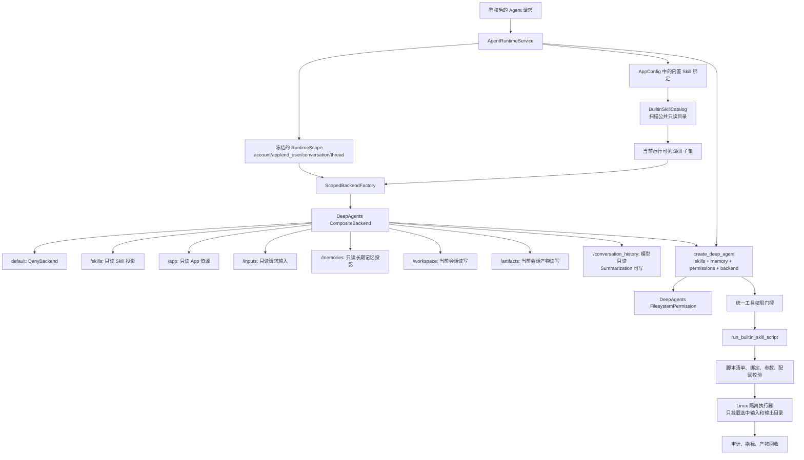

# Skill、文件系统、Backend 与权限安全完整实现方案

> 状态：目标实现规范，作为后续代码改造与验收依据。
> 适用版本：DeepAgents 0.6.12；升级框架时必须重新验证本文列出的权限和 Backend 契约。
> 决策范围：线上 V1 只支持平台内置 Skill 与平台内置脚本，不开放用户上传 Skill、远程 Skill、任意命令或任意脚本。

## 1. 结论与强制决策

本项目继续使用 DeepAgents 原生 `SkillsMiddleware`、`FilesystemMiddleware`、`CompositeBackend`、`FilesystemPermission`、Memory、Summarization 和 SubAgent 能力。my-dify 只实现框架没有覆盖的业务边界：租户身份、App 绑定、只读目录投影、配额、审计，以及受控脚本入口。

以下决策是线上硬约束：

1. **DeepAgents 原生优先**：先使用 `create_deep_agent(backend=, skills=, memory=, permissions=)`；不得重写 Skills 加载器、文件工具或摘要文件协议。
2. **默认关闭（fail-closed）**：未声明的路径、工具、Skill、脚本、网络和环境变量一律拒绝；DeepAgents 文件权限最后必须有兜底 `deny`。
3. **公共目录是物理来源，不是公共写区**：所有平台内置 Skill 统一保存在部署镜像内的公共、版本化、只读目录；运行时只把当前 App/Agent 已绑定的子集投影为 `/skills/`。
4. **Skill 是指令包，不是权限主体**：`SKILL.md` 的 `allowed-tools` 只用于提示模型，不能作为安全授权。实际权限由服务端工具注册表、DeepAgents `permissions=`、Backend ACL 和脚本执行策略共同决定。
5. **线上默认 Backend 不实现 `SandboxBackendProtocol`**：不向模型暴露通用 `execute(command)`。当前 `MyDifySandboxBackend` 不得继续作为线上默认 Backend。
6. **只开放窄脚本工具**：模型只能调用 `run_builtin_skill_script(skill, script, inputs, output, arguments)`；服务端从绑定关系和内置清单解析真实脚本，模型不能提供命令、解释器路径或宿主机路径。
7. **Windows 不执行代码**：Windows 仅用于开发期文件功能验证，不能降级承担线上脚本安全边界。生产脚本运行必须使用 Linux Bubblewrap 或独立容器，并在能力缺失时失败关闭。
8. **多层权限不可相互替代**：DeepAgents `permissions=` 是工具层规则，Backend ACL 是数据层硬边界，Sandbox 是进程层边界；任意一层通过都不代表整体授权通过。
9. **物理路径永不进入模型上下文**：模型只看到 `/skills`、`/workspace` 等虚拟路径；account、app、conversation、对象存储 key 和宿主机目录只能由服务端运行上下文派生。
10. **不新增第二套通用文件系统或执行引擎**：自定义代码只能是协议适配器、权限边界和执行策略适配器；底层文件工具继续由 DeepAgents 提供，底层隔离继续使用现有 Linux 沙箱能力。

## 2. 当前实现评估

当前代码已经具备可复用基础，但没有达到公开线上多租户安全门槛。

| 当前组件 | 可复用能力 | 必须修正的问题 |
|---|---|---|
| `Skill` / `SkillService` | App 归属、版本、启停和 Creator CRUD | 当前以 App 可编辑数据库正文为来源，与 V1“平台内置、公共只读目录”不一致 |
| `SkillCatalogBackend` | 按请求投影启用 Skill，写操作返回拒绝 | 只投影 `SKILL.md`，尚不支持安全投影 `scripts/`、`references/`、`assets/`；来源仍是 DB 行 |
| `MyDifyWorkspaceBackend` | account/app/conversation 数据隔离、版本记录、路径穿越校验 | `/seed` 仍可写；未匹配路径隐式落入当前会话；缺少显式命名空间 ACL 和完整配额 |
| `MyDifySandboxBackend` | Linux Bubblewrap、禁网 namespace、超时和资源限制 | 作为默认 Backend 会启用通用 `execute`；执行前物化整个 Workspace，执行后回写所有变化文本文件，权限过宽 |
| `AgentRuntimeService` | 统一组装 Workspace、Skills、Memory 和 saver | 默认创建可执行 Backend；未按显式命名空间路由；没有统一权限策略对象 |
| `build_deep_agent` | 统一调用 `create_deep_agent` | 尚未传入 `permissions=`；DeepAgents 未匹配规则默认允许 |

DeepAgents 0.6.12 的已验证契约：

- `FilesystemPermission` 按声明顺序匹配，第一条命中规则生效；没有规则命中时默认 `allow`。
- `permissions=` 只约束 `FilesystemMiddleware` 提供的文件工具，不会自动保护直接 Backend 调用。
- `CompositeBackend` 只负责路径路由；未匹配路径交给 default Backend。
- `execute` 不按文件路径路由，始终委托给 default Backend；default 实现 `SandboxBackendProtocol` 时通用执行能力生效。
- `FilesystemBackend(virtual_mode=True)` 能固定虚拟根并阻止常见路径穿越，但不是进程沙箱，也不能单独承担多租户授权。

因此，目标实现必须同时改变默认 Backend、虚拟目录、权限规则和脚本入口，不能只在现有 `execute` 外再加一条 prompt 提示。

## 3. 总体架构



安全决策链固定为：

```text
服务端身份作用域
  → 当前 App/Agent 的能力集合
  → 工具可见性过滤
  → 单次调用权限门控
  → DeepAgents 文件权限
  → Backend 命名空间 ACL 与租户查询
  → OS 沙箱和资源限制
  → 输出校验与审计
```

任何一层拒绝，调用立即终止。下游层只能继续收窄权限，不能扩大上游授权。

## 4. Skill 机制

### 4.1 V1 来源与信任等级

V1 只有一种可执行 Skill 来源：**平台内置 Skill**。

| 来源 | V1 状态 | 权威存储 | 是否可含脚本 | 是否可被 Creator 修改 |
|---|---|---|---|---|
| 平台内置 | 启用 | 镜像内公共只读目录 | 可以，必须登记入口 | 否，只能绑定/解绑 |
| 平台管理员上传 | 暂不启用 | 后续对象存储包仓库 | 默认不执行 | 否，需审核发布流程 |
| 租户/Creator 上传 | 暂不启用 | 未设计为生产能力 | 否 | 否 |
| 终端用户上传 | 禁止 | 无 | 否 | 否 |
| 远程/MCP Skill | 暂不启用 | 外部来源 | 否 | 否 |

以后增加新来源时必须重新做供应链、签名、扫描、审核、撤回和租户隔离设计，不能复用“内置即受信”的结论。

### 4.2 公共存储目录

内置 Skill 使用一个公共物理目录，而不是为每个 App 复制一份：

```text
仓库建议位置:
resources/agent_skills/builtin/
├── csv-analysis/
│   ├── SKILL.md
│   ├── scripts/
│   │   └── summarize_csv.py
│   ├── references/
│   └── assets/
└── document-extraction/
    ├── SKILL.md
    └── scripts/

生产镜像位置:
/opt/my-dify/agent-skills/builtin/
```

目录必须满足：

- 随版本构建进镜像，镜像层或 volume 以只读方式挂载；应用进程和脚本进程均无写权限。
- 不放在 `/workspace`，不与终端用户上传文件、对话文件或长期记忆共用物理目录。
- 不通过模型可见路径泄露 `/opt/...`；运行时只映射为 `/skills/<name>/...`。
- 不用符号链接跨出 Skill 根目录；启动扫描发现符号链接、硬链接异常、设备文件或非普通文件时拒绝加载。
- 单文件、单包、总目录大小和文件数量设硬上限；只允许 UTF-8 `SKILL.md` 和清单声明的资源类型。
- 公共目录对所有租户共享的是物理字节，不是能力授权。每次运行仍只投影当前 App/Agent 已绑定的 Skill。

### 4.3 包结构和单一事实来源

每个 Skill 的元数据与说明都放在 `SKILL.md` frontmatter 中，避免数据库正文、独立 manifest 和 Markdown 三份信息漂移。建议格式：

```yaml
---
name: csv-analysis
description: 分析 CSV 字段、质量和汇总指标；用户要求检查或总结 CSV 时使用。
allowed-tools:
  - read_file
  - write_file
  - run_builtin_skill_script
compatibility: my-dify>=2
metadata:
  my_dify:
    version: 1.0.0
    execution_mode: inline
    scripts:
      - id: summarize_csv
        path: scripts/summarize_csv.py
        runtime: python3
        timeout_seconds: 30
        max_output_bytes: 1048576
        input_count: 1
        output_kind: json
---
```

约束如下：

- `name` 必须与目录名一致，只允许小写字母、数字和单连字符。
- `description` 把触发语言放在前面，保持简短；Skills 发现阶段只加载元数据，正文按需读取。
- `metadata.my_dify.version` 是发布版本；目录内容摘要另行计算为 digest，不由作者手写。
- `allowed-tools` 是模型提示，不是授权。有效工具集取“平台全局允许 ∩ Agent 配置允许 ∩ Skill 建议”的交集。
- `scripts` 只声明相对路径和受限参数，不允许包含 shell 命令、宿主机绝对路径、环境变量或任意解释器参数。
- 启动时用严格 schema 校验整个 frontmatter；无效内置 Skill 导致构建或启动失败，不允许静默忽略后继续上线。

### 4.4 发现、绑定与懒加载

1. 服务启动时扫描公共目录，只解析 frontmatter 和包索引，计算内容 digest。
2. `BuiltinSkillCatalog` 生成稳定、只读的元数据缓存；缓存 key 至少包含 `name + version + digest`。
3. Web Creator 通过 `GET /apps/{app_id}/skills` 查看目录元数据和当前草稿挂载状态；接口不返回可编辑正文，也不提供上传、创建、修改或删除能力。
4. Creator 把 Skill 挂载到主 Agent，草稿和发布版 AppConfig 只保存 `[{name, version, digest, enabled}]`，不复制 Skill 正文。
5. SubAgent 只能从主 Agent 挂载集合中选择 `subagents[].skills` 子集。
6. 运行时根据已发布 AppConfig 和 Agent/SubAgent 配置求出允许集合。
7. `BuiltinSkillBackend` 只投影允许集合到 `/skills/`；不允许通过 `ls`、`glob`、错误消息或下载接口发现未绑定 Skill。
8. `skills=["/skills/"]` 交给 DeepAgents 原生 `SkillsMiddleware`；启动上下文只包含 Skill 元数据，模型需要时使用原生 `read_file` 读取完整 `SKILL.md` 或参考资源。
9. 内置目录变更只能通过新镜像发布；运行中不监听目录热更新，避免缓存和授权状态漂移。

### 4.5 内联与隔离

- 默认 Skill 以内联方式工作：DeepAgents 加载 `SKILL.md`，模型在当前上下文中执行步骤。
- 只有重型、长上下文 Skill 才允许声明隔离 SubAgent；隔离不代表获得更多文件或工具权限。
- SubAgent 的权限必须是父 Agent 权限的子集。DeepAgents 的 SubAgent `permissions` 会替换父规则，因此构建时必须执行集合校验，禁止配置扩大权限。
- 脚本运行永远是进程隔离，与 Skill 是否内联无关。

## 5. 虚拟文件系统

### 5.1 逻辑路径与物理路径分离

模型只操作稳定的 POSIX 虚拟路径。每次运行的 `RuntimeScope` 由服务端鉴权和数据库关系生成，Backend 用它解析真实存储键：

```text
模型路径: /workspace/notes.md
内部键:   account/{account_id}/app/{app_id}/conversation/{conversation_id}/workspace/notes.md
```

禁止模型传入或覆盖 `account_id`、`app_id`、`end_user_id`、`conversation_id`、`thread_id`。禁止再接受 `/workspace/{account}/{app}/...` 这种管理型全路径作为 Agent 工具输入。

### 5.2 命名空间与权限矩阵

| 虚拟路径 | 数据来源 | 模型读 | 模型写 | 框架内部写 | 生命周期 |
|---|---|---:|---:|---:|---|
| `/skills/` | 公共内置 Skill 目录的授权子集 | 是 | 否 | 否 | 随平台版本 |
| `/app/` | 已发布 App 静态说明与资源投影 | 是 | 否 | 否 | 随 App 版本 |
| `/inputs/` | 当前请求附件的只读快照 | 是 | 否 | 否 | 随会话或任务 |
| `/memories/` | PostgreSQL 长期事实只读投影 | 是 | 否 | 否 | 按事实生命周期 |
| `/workspace/` | 当前会话工作文件 | 是 | 是 | 是 | 会话级，可配清理 |
| `/artifacts/` | 当前会话正式产物 | 是 | 是 | 是 | 按产品保留策略 |
| `/conversation_history/` | DeepAgents 压缩历史外置文件 | 是 | 否 | 是 | 随 thread/conversation |
| `/.system/` | 服务端内部状态 | 否 | 否 | 是 | 内部 |
| `/.audit/` | 审计与安全日志 | 否 | 否 | 是 | 合规保留 |
| 任何其他路径 | 无 | 否 | 否 | 否 | 无 |

`/seed/` 被 `/app/` 替代。`/app/` 是只读发布资源，不得沿用当前共享 seed 的写语义。

### 5.3 文件安全约束

- 统一规范化 Unicode、POSIX 分隔符和绝对虚拟路径；拒绝 NUL、控制字符、反斜杠、`.`、`..`、`~`、空段和超长路径。
- 创建、读取、编辑、glob、grep、上传、下载和删除使用同一个规范化器，不允许各工具分别实现。
- 路径检查必须在规范化后、存储访问前执行；错误信息只返回虚拟路径。
- Backend 不跟随符号链接，不接收设备文件、FIFO、socket 或硬链接逃逸。
- DB 版本号通过事务锁、唯一约束或原子序列分配，不能简单使用 `latest + 1` 产生并发竞态。
- 写入前同时检查：单文件大小、会话总容量、文件数量、写入频率和租户配额。
- `glob`、`grep`、`ls` 设置最大结果数、扫描文件数和响应字节数，防止读取型 DoS。
- 二进制内容走对象存储/上传文件服务，文本 Backend 不尝试把任意二进制解码后写入数据库。

## 6. Backend 设计

### 6.1 目标组合

`CompositeBackend` 的 default 必须是拒绝全部文件操作的 `DenyBackend`，所有可访问路径都通过显式 route 注册：

```python
backend = CompositeBackend(
    default=DenyBackend(),
    routes={
        "/skills/": builtin_skill_backend,
        "/app/": app_resource_backend,
        "/inputs/": input_snapshot_backend,
        "/memories/": memory_profile_backend,
        "/workspace/": workspace_backend,
        "/artifacts/": artifact_backend,
        "/conversation_history/": conversation_history_backend,
    },
    # DeepAgents 会在 artifacts_root 下追加 conversation_history/；保持根为 /。
    artifacts_root="/",
)
```

所有 route Backend 都在构造时捕获冻结的 `RuntimeScope`，公开方法不再接收租户 ID。`DenyBackend` 和各只读包装器属于允许的最小权限适配层，不是第二套文件系统。

### 6.2 组件职责

| 组件 | 基于框架 | 自定义职责 |
|---|---|---|
| `CompositeBackend` | DeepAgents 原生 | 仅配置路由 |
| `FilesystemBackend(virtual_mode=True)` | DeepAgents 原生 | 读取公共内置目录时提供虚拟路径语义 |
| `BuiltinSkillBackend` | `BackendProtocol` 薄适配 | 只暴露已绑定 Skill，拦截写入和宿主路径泄露；底层委托原生 FilesystemBackend |
| `ScopedWorkspaceBackend` | `BackendProtocol` 适配 | account/app/conversation 查询、版本、配额、审计 |
| `MemoryProfileBackend` | `BackendProtocol` 适配 | PostgreSQL 事实到 `/memories/profile.md` 的只读投影 |
| `DenyBackend` | `BackendProtocol` 最小边界 | 对未路由路径统一返回拒绝 |
| `BuiltinSkillScriptRunner` | 业务工具适配 | 把受限脚本调用映射到隔离执行器，不提供 shell |

### 6.3 Backend 不能依赖 `permissions=` 保安全

DeepAgents 当前明确说明 `permissions=` 在文件工具层执行，直接 Backend 调用不会自动应用。因此：

- 只读 Backend 的 `write/edit/upload/delete` 自身必须拒绝。
- Workspace Backend 必须在每次方法调用中重新校验作用域和命名空间。
- Summarization、Memory、后台任务等框架/服务端直接访问 Backend 时，也必须使用专用内部身份或专用 Backend 实例。
- 不允许 API Handler、Task 或 Service 绕过作用域 Backend 直接按模型传入路径访问 `workspace_files`。

### 6.4 默认 Backend 不可执行

线上提供给 `create_deep_agent` 的 default Backend 不能实现 `SandboxBackendProtocol`。这样 DeepAgents 会将 `execute` 视为当前 Backend 不支持的能力，模型不能通过文件中间件执行任意 shell。

如果当前 DeepAgents 版本仍把不可用 `execute` schema 暴露给模型，应优先使用框架原生 Harness Profile `excluded_tools={"execute"}` 隐藏它，并用契约测试锁定；不得通过同名假工具覆盖。

`MyDifySandboxBackend` 的后续处理：

- 不再作为 Agent Runtime 的默认 Backend。
- 可暂时保留用于开发验证，但生产入口不能引用。
- 其中 Bubblewrap、进程回收和资源限制能力可以下沉为脚本执行器复用。
- “物化整个 Workspace + 执行任意命令 + 回写所有文本文件”的接口不得进入生产脚本路径。

## 7. 权限机制

### 7.1 四层权限

| 层 | 解决的问题 | 决策对象 | 默认行为 |
|---|---|---|---|
| P1 能力可见性 | 模型是否能看到工具/Skill | Tool registry、Skill binding | 不可见 |
| P2 DeepAgents 文件权限 | 内置文件工具能否操作路径 | `FilesystemPermission` | 最终兜底拒绝 |
| P3 Backend ACL | 数据是否属于当前主体、命名空间是否可写 | RuntimeScope、Backend route | 拒绝 |
| P4 执行沙箱 | 已批准脚本能访问什么进程/文件/网络 | mount、namespace、rlimit、seccomp | 不挂载、不联网 |

P1 和 P2 改善模型行为与工具层安全；P3、P4 才是不可由 prompt 绕过的硬边界。

### 7.2 DeepAgents 原生文件权限

规则按第一条命中生效，必须把特殊拒绝放前面，把兜底拒绝放最后。目标语义示例：

```python
permissions = [
    FilesystemPermission(
        operations=["read", "write"],
        paths=["/.system/**", "/.audit/**"],
        mode="deny",
    ),
    FilesystemPermission(
        operations=["write"],
        paths=[
            "/skills/**",
            "/app/**",
            "/inputs/**",
            "/memories/**",
            "/conversation_history/**",
        ],
        mode="deny",
    ),
    FilesystemPermission(
        operations=["read"],
        paths=[
            "/skills/**",
            "/app/**",
            "/inputs/**",
            "/memories/**",
            "/workspace/**",
            "/artifacts/**",
            "/conversation_history/**",
        ],
        mode="allow",
    ),
    FilesystemPermission(
        operations=["write"],
        paths=["/workspace/**", "/artifacts/**"],
        mode="allow",
    ),
    FilesystemPermission(
        operations=["read", "write"],
        paths=["/**"],
        mode="deny",
    ),
]
```

DeepAgents 当前版本要求 permission path 必须以 `/` 开头，不能使用裸 `*`。文件工具输入统一规范化为绝对虚拟路径后由 `/**` 兜底拒绝；未路由路径还会继续落到 `CompositeBackend.default = DenyBackend()`。上述 glob 必须通过 DeepAgents 当前版本的单元测试确认根目录、尾斜杠和递归匹配行为，不能仅靠肉眼判断。框架升级时运行同一契约测试。

### 7.3 工具权限门控

所有业务工具调用进入统一门控，决策只有三种：`allow`、`deny`、`interrupt`。线上无头终端用户场景中，不可处理的 `interrupt` 转为 `deny`，不能自动批准。

评估顺序固定为：

1. 平台不可绕过拒绝：禁用工具、受保护路径、非内置脚本、网络和秘密访问。
2. 租户/App/Agent 显式拒绝。
3. 工具内容检查：路径、脚本 ID、输入输出、参数 schema、配额。
4. 不可绕过的安全检查。
5. 显式允许。
6. 默认拒绝。

HITL 不属于当前版本；权限策略返回 `interrupt` 时，线上运行统一转为 `deny`，不创建暂停或审批状态。

工具池必须先按权限过滤，避免模型看到不可用工具；执行时仍逐调用重新检查，防止会话中途策略变化或旧工具池绕过。

### 7.4 SubAgent 权限

- 父 Agent 只把当前任务需要的 Skill、工具和路径传给 SubAgent。
- SubAgent 的工具集合和文件权限必须是父级集合的子集。
- 因为 DeepAgents 的 SubAgent 自有 `permissions` 会替换父规则，运行时在构建 spec 时执行静态子集校验；缺失时继承父规则。
- 不允许 SubAgent 通过 prompt、名称、Skill frontmatter 或任务参数添加工具。
- 脚本调用的审计记录同时包含 root agent、subagent、task、conversation 和 skill/script 标识。

## 8. 内置脚本执行

### 8.1 为什么不用通用 `execute`

DeepAgents 原生 `execute` 的契约是 shell command 字符串。它适合受控开发 Agent 或完整代码沙箱，但不能表达线上 V1 所需的能力边界：只运行已发布脚本、固定解释器、结构化参数、选定输入、声明输出、无 shell。

因此增加窄工具属于“框架缺失能力的最小权限适配”，不是复制 DeepAgents 文件工具或另建通用执行引擎。

### 8.2 工具契约

```python
run_builtin_skill_script(
    skill: str,
    script: str,
    inputs: list[str],
    output: str,
    arguments: dict[str, JsonValue],
) -> ScriptRunResult
```

模型不能传入：

- shell command；
- `python`、`bash` 等解释器路径；
- 任意脚本路径；
- cwd、环境变量、网络选项、mount、timeout 或资源上限；
- account/app/conversation 等租户字段。

服务端按以下顺序处理：

1. 从 `RuntimeScope` 获取当前主体。
2. 验证 Skill 已绑定给当前 App/Agent，脚本 ID 存在于该内置版本清单。
3. 用 frontmatter schema 校验 `arguments`，拒绝未知字段、超长字符串和路径型参数逃逸。
4. 验证每个输入虚拟路径可读且位于 `/inputs` 或显式授权的 `/workspace`。
5. 验证输出位于 `/artifacts/<run_id>/` 或授权的 `/workspace` 子目录。
6. 服务端生成固定 argv，例如 `[python_executable, script_realpath, "--request", request_json]`，使用 `shell=False`。
7. 创建一次性沙箱，只挂载脚本包只读副本、选定输入只读副本和空白输出目录。
8. 执行后只回收声明输出；校验类型、数量、大小和路径，再写入 Artifact Backend。
9. 清理沙箱并写审计、指标和退出状态。

### 8.3 Linux 沙箱要求

生产执行器至少满足：

- Bubblewrap 或独立容器存在并通过启动自检；不存在则服务启动失败或脚本功能整体关闭。
- user、PID、mount、IPC、UTS 和 network namespace 隔离；默认无网络。
- 根文件系统只读且最小化；Skill 包和输入只读挂载，输出目录独立可写。
- 不继承主进程环境，只注入固定的非秘密环境变量；`HOME` 指向临时目录。
- 固定 runtime 镜像和依赖锁，不允许脚本安装包或调用宿主 Docker socket。
- 限制 CPU 时间、墙钟时间、地址空间、文件大小、进程数、文件描述符、stdout/stderr 和输出总量。
- 进程树在超时、取消、客户端断开和服务关闭时全部回收。
- 可用时增加 seccomp、只读 capabilities 集和 `no_new_privs`。
- 运行用户无宿主机写权限，不挂载源码仓库、配置文件、数据库 socket、云凭据或其他租户数据。

当前 `MyDifySandboxBackend` 的 `--unshare-all` 和 rlimit 可复用，但必须把整 Workspace 物化改成精确 mount/copy，并取消执行后的全目录扫描回写。

### 8.4 结果与错误

`ScriptRunResult` 只返回结构化字段：`run_id`、`status`、`exit_code`、截断后的 stdout/stderr 摘要、产物虚拟路径、耗时和错误代码。真实路径、完整环境和底层异常栈只写服务端日志。

非零退出、超时、配额超限、输出不合规和沙箱不可用都视为失败，不持久化半成品；确需保留诊断文件时写到不可被模型访问的审计存储。

## 9. 运行时装配

目标装配顺序：

1. 鉴权并创建不可变 `RuntimeScope`。
2. 加载已发布 AppConfig，解析 root Agent/SubAgent 的工具和内置 Skill 绑定。
3. 从公共目录目录索引解析匹配版本和 digest；缺失或不一致则拒绝运行。
4. 创建只暴露授权 Skill 子集的只读 Backend。
5. 创建 `/app`、`/inputs`、`/memories`、`/workspace`、`/artifacts`、`/conversation_history` 的作用域 Backend。
6. 用 `DenyBackend` 作为 default 构建原生 `CompositeBackend`。
7. 生成主 Agent 和各 SubAgent 的 `FilesystemPermission`；执行权限子集校验。
8. 从统一工具注册表生成当前运行工具池；只有绑定了可执行内置 Skill 时才加入 `run_builtin_skill_script`。
9. 调用 DeepAgents 原生工厂：

```python
create_deep_agent(
    model=model,
    tools=allowed_tools,
    system_prompt=system_prompt,
    middleware=business_middleware,
    subagents=subagent_specs,
    skills=["/skills/"] if selected_skills else None,
    memory=["/memories/profile.md"] if has_memory else None,
    permissions=filesystem_permissions,
    backend=composite_backend,
    checkpointer=checkpointer,
    state_schema=MyDifyDeepAgentState,
)
```

10. 文件工具由 DeepAgents 原生中间件处理；业务工具由统一权限门控处理；压缩历史由 Summarization 通过专用 Backend 路径写入。
11. 运行结束后关闭 DB session、清理临时输入和脚本沙箱，刷新用量与审计状态。

## 10. 配置与持久化

### 10.1 AppConfig Skill 绑定

V1 不需要新增 `scripts` 表。已发布 AppConfig 保存引用，不保存 Skill 内容：

```json
{
  "skills": [
    {
      "name": "csv-analysis",
      "version": "1.0.0",
      "digest": "sha256:...",
      "enabled": true
    }
  ]
}
```

SubAgent 可以引用主配置已经绑定的 Skill 名称子集，不能自行声明新的物理来源或版本。

### 10.2 当前 `skills` 表的收口

当前 `skills` 表、`SkillService` 内容 CRUD 和 Creator 正文编辑器属于未发布旧实现，不进入 V1：

1. `GET /apps/{app_id}/skills` 保留为内置目录元数据与挂载状态查询，数据来自 `BuiltinSkillCatalog`。
2. 删除 Skill 正文的创建、编辑、启停、删除 API 和前端编辑器。
3. 删除未发布的 `skills` 模型和 `d_v2_005_create_skills`，并重接后续迁移依赖。
4. 主 Agent 绑定保存在 AppConfig/AppConfigVersion；SubAgent 只保存绑定名称子集，不新增 Skill 绑定表。

后续如开放平台管理员上传包，应另做经过签名、扫描和发布的包仓库方案，不能恢复租户可编辑正文作为执行来源。

### 10.3 配置项

| 配置 | 生产要求 |
|---|---|
| `BUILTIN_SKILLS_ROOT` | 固定绝对路径；启动时校验只读、所有者和目录安全 |
| `BUILTIN_SCRIPT_EXECUTION_ENABLED` | 默认 false；仅 Linux 安全能力自检通过后可 true |
| `BUILTIN_SCRIPT_SANDBOX` | 只允许 `bubblewrap` 或批准的容器 runner |
| `WORKSPACE_MAX_BYTES` | 必填且大于零 |
| `WORKSPACE_MAX_FILES` | 必填且大于零 |
| `SCRIPT_MAX_CONCURRENCY_PER_TENANT` | 必填且大于零 |
| `SCRIPT_DEFAULT_TIMEOUT_SECONDS` | 不超过平台硬上限 |
| `SCRIPT_NETWORK_MODE` | V1 固定 `none`，不可由请求覆盖 |

生产配置缺失或非法时 fail-fast，不能使用开发默认值继续启动。

## 11. 审计与可观测性

每次文件写入和脚本调用记录：

- request/run/thread/conversation ID；
- account/app/end-user/actor ID；
- root agent/subagent/task ID；
- tool、Skill、version、digest、script ID；
- 权限决策、命中规则、拒绝原因；
- 输入与输出虚拟路径及内容摘要，不记录敏感正文；
- sandbox 类型、退出码、超时、CPU/内存峰值、输出大小；
- 创建、修改、删除的 Artifact 版本。

至少提供以下指标和告警：权限拒绝率、跨租户拒绝、路径校验失败、脚本成功率/超时率、沙箱启动失败、并发队列长度、Workspace 使用率、输出截断和异常大文件。

审计日志写入 `/.audit` 对应的服务端存储，模型和终端用户文件 API 均不可读取。

## 12. 实施顺序

### 阶段 A：先关闭当前高风险入口

1. `AgentRuntimeService` 默认从 `MyDifySandboxBackend` 切换为不可执行 Workspace Backend。
2. 确保线上工具池不暴露可用的通用 `execute`；增加契约测试。
3. 给 `create_deep_agent` 显式传 `permissions=`，添加最终兜底拒绝。
4. 禁止 Windows 生产脚本执行。

**退出条件**：模型不能执行 shell；未声明路径全部拒绝；现有 Memory/Summarization 文件能力仍可工作。

### 阶段 B：内置 Skill 公共目录

1. 建立 `resources/agent_skills/builtin/` 和至少一个无脚本、一个有脚本的示例 Skill。
2. 实现启动扫描、schema 校验、digest 和只读 `BuiltinSkillCatalog`。
3. 将 `SkillCatalogBackend` 收口为公共目录授权子集的薄投影，支持包内 references/assets/scripts 读取。
4. AppConfig/Creator 改成选择和绑定内置 Skill，不编辑正文。

**退出条件**：两个租户共享同一物理包，但只看到各自绑定的 Skill；未绑定目录无法通过任何文件操作枚举或读取。

### 阶段 C：显式文件命名空间

1. 引入冻结 `RuntimeScope` 和 `DenyBackend`。
2. 用显式 route 替换默认路径回退；新增 `/app`、`/inputs`、`/artifacts`，移除 `/seed` 写语义。
3. 对每个 Backend 实施自身 ACL、配额、结果上限和路径规范化。
4. 修复 Workspace 版本并发分配。

**退出条件**：权限矩阵中的每一格都有集成测试，任意未路由路径均在 Backend 层拒绝。

### 阶段 D：受控内置脚本

1. 定义 frontmatter 脚本 schema 与 `run_builtin_skill_script` 工具 schema。
2. 实现统一工具门控和服务器端 argv 构造。
3. 重构现有 Linux 沙箱能力，改成精确输入/输出挂载，不物化整个 Workspace。
4. 补全取消、进程树回收、配额、输出校验、审计和指标。

**退出条件**：仅能运行绑定 Skill 中登记的脚本；命令注入、任意路径、未声明输出、联网和其他租户数据访问全部失败。

### 阶段 E：生产验收

1. 在真实生产镜像中验证目录权限、Bubblewrap/container、禁网和启动自检。
2. 运行完整权限、安全、恢复、并发和资源耗尽测试。
3. 进行框架升级契约测试和全入口 E2E。
4. 完成开关回滚：可以一键关闭全部脚本执行而保留纯指令 Skill。

**退出条件**：所有安全门禁可重复执行，脚本功能关闭时 Agent、Skill 阅读、Memory 和 Summarization 无回归。

## 13. 自动化验收矩阵

| 类别 | 场景 | 期望结果 |
|---|---|---|
| Skill 发现 | 只绑定一个内置 Skill | 发现列表只包含该 Skill |
| Web 目录 | Creator 打开 Skill 选择器 | 只展示内置目录元数据和挂载状态，无正文编辑/上传/删除入口 |
| 主 Agent 挂载 | Creator 选择并发布 Skill | AppConfigVersion 固化 name/version/digest，运行时可发现 |
| SubAgent 挂载 | SubAgent 选择主 Agent 未挂载 Skill | 保存或发布被拒绝 |
| Skill 隔离 | App A 枚举 App B 绑定 Skill | 不可见且不可通过错误信息推断 |
| Skill 完整性 | digest 与 AppConfig 不一致 | 拒绝启动该运行 |
| Skill 供应链 | 包含跨根符号链接/设备文件 | 构建或启动失败 |
| 懒加载 | 未激活 Skill | 只注入元数据，不读取正文/资源 |
| 文件兜底 | 访问 `/unknown/a.txt` | DeepAgents 权限和 default Backend 均拒绝 |
| 只读目录 | 写 `/skills`、`/app`、`/inputs`、`/memories` | 工具层和 Backend 层均拒绝 |
| 历史权限 | 模型写 `/conversation_history` | 拒绝；Summarization 内部写成功 |
| 路径攻击 | `..`、反斜杠、Unicode 混淆、超长路径 | 规范化器拒绝 |
| 租户隔离 | 伪造 account/app/conversation 路径 | 请求参数无法覆盖 RuntimeScope，访问失败 |
| 配额 | 超文件数/字节/扫描结果 | 原子拒绝且不产生半写版本 |
| 通用执行 | 模型调用 `execute` | 工具不可见或明确不可用，命令不执行 |
| 脚本授权 | 调用未绑定 Skill/未登记脚本 | 门控拒绝 |
| 参数注入 | 参数包含 shell 元字符/路径逃逸 | 作为结构化值处理或 schema 拒绝，无 shell 解释 |
| 输入隔离 | 脚本读取未声明 Workspace 文件 | 沙箱内不存在 |
| 输出隔离 | 脚本写声明目录外 | OS 层拒绝且不回收 |
| 网络隔离 | DNS/HTTP/私网元数据访问 | 失败 |
| 资源耗尽 | fork bomb、无限循环、大输出 | rlimit/timeout/输出上限终止并回收进程树 |
| Windows | 生产配置启用脚本 | 启动失败或脚本功能保持关闭 |
| SubAgent | 子级声明扩大 tools/paths | 构建 spec 失败 |
| 框架升级 | DeepAgents 版本变化 | 权限默认、路由、execute 能力和 Skill 加载契约测试通过 |

## 14. 明确禁止的实现

- 把公共 Skill 目录设置成应用进程或 Agent 可写目录。
- 把所有平台 Skill 都暴露给所有 App，再依赖 prompt 要求模型不要读取。
- 继续把 `MyDifySandboxBackend` 作为线上 default Backend。
- 让模型直接构造 shell command，或把 `allowed-tools` 当成权限白名单。
- 只使用 DeepAgents `permissions=` 而省略 Backend ACL。
- 只依赖 Backend ACL 而把未授权工具 schema 暴露给模型。
- 把租户 ID 放进模型可编辑路径并相信模型不会伪造。
- 为 Skill 脚本挂载整个 Workspace、应用源码、宿主机配置或 Docker socket。
- 执行结束后扫描并回写沙箱内全部文件。
- Windows 进程级 Python 审计降级为线上安全边界。
- 另写 SkillsMiddleware、FilesystemMiddleware 或通用 shell 工具替代 DeepAgents。
- 同时以公共目录和数据库正文作为同一 Skill 的内容权威源。

## 15. 最终上线门禁

- [ ] 线上 default Backend 不实现 `SandboxBackendProtocol`。
- [ ] `create_deep_agent` 显式接收 `permissions=`，且存在已测试的兜底拒绝。
- [ ] `CompositeBackend.default` 是拒绝型 Backend，所有可访问命名空间显式路由。
- [ ] `/skills` 只投影当前 App/Agent 已绑定的内置 Skill，物理目录只读。
- [ ] `/seed` 写语义已移除，模型不可见任何管理型租户路径。
- [ ] 只读 Backend 自身拒绝所有修改接口，直接调用不能绕过。
- [ ] 通用 `execute` 对线上 Agent 不可见或不可用。
- [ ] `run_builtin_skill_script` 不接受 command、解释器、cwd、环境变量和 mount。
- [ ] Linux 沙箱只挂载声明输入和输出，默认禁网，无 secret，限制资源并回收进程树。
- [ ] Windows 生产执行关闭且无法配置绕过。
- [ ] 权限、租户、路径、配额、命令注入、网络、资源耗尽和框架升级测试全部通过。
- [ ] 任意脚本故障或全局关闭脚本时，纯指令 Skill、Memory、Workspace 和 Summarization 仍正常运行。
