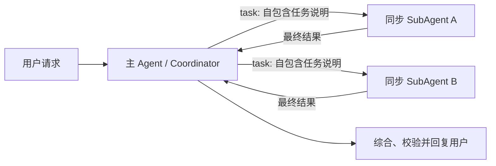

# 同步多 Agent 完整实现方案

> 状态：同步阶段已实现，生产安全仍依赖 `04-skill-filesystem-backend-permission-plan.md` 中的默认 Backend 与主 Agent 权限闭环。
> 适用版本：my-dify 当前工作区，DeepAgents 0.6.12。

## 1. 拍板结论

当前只支持一种多 Agent 拓扑：一个主 Agent 作为 Coordinator，通过 DeepAgents 原生同步 `task` 工具把自包含任务交给显式配置的 SubAgent，等待结果后由主 Agent综合并回复用户。

- 使用 `create_deep_agent(subagents=...)` 和原生 `SubAgentMiddleware`。
- 不实现异步 SubAgent、Swarm、peer 通信、递归委派或自建调度器。
- SubAgent 不继承父对话历史，只收到 `task.description`。
- 主 Agent必须先理解上下文，再生成自包含任务说明；不能把“理解上下文”转嫁给 worker。
- 工具、Skills 和文件写权限全部使用显式最小授权。
- DeepAgents 默认的 `general-purpose` worker 在线上关闭；空团队就不应出现 `task` 工具。
- TodoList 保存计划状态，并可作为主 Agent 下一步委派的依据；真正执行仍由主 Agent 调用原生 `task`，`write_todos` 本身不直接创建 SubAgent。

## 2. 运行拓扑



这是深度为 1 的星型结构。SubAgent 的工具集合中不存在 `task`，因此不能继续生成下一级 worker。不同 SubAgent 之间不直接通信，也不共享父对话状态；它们只通过主 Agent综合后的新任务间接衔接。

## 3. 为什么关闭 `general-purpose`

DeepAgents 默认自动加入名为 `general-purpose` 的通用同步 worker。它用于复杂搜索、查找文件和多步骤任务，默认继承主 Agent工具，并复用 backend、Skills 和文件权限。如果不处理，会产生两个平台问题：

1. App 没有配置团队时仍可能暴露 `task`，配置事实与运行能力不一致。
2. 这个 worker 的工具面不是 Creator 显式授权的角色白名单。

平台通过 DeepAgents 公开的 `HarnessProfile` 注册机制设置：

```python
HarnessProfile(
    general_purpose_subagent=GeneralPurposeSubagentProfile(enabled=False)
)
```

`create_deep_agent()` 当前不直接接收 profile 参数，因此 `harness_profile.py` 只负责把预构造 `BaseChatModel` 映射到框架使用的 `provider:model` 键。若模型 provider 无法识别，图构建失败；禁止静默回退到默认 worker。

## 4. 配置模型

`AppConfig.subagents` 是唯一权威配置，并随 DRAFT、PUBLISHED 和历史版本一起版本化。当前允许字段如下：

```json
[
  {
    "name": "researcher",
    "description": "搜索并归纳资料",
    "system_prompt": "你是严谨的研究员。",
    "mode": "sync",
    "context_passing": "NONE",
    "tools": ["web_search"],
    "skills": ["research"],
    "model": "openai:gpt-5.4"
  }
]
```

字段语义：

| 字段 | 当前规则 |
|---|---|
| `name` | App 内唯一的稳定路由键；小写字母开头，最多 64 位 |
| `description` | 给主 Agent看的职责和适用场景，决定是否委派 |
| `system_prompt` | SubAgent 的角色约束；运行时追加平台的无历史继承契约 |
| `mode` | 只接受 `sync`；保留字段用于 API 可读性和未来显式升级 |
| `context_passing` | 只接受 `NONE`；不复制父会话原文或生成第二套摘要 |
| `tools` | 业务工具名称白名单；空数组表示没有业务工具 |
| `skills` | 当前 App 已启用 Skill 名称的子集 |
| `model` | 可选的 DeepAgents 原生模型覆盖；省略时使用主模型 |

`graph_id`、`url`、`headers`、`k`、`timeout_seconds` 和 `max_concurrent_per_conversation` 在同步阶段全部拒绝。拒绝而非忽略可以避免 Creator 误以为已经获得超时、取消或远端执行保证。

## 5. 上下文装配

### 5.1 子 Agent 能看到什么

DeepAgents 原生同步委派会排除父 state 中的 `messages`、`todos` 和 `structured_response`。my-dify 的 account/app/conversation/end-user、workflow variables、召回事实和审核状态均用框架原生 `PrivateStateAttr` 标为父 Agent私有。SubAgent 的新消息列表只包含当前 `task.description`，主 Agent最终只收到 SubAgent 的最终消息。

主 Agent生成的任务说明必须包含：

1. 目标：要解决什么问题。
2. 输入：必要事实、路径、数据或引用。
3. 约束：范围、权限、格式、禁止事项。
4. 期望输出：返回给主 Agent的内容结构。
5. 验收标准：什么算完成，哪些不确定性必须声明。

不要出现“参考上文”“根据刚才讨论”“延续之前结果”等隐式引用。若后续步骤依赖前一个 worker 的结果，主 Agent必须先综合结果，再生成一份新的自包含任务说明。

### 5.2 为什么不支持 SUMMARY / RECENT_K

父对话已经由 LangGraph checkpoint 管理，并由 DeepAgents 原生 Summarization 负责主线程压缩。为 SubAgent 再写一套摘要器会产生第二套压缩语义、额外模型调用、敏感信息扩散和失败时回退原文的风险。

需要大输入时优先采用文件引用：主 Agent把受控材料写入 Workspace 或引用已有只读资源，再把精确路径放入任务说明。文件能力完成生产权限闭环前，SubAgent 仍保持只读。

## 6. 最小权限装配

### 6.1 业务工具

DeepAgents 的 `SubAgent.tools` 未提供时会继承主 Agent全部工具。因此平台始终传这个字段：

- `tools=[]`：无业务工具。
- `tools=[...]`：只传经过父工具集合校验的对象。
- 配置引用不存在或未授权工具：运行时构建失败。

SubAgent 永远不获得原生 `task` 委派工具，因此同步拓扑保持单层。

### 6.2 Skills

运行时先读取当前 App 已启用的 Skill 权威目录，然后为每个 SubAgent 创建只包含其绑定子集的只读 Backend 路由：

```text
/skills/                              主 Agent 可见的 App Skill 集合
/subagent_skills/researcher/          researcher 获准的 Skill 子集
/subagent_skills/writer/              writer 获准的 Skill 子集
```

对应 SubAgent 只接收自己的 source 根。配置引用未启用 Skill 时拒绝启动，不允许退化为整个 App Skill 目录。

### 6.3 文件系统

每个同步 SubAgent 当前显式设置 DeepAgents 原生文件权限：对 `/**` 的 `write` 操作为 `deny`；读取时拒绝主 Skill 目录、其他角色 Skill 目录、`/conversation_history/**` 和 `/memories/**`，仅先行放行本角色 Skill source。该规则会替换父 Agent权限，避免继承主 Agent写能力或绕过角色级 Skill/记忆隔离。

这只是同步 worker 的安全默认，不代表整个线上文件系统已经生产就绪。以下能力仍由文档 04 的权限阶段完成：

- 主 Agent 默认 Backend 改为拒绝型，只开放显式路由。
- App、account、conversation 和 end-user 的 ACL 与跨租户测试。
- 配额、审计、并发版本控制以及受控 Skill 脚本沙箱。
- 需要写文件的特定 SubAgent 权限模板和独立工作区/合并点。

生产闭环前不开放 Creator 自定义 SubAgent 写权限。

## 7. 同步执行生命周期

1. API 从发布或草稿 AppConfig 读取 `subagents`。
2. `AgentRuntimeService` 校验同步 schema，加载 App 的 enabled Skills，并生成角色级 Skill Backend 路由。
3. `build_deep_agent()` 注册关闭默认 worker 的 Harness Profile。
4. `build_subagent_specs()` 将工具名映射为父工具集合中的实际对象，始终传显式工具列表和角色 Skill source；非 Sandbox 传只读文件权限，Sandbox 按 DeepAgents 0.6.x 约束传空规则。
5. DeepAgents 原生 `SubAgentMiddleware` 注册 `task`；空团队时不注册。
6. 主 Agent选择角色并发出 `task(description, subagent_type)`。
7. EventTranslation 边界产生 `SUB_AGENT_DELEGATE`。
8. SubAgent 在隔离消息上下文中同步执行，把完整最终消息返回主 Agent。
9. EventTranslation 边界产生 `SUB_AGENT_END`。
10. 主 Agent检查证据、冲突和缺失项，综合成最终用户回复。

同步调用与当前请求同生共死。平台不承诺业务级硬超时：线程池 `future.cancel()` 无法终止已经运行的模型/工具调用，所以原实现已删除。请求超时应由 HTTP、模型客户端和工具自身的可取消超时共同承担；需要跨请求生命周期的任务进入异步阶段设计。

## 8. 事件与可观测性

当前可观测边界是 DeepAgents 原生 `task` 工具：

| 时点 | 事件 | 当前字段 |
|---|---|---|
| 主 Agent发起 `task` | `SUB_AGENT_DELEGATE` | 角色名、任务描述、tool call id |
| `task` 返回 Command/ToolMessage | `SUB_AGENT_END` | 角色名、最终结果、tool call id |

现有单数表 `message_agent_thought` 已通过 `d_v2_008` 增加 `agent_id`、`agent_type`、`parent_agent_id`、`delegation_id`、可空 `task_id` 和 Todo 快照。同步阶段使用 `delegation_id` 关联 DeepAgents tool call，`task_id` 只预留给未来后台异步任务；前端按 Agent 类型和委派关系展示轨迹。

应采集的核心指标包括委派次数、各角色成功率、延迟、模型与工具 token、失败类型、结果大小和权限拒绝次数。

## 9. 失败语义

- 配置错误、未知工具、未启用 Skill、模型 profile 无法绑定：图构建失败，不启动不安全的降级版本。
- SubAgent 工具或模型失败：由 DeepAgents 原生 task 结果返回主 Agent；主 Agent可改写任务后重试或自己处理。
- 信息不足：SubAgent 必须明确报告缺失输入，不得假设父会话内容。
- 多个 worker 结论冲突：主 Agent负责核验和裁决，不能把原始结果直接拼接给用户。
- 客户端断开或请求超时：当前不伪装成已取消；后台可持续任务必须等异步阶段具备持久化生命周期后再开放。

## 10. 当前代码映射

| 职责 | 文件 |
|---|---|
| 配置校验和 DeepAgents spec 适配 | `internal/core/agent_v2/subagents/specs.py` |
| 关闭隐式 `general-purpose` | `internal/core/agent_v2/runtime/harness_profile.py` |
| 原生图装配 | `internal/core/agent_v2/runtime/factory.py` |
| Workspace、Skills 与角色 Skill 路由 | `internal/service/agent_runtime_service.py` |
| LangChain Hook 适配 | `internal/core/agent_v2/middleware/event_translation_middleware.py` |
| task/Todo 事件语义与关联 | `internal/core/agent_v2/events/` |
| Creator 同步团队编辑 | `my-dify-ui/src/views/space/apps/components/abilities/SubagentsAbilityItem.vue` |

已删除的自建机制包括 `SubagentPolicyMiddleware`、父历史 SUMMARY/RECENT_K 注入、同步线程池超时和进程内异步 Timer 取消。

## 11. 验收矩阵

- 空团队：默认 `general-purpose` 为关闭状态，无隐式 worker。
- 配置：只接受同步模式和 NONE 上下文，异步/旧策略字段明确拒绝。
- 工具：空列表不会继承父工具；未知工具拒绝。
- Skills：每个角色只读到绑定子集；未启用引用拒绝。
- 文件：SubAgent 对任意路径写操作被 DeepAgents 权限规则拒绝。
- 上下文：runtime 不调用 LLM 生成 SubAgent 摘要，不复制历史消息。
- 委派：原生同步 SubAgent 图可编译，task 开始/结束事件可翻译。
- 入口：Debug、Assistant、WebApp、OpenAPI、WeChat 均使用统一 runtime bundle。
- 前端：只展示同步配置，空工具明确表示无业务工具。

当前聚焦验证命令：

```powershell
& .\.venv\Scripts\python.exe -m pytest `
  test\internal\core\agent_v2 `
  test\internal\service\test_agent_runtime_service.py `
  test\internal\service\test_subagent_config.py -q

npm --prefix ..\my-dify-ui run build
```

## 12. 后续阶段

同步能力完成后，按以下顺序继续：

1. 补齐主 Agent与 Backend 的生产权限闭环，以及可控的 SubAgent 写工作区。
2. 扩展委派轨迹字段和前端树形视图，补真实模型端到端委派。
3. 评估 DeepAgents 新版本是否提供稳定的原生异步生命周期；优先升级框架。
4. 只有框架仍缺平台必需的查询、取消、恢复和跨进程事件能力时，才设计最小的任务注册与事件适配。
5. 异步阶段必须具备持久化任务 ID、查询/取消、进程重启恢复、并发配额、超时、审计和通知，不能复用当前同步调用冒充后台任务。

Swarm、peer-to-peer 和递归委派不在当前路线内。若以后引入，必须作为与 Coordinator 互斥的新模式，先定义深度、上下文、文件隔离、所有权和取消语义。
