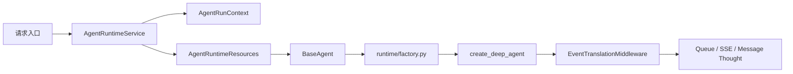

# Agent V2 运行时架构

本文描述当前代码的真实职责边界。Agent V2 的任务是把平台配置转换为
DeepAgents 应用参数，不重新实现 Agent 状态机、文件工具、记忆加载、摘要
压缩或 SubAgent 调度。

## 1. 总体流程



一次运行的顺序是：

1. 入口校验 Account、App、Conversation 和 EndUser。
2. `AgentRuntimeService` 创建不可变的 `AgentRunContext`。
3. `AgentContextAssembler` 创建 Checkpoint、Store、Backend、Skill 路由、
   Workspace、Sandbox、权限和 telemetry。
4. 入口把前端 AppConfig 转换为 `AgentConfig`，包含模型、提示词、工具、
   Review 和 SubAgent 配置。
5. `BaseAgent` 将 `AgentConfig` 与 `AgentRuntimeResources` 传给
   `runtime/factory.py`。
6. `build_deep_agent()` 调用 `create_deep_agent()`。
7. 执行时只传入 `messages`、稳定 `thread_id` 和本次 `context`。

## 2. State、Context 和 Config

### 2.1 图 State

项目不定义自有 Agent State，也不维护以下字段：

- `history`
- `iteration_count`
- `task_id`
- `account_id`
- `app_id`
- `conversation_id`
- `memory`

`create_deep_agent()` 使用 DeepAgents 原生 State。当前运行中由框架维护：

- `messages`
- 原生 Todo 字段
- 原生 filesystem 字段
- Skills、摘要和其他 middleware 的私有字段

调用轮次限制由 `ModelCallLimitMiddleware(run_limit=...)` 和
`ToolCallLimitMiddleware(run_limit=...)` 完成，不进入 State。

### 2.2 运行时 Context

`AgentRunContext` 是 LangGraph/DeepAgents 的 `context_schema`，只保存本次
运行由服务端确认的不可变身份：

- `account_id`
- `app_id`
- `conversation_id`
- `created_by`
- `end_user_id`
- `agent_id`

它通过 `graph.stream(..., context=runtime_context)` 进入运行时。工具、
StoreBackend namespace factory 和自定义 middleware 可以读取它；它不会自动
出现在模型提示词中。

### 2.3 平台配置

`AgentConfig` 不是图 State，也不是运行时 Context。它是前端/数据库配置到
DeepAgents 参数的业务输入模型，主要包括：

- 模型调用对象；
- App 名称、说明、预设提示词和开场白；
- 已授权工具；
- Review 配置；
- `max_model_calls`、`max_tool_calls`；
- 同步 SubAgent 配置。

## 3. 线程与持久化

`ThreadIdentity` 生成稳定的 LangGraph `thread_id`：

```text
account_id + app_id + conversation_id + agent_id
```

`runtime/thread_config.py` 只负责把可信的 thread ID 和 metadata 合并进
调用配置，并覆盖客户端传入的同名租户字段。

短期记忆由：

```text
checkpointer + thread_id
```

负责。生产使用 `PostgresSaver`，开发或离线场景才使用 `InMemorySaver`。
原始 `Message` 仍是业务展示、审计和入口数据源，但不再由 Agent V2 手工
拼接成 `history` State。

## 4. Backend 路由

`runtime/assembly.py` 只负责组装路由，具体文件操作由 Backend 实现。

非 Sandbox 模式：

```text
CompositeBackend
├── default                         -> StateBackend
├── /workspace/                     -> MyDifyWorkspaceBackend
├── /artifacts/                     -> MyDifyWorkspaceBackend
├── /skills/                        -> SkillCatalogBackend(read-only)
├── /subagent_skills/<name>/        -> SkillCatalogBackend(read-only)
└── /memories/                      -> StoreBackend
```

启用官方 Sandbox 后，Sandbox 成为 `CompositeBackend.default`，而
Workspace、Skill 和 Memory 继续使用各自的显式路由。

`/workspace/` 和 `/artifacts/` 的既有文件在 Sandbox 创建时上传，运行结束
后再同步回 `workspace_files`。原生 `execute` 只在 SandboxBackend 存在时
由 DeepAgents FilesystemMiddleware 暴露，项目不注册自定义 shell 或脚本工具。

DeepAgents 的 `/conversation_history/` 和 `/large_tool_results/` 属于框架
内部路径，由原生 StateBackend、SummarizationMiddleware 和 FilesystemMiddleware
处理，不再映射到 MyDify Workspace。

## 5. Skills

Skills 使用 DeepAgents 原生 `skills=` 和 `SkillsMiddleware`：

1. `SkillService` 返回当前 App 已授权的内置 Skill。
2. `SkillContextAssembler` 校验主 Agent 和 SubAgent 的 Skill 子集。
3. `SkillCatalogBackend` 将已授权包投影成只读虚拟文件。
4. `SkillsMiddleware` 首先读取 frontmatter，再按需读取完整 `SKILL.md`。

项目不复制 Skill 发现、frontmatter 解析或渐进式加载算法。Skill 目录不是
Memory，也不能写入。

## 6. 记忆和压缩

### 6.1 长期文件记忆

长期记忆使用 DeepAgents 原生：

```text
CompositeBackend("/memories/" -> StoreBackend)
StoreBackend(namespace=memory_namespace_from_runtime)
create_deep_agent(memory=["/memories/AGENTS.md"], store=store)
```

命名空间由 `AgentRunContext` 生成：

```text
("mydify", account_id, app_id, end_user_id_or_account)
```

因此每个租户、App 和终端用户都拥有独立的 `/AGENTS.md` 文件。逻辑上都
叫 `/AGENTS.md`，但物理 Store namespace 不同，不会写入一个共享文件。
是否启用长期 Store 由 `AGENT_MEMORY_BACKEND` 决定。

### 6.2 上下文压缩

DeepAgents 自动装配 `SummarizationMiddleware`。它负责：

- 大工具结果外置；
- 对话历史摘要；
- 摘要触发和消息替换；
- 必要时通过 Backend 读取外置内容。

项目不实现 token 计算、历史裁剪、摘要器或 `history` 冷启动字段。

## 7. SubAgent 和 Todo

`create_deep_agent()` 原生提供 `write_todos` 和 `task`。项目只做配置适配：

- SubAgent 只接受同步 `mode=sync`；
- `context_passing` 固定为 `NONE`；
- 工具只能是主 Agent 已授权工具的子集；
- Skill 只能是主 Agent 已挂载 Skill 的子集；
- 子 Agent 不继承父对话和父记忆；
- 通过 Harness Profile 关闭隐式 `general-purpose` worker。

Todo、委派和工具事件通过 `EventTranslationMiddleware` 翻译为 MyDify
的 QueueEvent。项目不创建 `AgentRuntimePlan`、计划表或第二套调度器。

## 8. 目录职责

| 目录 | 职责 |
|---|---|
| `agents/` | 业务调用、队列、结果聚合和图执行驱动 |
| `runtime/` | DeepAgents 参数装配、提示词、线程配置、SubAgent 配置和 telemetry |
| `backends/` | BackendProtocol 的业务适配器 |
| `persistence/` | PostgresSaver、PostgresStore 和 WorkspaceRepository |
| `middleware/` | 仅保留运行时间、审核和事件翻译等业务 middleware |
| `events/` | LangChain 消息/Command 到 QueueEvent 的纯翻译 |

已删除的 `state/`、`contract/`、`entities/`、`context/`、`memory/` 和
`subagents/` 源码目录不再作为架构入口。`AgentRunContext` 和
`AgentRuntimeResources` 归入 `runtime/models.py`。
