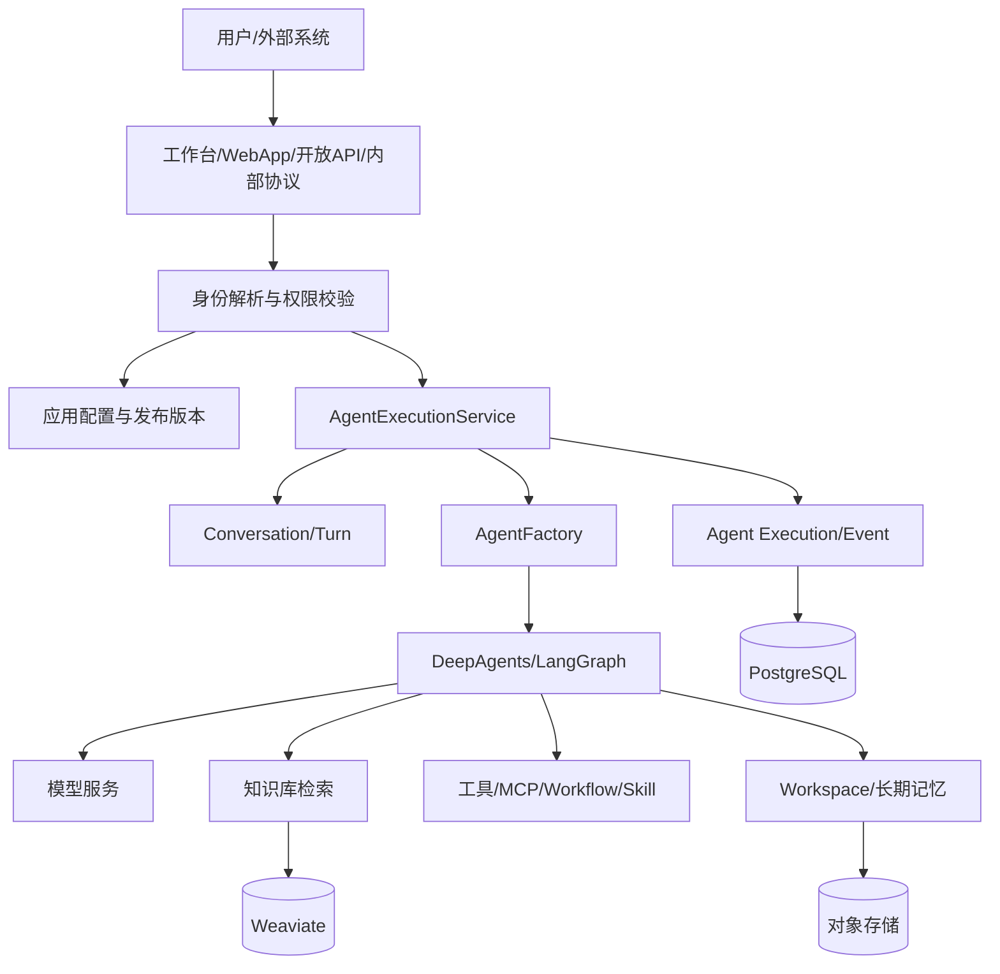

# 平台文档目录与整体架构

## 1. 项目一句话介绍

这是一个 Agent 应用平台：用户可以创建和发布 Agent 应用，为应用配置模型、提示词、知识库、工具、工作流、Skill、长期记忆和审核能力；终端用户通过工作台、WebApp 或开放 API 发起任务，平台将每次提问转换为可恢复的 Agent Execution，并以事件流返回执行过程，最终沉淀为可查询、可评测、可分析的数据。

## 2. 推荐阅读顺序

理解具体代码、设计取舍和技术难点，先看 [模块实现详解目录](implementation/README.md)。该目录按当前源码核对，覆盖配置装配、运行生命周期、事件与前端、子 Agent、上下文与记忆、知识库、能力集成、文件交付、多入口、测评和部署，共 11 个专题。

按运行时组件（执行器、编排、中间件、工具、记忆、事件、恢复、测评）看「当前怎么做」，见 [组件地图](../components/00-组件地图.md)。与实现详解交叉引用，不重复业务链路。

以下原有文档保留业务概览和对外讲解用途；其中改进建议不代表已经实现，具体行为以实现详解和所引用源码为准。

1. [身份与应用配置](01-身份与应用配置.md)：先理解谁拥有资源、应用如何编辑和发布。
2. [Agent 运行时与会话](02-Agent运行时与会话.md)：理解平台最核心的一次请求如何执行。
3. [知识库与 Agent 能力](03-知识库与Agent能力.md)：理解 Agent 如何获得知识和外部动作能力。
4. [交付入口与质量运营](04-交付入口与质量运营.md)：理解同一套能力如何服务不同入口。
5. [数据库与工程实现](05-数据库与工程实现.md)：理解表设计、工程落点、风险和排障。
6. [面试讲解稿](06-面试讲解稿.md)：按项目介绍、难点、取舍和追问组织表达。
7. [简历项目描述](07-简历项目描述.md)：提供“总结：具体描述”格式的简历成稿、量化指标模板和不同篇幅版本。
8. [个人负责版简历描述](08-个人负责版简历项目描述.md)：根据 Git 演进历史突出前后端与 Agent 全栈负责，以及 LangGraph 到 DeepAgents 的架构升级。

## 3. 总体组成

## 4. 一次请求的主链路

入口解析身份和 `invoke_from`；Service 锁定会话并完成幂等检查；事务内创建 Turn 和 Execution；Factory 读取草稿或发布配置并装配 Agent；Core 执行模型、检索和工具；事件编号后实时发布，由独立线程合批落库；结束前排空尾批，再结算答案、用量、状态和错误。客户端以快照和配套水位恢复，再衔接后续事件。实时发布早于持久化的边界见 [事件实现](implementation/03-事件协议与前端流式体验.md)。

## 5. 核心术语

| 术语 | 含义 |
|---|---|
| Account | 平台认证身份，拥有应用和资源 |
| End User | 某个应用范围内的终端消费者 |
| App | 可配置、可调试、可发布的 Agent 应用 |
| Conversation | 持续的对话容器 |
| Conversation Turn | 一次用户问题和 Agent 回答 |
| Agent Execution | 一轮 Turn 的可恢复执行过程 |
| Agent Event | 执行过程中可推送、可重放的事件 |
| Agent Definition | 运行时实际使用的模型、提示词和能力集合 |

