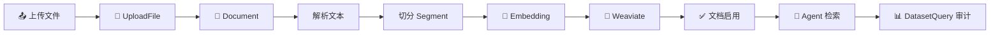

# Agent 运行时、会话、事件和执行生命周期

本文档按业务域拆分，统一描述业务需求、业务运转流程、数据库设计、代码实现和面试讲解重点。总目录见 [平台文档目录](00-平台总览.md)。

具体实现见 [运行生命周期](implementation/02-会话与运行生命周期.md)、[事件与前端](implementation/03-事件协议与前端流式体验.md)、[上下文与记忆](implementation/05-提示词上下文压缩与记忆.md)。本篇后半部分保留业务讲解，技术边界以专题及源码为准。

## 4. 模块三：会话、任务和 Agent 执行

### 4.1 业务流程

1. 用户在调试页、WebApp、任务中心、开放 API 或内部协议提交输入。
2. 服务端解析可信身份和固定 `invoke_from`，创建或复用 Conversation。
3. 事务内锁定 Conversation，做输入消息幂等和运行冲突检查。
4. 创建 Conversation Turn、Agent Execution，并冻结执行输入和配置指纹。
5. 后台线程装配 Agent：读取配置、解析模型、授权工具/知识库/Skill、创建 LangGraph。
6. 执行期间写入规范化事件，SSE 推送给前端；断线可按序号续传。
7. Agent 缺信息时进入 `waiting_input`，提交答案后恢复同一个 Execution；用户可取消运行。
8. 结束后写入答案、用量、耗时、状态和快照，Execution 进入 `completed/failed/cancelled`。

状态机：`running → completed|failed|cancelled|waiting_input`，`waiting_input → running`。取消待填 Run 会清除其待填写内容，已取消 Run 不能恢复；新的普通提问创建新 Run。

### 4.2 数据库设计

| 表 | 关键字段 | 作用 |
|---|---|---|
| `conversation` | `app_id,invoke_from,owner_account_id,created_by,is_pinned,is_deleted` | 稳定会话和授权归属 |
| `conversation_turn` | `conversation_id,query,answer,status,token_usage,total_price,trace_id` | 一轮问答业务记录 |
| `agent_execution` | `conversation_id,turn_id,status,execution_options,pending_inputs,input_history,display_state,last_event_sequence,executor_id,cancel_requested_at` | 可恢复的执行生命周期 |
| `agent_execution_event` | `execution_id,sequence,payload` | 有序事件和断线续传 |
| `agent_execution_submission` | `execution_id,input_batch_id,answers,accepted_sequence` | 表单答案幂等记录 |

实现要点：

- Conversation 行 `SELECT FOR UPDATE` 串行化同会话启动。
- 部分唯一索引保证一个会话最多一个占用中的 Execution、一个输入消息只创建一次运行。
- `executor_id` 表示当前执行片段；恢复时换新，结算时清空。
- 实时事件先进入有界待写队列并发布，再由独立线程合批落库；业务终态在结算提交后形成，客户端按快照水位衔接后续事件。
- `cancel_requested_at` 是业务事实；跨进程部署应增加 Redis Pub/Sub 或队列取消信号，不能只依赖进程内事件。
- 当前孤儿收敛依赖进程内 Tracker，多 worker 部署前应改为租约/心跳或共享执行注册表。

### 4.3 代码实现

- Service：`internal/service/agent`、`internal/service/conversation`。
- Core：`internal/core/agent_v2`。
- 事件协议：`internal/service/agent_protocol`。
- Handler：`internal/handler/agent*`。
- 前端：`src/hooks/use-agent-workbench.ts`、`src/hooks/use-conversation.ts`、`src/views/tasks`。

## 12. 面向讲解的模块拆解

下面每个模块都按“谁使用、解决什么问题、主流程、核心数据、代码如何落地、异常怎么处理”来说明。向其他人介绍时可以按这个顺序讲，听众先理解业务，再看技术实现。

### 12.1 账号与权限：先回答“谁能操作什么”

**业务角色**有三种：Account 是平台账号，负责创建和管理资源；Application Owner 是某个 App 的拥有者；End User 是应用外部消费者，只在该 App 范围内有效。一个 Account 可以同时是某个 App 的 Owner，也可以通过 WebApp 作为另一个 App 的 End User。

**权限判断顺序**固定为：解析凭证 → 得到可信主体 → 确认资源所属账号或应用 → 确认入口允许的状态 → 执行业务。请求体中传入的 `account_id`、`owner_account_id` 和 `invoke_from` 都不能覆盖服务端解析结果。

**示例**：用户在调试页打开 App A，JWT 得到 Account 1，服务端查询 `app.account_id=Account 1` 且 `invoke_from=debugger`；同一个人打开 App B 的 WebApp 链接时，身份可能是 End User 2，服务端只能访问 App B 发布配置和允许的会话。

**失败处理**：凭证无效返回 401；资源不属于主体返回 403 或统一的资源不存在；应用未发布时 WebApp 返回不可用；API Key 被禁用后立即拒绝新请求，但不影响已经开始的运行。

### 12.2 应用配置：把能力组合成一个可发布产品

一个 App 不是单独的模型调用，而是一份 Agent Definition。它至少包含：模型连接、系统提示词、工具、工作流、知识库、Skill、SubAgent、用户提问、长期记忆、审核、语音和展示配置。

**草稿与发布的区别**：调试使用草稿定义，生产入口使用发布定义；运行装配读取当次有效配置，恢复校验定义指纹。发布绑定不代表外部工具、远端服务和知识库内容也全部冻结，完整复现范围需要单独核对。

**保存配置的具体步骤**：

1. Handler 解析请求并校验字段格式。
2. App Service 查询所有被引用的工具、Workflow、Dataset、Skill 和模型连接。
3. 验证这些资源属于当前 Account、未被禁用、数量在上限内。
4. 对 JSONB 配置补齐默认值并生成规范化结构。
5. 在一个事务中更新草稿和更新时间。
6. 发布时复制配置、更新 App 指针及绑定、追加递增历史版本；当前这些步骤涉及多次事务，不是原子发布。

**为什么保留版本**：发布版本是线上问题定位和测评的依据。没有版本快照，就无法回答“这次回答使用了哪个提示词、哪个模型和哪一版知识库”。

### 12.3 Agent 运行时：平台的核心生产链路

一次用户提问至少对应四个对象：

| 对象 | 解决的问题 | 是否跨多轮 |
|---|---|---|
| Conversation | 这些提问属于哪个持续会话 | 是 |
| Conversation Turn | 这一轮用户问了什么、Agent 答了什么 | 否 |
| Agent Execution | 这一轮实际执行如何暂停、恢复、取消 | 可能跨多个执行片段 |
| Agent Event | 执行过程中发生了哪些可展示事件 | 属于一个 Execution |

**启动阶段**先做业务一致性，再启动线程：锁会话、检查同会话是否已有 `running/waiting_input`、处理输入消息幂等、写入 Turn 和 Execution。只有事务提交后才启动执行线程，防止线程提前执行而数据库回滚。

**装配阶段**由 `AgentFactory` 完成：读取入口对应的草稿或发布配置；解析模型连接；加载 Skill；校验和构造工具；绑定 Dataset 检索器；配置 Workspace、长期记忆、审核和用户提问；生成运行上下文。Agent Core 只接收已经授权和解析好的定义，不直接决定平台权限。

**执行阶段**由 LangGraph/DeepAgents 驱动：模型产生思考和工具调用，工具返回观察结果，必要时通过 `ask_user` 产生中断。事件经过规范化和协议投影后，同时落库和推送。

**结算阶段**根据 Core 结果决定状态：有答案且正常结束为 `completed`；异常为 `failed`；收到取消并排空执行为 `cancelled`；等待用户表单为 `waiting_input`。结算时统一更新答案、用量、延迟、错误、快照和最终事件。

### 12.4 事件流：为什么既要 SSE 又要数据库

SSE 适合实时体验，数据库适合可靠性。事件写入采用单调递增 `sequence`，客户端记录最后一个序号；重连时携带起点，服务端查询大于该序号的事件。这样即使网络断开、浏览器刷新或 Worker 重启，也不会丢失已经提交的事件。

事件大致分为四类：

1. `lifecycle`：preparing、running、waiting_input、completed、failed、cancelled。
2. `messages`：用户消息、Agent 答案、答案增量。
3. `tools`：工具开始、参数、结果、错误。
4. `values/input`：状态快照、待填表单、用户提交结果。

客户端不应把某一次 SSE 推送当作最终事实；最终状态以状态查询和已持久化事件为准。

### 12.5 Dataset/RAG：从文件变成可引用知识

知识库的处理不是一次同步接口，而是一条异步数据管道：

数据库中的 `Document` 和 `Segment` 是处理状态和权限事实，`Segment.node_id` 对应向量节点。任何一个阶段失败都要写入状态和错误，不要只在日志中记录，否则前端无法展示、任务无法重试。

**检索时**先校验 App 是否绑定 Dataset，再按 App 的 `retrieval_config` 执行 Top-K、相似度阈值和关键词过滤，最后把片段转成模型上下文。检索结果应包含 Dataset、Document、Segment 标识，便于答案引用、命中统计和问题追踪。

### 12.6 工具与工作流：把外部动作接入 Agent

API Tool 是“调用一个外部 HTTP 接口”；MCP 是“连接一个 MCP Server 并发现多个工具”；Workflow 是“执行一张预定义图”；Skill 是“给 Agent 增加一组稳定的行为指令和资源”。它们虽然形态不同，但在运行时都被转换成 Agent 可调用的能力。

绑定流程是：资源创建/发现 → 资源校验 → 加入草稿 → 发布冻结 → AgentFactory 装配 → 执行并记录事件。工具的密钥不应出现在事件 payload 和普通日志中；工具错误需要区分“参数校验失败、网络失败、外部业务失败、超时”四类，方便重试和产品提示。

### 12.7 Workspace 与长期记忆：区分文件和对话

Workspace 是 Agent 可读写的文件空间，适合中间产物、报告、代码和用户上传内容；长期记忆是跨会话保留的信息，适合偏好、事实和总结。两者都可以落到文件系统，但业务开关、权限范围和清理策略不同。

文件写入采用“路径规范化 → 作用域校验 → revision 校验 → 对象存储写入 → 元数据提交”。如果 revision 不匹配，返回冲突而不是静默覆盖。下载和预览必须重新做鉴权，不能因为拿到了 `object_key` 就直接访问对象存储。

### 12.8 测评与分析：把运行结果转成质量反馈

测评不修改生产会话，而是引用历史 Execution 并保存独立的 `source_snapshot`。历史评分冻结任务文本与回答，不包含完整工具轨迹和外部执行证据；执行验收另用隔离环境，不能称为完整生产回放。评测标准、Judge 配置和评测器版本一起保存，明确评分依据。

分析模块读取 Turn 的消息量、Token、价格、延迟和状态，按 App、时间、账号和入口聚合。高频指标建议异步汇总；明细数据继续保留，用于下钻到某次会话和某个事件。

