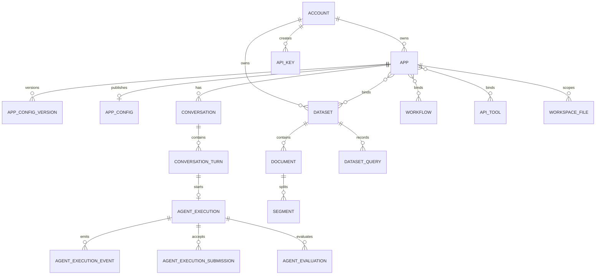

# 数据库关系、实施顺序、风险、排障和接口代码对照

本文档按业务域拆分，统一描述业务需求、业务运转流程、数据库设计、代码实现和面试讲解重点。总目录见 [平台文档目录](00-平台总览.md)。

## 10. 推荐的端到端实现顺序

1. 先稳定 Account、App、Conversation、Turn、Execution 五个核心聚合及鉴权边界。
2. 完成 App 草稿/发布事务、配置 Schema 和引用资源校验。
3. 完成 Execution 状态机、事件持久化、幂等、取消和断线续传，再接入具体模型。
4. 接入 Dataset/RAG，明确关系库与向量库的一致性和重建策略。
5. 接入 API Tool、MCP、Workflow、Skill，并实现发布配置快照。
6. 接入 Workspace/长期记忆和 WebApp/开放 API 交付入口。
7. 最后建设 Evaluation、分析汇总、渠道和运营能力。

## 11. 当前实现需要优先关注的事项

- **多进程执行一致性**：孤儿 Run 判定和取消信号当前主要依赖进程内状态，扩容前应引入共享租约或消息机制。
- **配置 JSONB 演进**：增加 schema_version、发布快照指纹和迁移器，避免前后端字段漂移。
- **资源删除策略**：工具、工作流、Dataset、Skill 被已发布应用引用时应禁用或生成新版本，避免运行时找不到依赖。
- **敏感信息保护**：API Key、Provider Key、MCP Header/Env、OAuth Token 必须加密或哈希，并在日志中脱敏。
- **异步任务可观测性**：文档索引、Agent Execution、Evaluation 均应有 trace_id、重试次数、租约和死信处理。
- **统一术语**：Account 是平台身份，End User 是应用消费者，Conversation 是持续会话，Conversation Turn 是一轮问答，Agent Execution 是可恢复执行；不要混用 User、Task、Run 表示不同实体。

## 13. 数据库关系总览

这里的连线表达业务关系，实际代码部分表没有声明数据库 Foreign Key，这是当前模型的一个维护风险。对于核心关系，建议补齐 FK 或在 Service 层建立统一的存在性和软删除校验。

## 16. 运维与排障思路

遇到“请求没有返回”时，先检查 `agent_execution.status` 和 `last_event_sequence`，再看是否有事件记录；遇到“页面显示运行但后台没有进度”时，检查执行权 `executor_id`、Tracker/租约和 Worker 日志；遇到“知识库搜不到”时，依次检查 Document/Segment 状态、Embedding 指纹、Weaviate 节点和 Dataset 绑定；遇到“工具突然不可用”时，检查资源是否被禁用、发布快照是否仍引用旧版本以及凭证是否过期。

建议所有异步链路统一携带 `trace_id`、`app_id`、`conversation_id`、`turn_id`、`execution_id`，日志中禁止打印完整 Token、API Key、Authorization Header、MCP Header 和用户隐私内容。

## 17. 页面、接口与后端模块对照

| 前端功能 | 典型页面/Hook | 主要接口域 | 后端 Service/Model |
|---|---|---|---|
| 应用列表与编辑 | `views/space/apps`、`use-app.ts` | `/apps` | `service/app`、`model/app.py` |
| 调试运行 | `use-agent-workbench.ts` | `/apps/{id}/conversations/*` | `service/agent`、`agent_execution.py` |
| 任务中心 | `views/tasks` | `/tasks/*` | `service/conversation`、`service/agent` |
| WebApp 对话 | `views/web-apps`、`use-web-app.ts` | `/web-apps/{token}/*` | `service/agent`、`end_user.py` |
| 知识库 | `views/space/datasets`、`use-dataset.ts` | `/datasets/*` | `service/dataset`、`model/dataset.py` |
| 工具与工作流 | `views/space/tools`、`workflows` | `/tools/*`、`/workflows/*` | `service/tool`、`service/workflow` |
| Workspace | `WorkspaceFilesPanel.vue` | `/workspace-files/*` | `service/file`、`workspace_file.py` |
| 测评 | `EvaluationView.vue` | `/evaluations/*` | `service/agent_evaluation`、`agent_evaluation.py` |
| 开放 API 管理 | `views/openapi` | `/openapi/*` | `service/api_key`、`service/agent` |

接口层只负责协议形状和错误码，跨入口复用的规则必须下沉到 Service。例如“同一会话不能同时运行两个任务”不能只写在 WebApp Handler，否则调试页和开放 API 会绕过约束。

