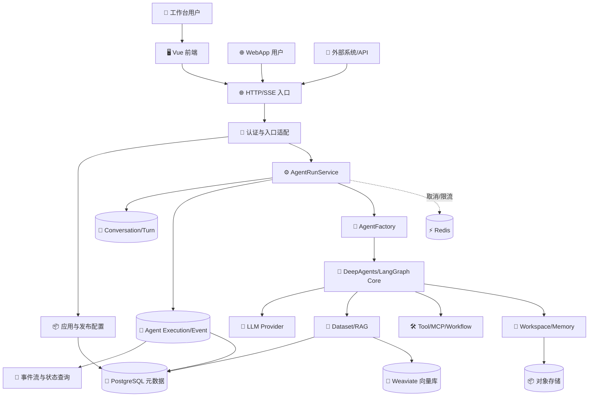
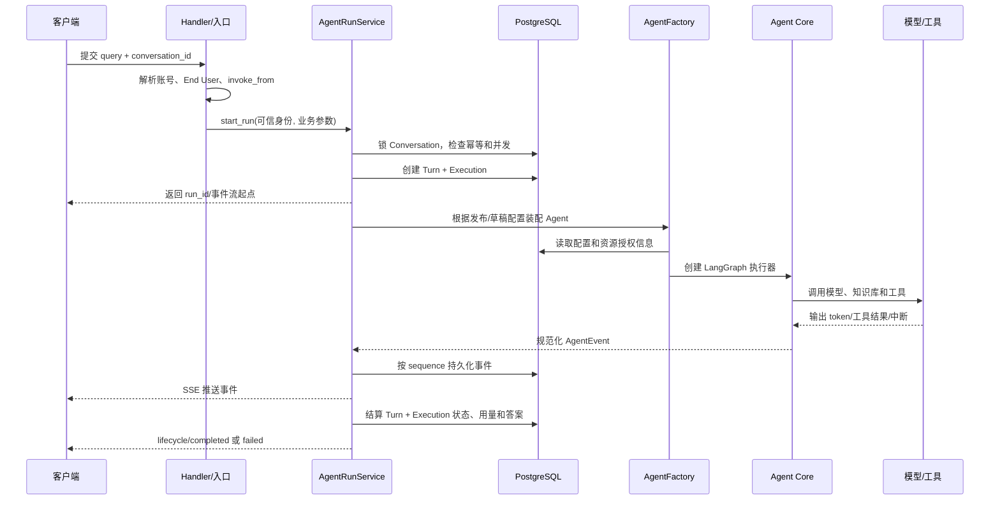
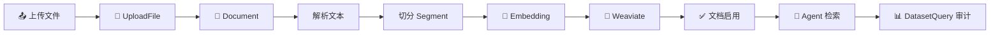
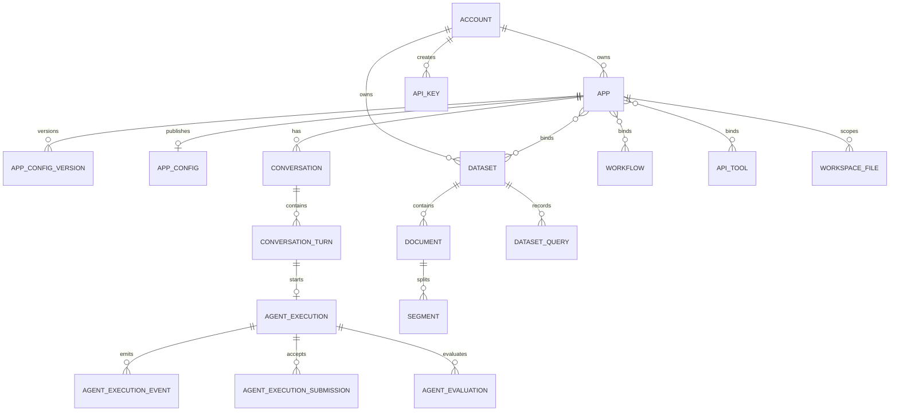

# 平台业务模块与实现方案

本文基于当前仓库的后端 `my-dify`、前端 `my-dify-ui`、`internal/model`、`internal/service`、`internal/handler` 和现有 Agent 文档整理。目标是把业务流程、数据模型和代码落点串起来，便于产品、后端、前端和数据库协作。

> 本文保留为完整合并版。面向分享、培训和面试时，建议从 [平台文档目录](platform/00-平台总览.md) 进入，按业务域阅读拆分后的文档。

## 1. 平台整体分层

平台可以划分为六层：

1. **身份与资源层**：Account、API Key、End User、应用归属和权限。
2. **Agent 定义层**：应用基础信息、模型、提示词、工具、工作流、知识库、Skill、记忆和审核配置。
3. **知识与能力层**：Dataset/RAG、API Tool、MCP、Workflow、Skill、Provider API Key。
4. **运行时层**：Conversation、Conversation Turn、Agent Execution、事件流、输入中断、取消和恢复。
5. **交付层**：WebApp、开放 API、内部 Agent Protocol、Workspace 文件、长期记忆和语音渠道。
6. **运营与质量层**：Agent Evaluation、应用分析、运行历史和错误追踪。

核心原则是：应用配置决定 Agent Definition；一次用户提问创建一个 Conversation Turn 和一个 Agent Execution；Execution 产生可重放的协议事件；入口只负责身份解析和协议适配，实际编排集中在 `internal/service/agent`，图执行集中在 `internal/core/agent_v2`。

### 1.1 用一句话理解平台

可以把平台理解成“**Agent 应用管理后台 + Agent 执行引擎 + 面向多个渠道的运行服务**”：账号在后台配置一个应用，应用把模型、提示词、知识、工具和记忆组合起来；用户从工作台、WebApp 或 API 发起请求；平台将请求转换为一次可恢复的 Agent Execution；执行过程以事件流返回，最终形成可查询、可重放、可评测的业务记录。

### 1.2 系统组件关系

### 1.3 一次请求如何运转

这条链路中，HTTP 请求只负责“接单”，真正执行在后台运行片段中完成。客户端断线后重新请求事件流，服务端按 `last_event_sequence` 读取数据库继续发送，因此事件表是事实来源，内存通知只负责降低延迟。

### 1.4 三类数据的边界

| 数据类型 | 示例 | 保存位置 | 生命周期 |
|---|---|---|---|
| 配置数据 | 模型、提示词、工具绑定 | `app_config`/`app_config_version` | 草稿编辑、发布冻结、历史保留 |
| 业务事实 | 会话、问答、执行状态、用量 | PostgreSQL 业务表 | 长期保留，可查询和统计 |
| 运行过程 | token 事件、工具事件、表单中断 | `agent_execution_event` + LangGraph checkpoint | 执行期间产生，供重放和恢复 |

不要把三类数据混在一个 JSON 字段中：配置需要版本，业务事实需要索引和权限，运行过程需要顺序和幂等。

## 2. 模块一：账号、身份与权限

### 2.1 业务流程

1. Account 登录后取得 JWT，工作台请求从 JWT 得到平台账号。
2. 开放 API 使用 API Key 映射到 Account，并校验 `is_active`。
3. WebApp/外部渠道使用应用范围内的 End User；End User 可以关联 Account，但不等同于应用所有者。
4. 每个资源查询都同时校验 `account_id`、资源归属、应用状态和调用入口 `invoke_from`。
5. 内部 Agent Protocol 使用带 HMAC 的短期 Token，服务端再次核对父应用、目标应用和发布状态。

### 2.2 数据库设计

| 表 | 关键字段 | 作用 |
|---|---|---|
| `account` | `id,name,email,password,password_salt` | 平台身份和登录信息 |
| `account_oauth` | `account_id,provider,openid,encrypted_token` | 第三方登录绑定 |
| `api_key` | `account_id,api_key,is_active` | 开放 API 凭证 |
| `end_user` | `app_id,account_id` | 应用内终端用户身份 |
| `provider_api_key` | `account_id,provider_name,api_key,base_url,enabled_models` | 模型服务连接 |

建议：凭证只存哈希或加密密文；`api_key`、OAuth Token、模型密钥建立唯一索引和轮换字段；所有资源表都保留 `account_id`，避免仅依赖应用关联推导权限。

### 2.3 代码实现

- 模型：`internal/model/account.py`、`api_key.py`、`end_user.py`、`provider_api_key.py`。
- 认证：`internal/middleware/middleware.py`、`JwtService`、`ApiKeyService`。
- 业务边界：各入口 Service 的 `get_owned_*` 方法统一做归属校验。
- 前端：`src/stores/account.ts`、`src/hooks/use-auth.ts`。

## 3. 模块二：应用配置、草稿与发布

### 3.1 业务流程

1. 账号创建应用，填写名称、图标、描述。
2. 前端读取草稿配置，修改模型、提示词、工具、工作流、知识库、Skill、记忆、提问和审核开关。
3. 后端校验引用资源归属、数量上限、模型连接和配置结构，保存草稿。
4. 调试入口读取草稿；WebApp、开放 API 和其他生产入口读取已发布配置。
5. 发布时生成递增版本并复制配置快照，更新 `app.app_config_id` 和 `status=published`。
6. 取消发布清空生产配置引用；历史版本可以回退到草稿，再次发布。
7. 发布后生成 WebApp Token；重新生成 Token 会使旧链接失效。

### 3.2 数据库设计

| 表 | 关键字段 | 作用 |
|---|---|---|
| `app` | `id,account_id,name,token,status,app_config_id,draft_app_config_id` | 应用主实体和发布指针 |
| `app_config` | `app_id,model_config,preset_prompt,skills,subagents,tools,workflows,retrieval_config,long_term_memory,user_input,...` | 当前生产配置 |
| `app_config_version` | 同上 + `version,config_type` | 草稿和发布历史快照 |
| `app_dataset_join` | `app_id,dataset_id` | 应用与知识库关系 |

当前配置采用 JSONB，适合快速扩展，但应在 Service 层做 Pydantic schema 校验、默认值填充、数量限制和引用资源白名单校验。发布事务必须同时完成版本写入和 App 指针更新，避免出现“版本已发布但应用仍指向旧配置”。建议为 `(app_id, config_type, version)` 建唯一索引，为 `token` 建唯一索引。

### 3.3 代码实现

- Service：`internal/service/app`、`agent_definition_service.py`。
- Handler：`internal/handler/app`。
- Schema：`internal/schema/app/app_config_schema.py`。
- 前端：`src/views/space/apps`、`src/hooks/use-app.ts`。

## 4. 模块三：会话、任务和 Agent 执行

### 4.1 业务流程

1. 用户在调试页、WebApp、任务中心、开放 API 或内部协议提交输入。
2. 服务端解析可信身份和固定 `invoke_from`，创建或复用 Conversation。
3. 事务内锁定 Conversation，做输入消息幂等和运行冲突检查。
4. 创建 Conversation Turn、Agent Execution，并冻结执行输入和配置指纹。
5. 后台线程装配 Agent：读取配置、解析模型、授权工具/知识库/Skill、创建 LangGraph。
6. 执行期间写入规范化事件，SSE 推送给前端；断线可按序号续传。
7. Agent 缺信息时进入 `waiting_input`，提交答案后恢复同一个 Execution；用户可取消运行。
8. 结束后写入答案、用量、耗时、状态和快照，Execution 进入 `completed/failed/cancelled`。

状态机：`running → completed|failed|cancelled|waiting_input`，`waiting_input → running`；等待输入的取消可通过重新填写恢复。

### 4.2 数据库设计

| 表 | 关键字段 | 作用 |
|---|---|---|
| `conversation` | `app_id,invoke_from,owner_account_id,created_by,is_pinned,is_deleted` | 稳定会话和授权归属 |
| `conversation_turn` | `conversation_id,query,answer,status,token_usage,total_price,trace_id` | 一轮问答业务记录 |
| `agent_execution` | `conversation_id,turn_id,status,execution_options,pending_inputs,input_history,display_state,last_event_sequence,executor_id,cancel_requested_at` | 可恢复的执行生命周期 |
| `agent_execution_event` | `execution_id,sequence,payload` | 有序事件和断线续传 |
| `agent_execution_submission` | `execution_id,input_batch_id,answers,accepted_sequence` | 表单答案幂等记录 |

实现要点：

- Conversation 行 `SELECT FOR UPDATE` 串行化同会话启动。
- 部分唯一索引保证一个会话最多一个占用中的 Execution、一个输入消息只创建一次运行。
- `executor_id` 表示当前执行片段；恢复时换新，结算时清空。
- 事件先落库再通知，客户端以 `sequence` 去重和续传。
- `cancel_requested_at` 是业务事实；跨进程部署应增加 Redis Pub/Sub 或队列取消信号，不能只依赖进程内事件。
- 当前孤儿收敛依赖进程内 Tracker，多 worker 部署前应改为租约/心跳或共享执行注册表。

### 4.3 代码实现

- Service：`internal/service/agent`、`internal/service/conversation`。
- Core：`internal/core/agent_v2`。
- 事件协议：`internal/service/agent_protocol`。
- Handler：`internal/handler/agent*`。
- 前端：`src/hooks/use-agent-workbench.ts`、`src/hooks/use-conversation.ts`、`src/views/tasks`。

## 5. 模块四：知识库与 RAG

### 5.1 业务流程

1. 创建 Dataset，选择 Embedding Provider、模型和维度。
2. 上传文件，生成 UploadFile 和 Document，选择解析/切分规则。
3. 异步执行“解析 → 切分 → 向量化 → 写入 Weaviate”，更新文档和片段状态。
4. 文档完成后启用；失败保留错误和阶段时间，支持重试或删除。
5. 应用配置绑定 Dataset 和检索参数。
6. Agent 运行时对问题做向量检索，记录 DatasetQuery，返回片段作为上下文。

### 5.2 数据库设计

| 表 | 关键字段 | 作用 |
|---|---|---|
| `dataset` | `account_id,embedding_provider,embedding_model,embedding_fingerprint,embedding_dimension` | 知识库和向量模型元数据 |
| `document` | `dataset_id,upload_file_id,process_rule_id,batch,status,各阶段时间,error` | 文档处理任务 |
| `segment` | `dataset_id,document_id,node_id,content,keywords,hash,status,hit_count` | 可检索文本片段与向量节点映射 |
| `process_rule` | `dataset_id,mode,rule` | 解析和切分规则 |
| `dataset_query` | `dataset_id,query,source,source_app_id,created_by` | 检索审计和统计 |
| `keyword_table` | `dataset_id,keyword_table` | 关键词索引辅助数据 |
| `upload_file` | `account_id,key,size,extension,mime_type,hash` | 原始文件对象元数据 |

关系库保存业务元数据，Weaviate 保存向量；`segment.node_id` 是跨存储关联键。删除 Dataset 时需先解除 App 绑定，再删除向量节点和关系记录。Embedding 指纹变化时禁止直接混写，建议新建索引批次并切换版本。

### 5.3 代码实现

- Service：`internal/service/dataset`、`internal/service/file`。
- Model：`internal/model/dataset.py`、`upload_file.py`。
- 前端：`src/views/space/datasets`、`src/hooks/use-dataset.ts`。

## 6. 模块五：工具、MCP、工作流与 Skill

### 6.1 业务流程

1. 账号创建或从商店安装能力资源。
2. API Tool 以简化 OpenAPI Schema 描述外部接口；MCP Server 连接后发现 MCP Tool；Workflow 保存可执行图；Skill 保存版本化指令/资源。
3. 应用草稿绑定资源，保存时校验资源属于当前账号且处于可用状态。
4. 发布时把绑定快照冻结到 App Config；运行时由 AgentFactory 解析并注入工具、子 Agent 和中间件。
5. 工具调用记录到事件流，失败作为工具事件和最终错误的一部分返回。

### 6.2 数据库设计

| 能力 | 表 |
|---|---|
| API Tool | `api_tool_provider`、`api_tool` |
| MCP | `mcp_server`、`mcp_tool` |
| Workflow | `workflow`、`workflow_result` |
| Skill | 代码内置 Skill 目录及应用配置中的 `skills` 快照 |
| 模型连接 | `provider_api_key` |

工具配置中的 Header、环境变量和密钥应加密存储；MCP 工具发现结果需要版本/发现时间；Workflow 发布前应保存调试通过标志。资源删除前检查 App Config 引用，已发布配置引用的资源采用禁用或软删除。

### 6.3 代码实现

- Service：`internal/service/tool`、`workflow`、`skill`、`language_model`。
- Model：`internal/model/api_tool.py`、`mcp_server.py`、`workflow.py`。
- 前端：`src/views/space/tools`、`workflows`、`store`。

## 7. 模块六：Workspace 文件与长期记忆

### 7.1 业务流程

1. 运行时根据 Account + App（必要时 Conversation）确定文件作用域。
2. Agent 通过文件工具读写 Workspace，后端做路径规范化、越界检查、大小和 MIME 限制。
3. 数据库存储文件元数据，对象存储保存内容；写入采用 revision 乐观锁。
4. 长期记忆以文件形式持久化，应用关闭记忆时禁止运行时读写。
5. WebApp 用户只能访问发布应用允许的共享范围，不能通过路径访问其他应用或账号文件。

### 7.2 数据库设计和实现

`workspace_files`：`account_id`、`app_id`、`conversation_id`（当前代码中是 scope 标识）、`path`、`object_key`、`mime_type`、`size_bytes`、`revision`、`created_by`、`is_deleted`。对象内容与元数据分离，删除采用软删除并异步清理对象。代码位于 `internal/model/workspace_file.py`、`internal/service/file`，前端位于 `WorkspaceFilesPanel.vue`。

建议把 scope 类型显式化（app/shared/conversation），避免使用名为 `conversation_id` 的派生 scope 字段造成误解；所有下载接口先做应用、账号、WebApp Token 和会话校验。

## 8. 模块七：Agent 测评、分析与运行历史

### 8.1 业务流程

1. 从历史 Execution 选择任务材料，填写评测标准和 Judge 配置。
2. 创建独立 Agent Evaluation，保存输入快照、标准和评测器版本。
3. 异步执行评测，写入结果或错误；重新评测创建新记录，不修改原始会话。
4. 应用分析按 Conversation Turn、Token、价格、账号和时间聚合，供应用分析页展示。

### 8.2 数据库设计

`agent_evaluation`：`account_id`、`app_id`、`execution_id`、`source_snapshot`、`criteria`、`judge_config`、`evaluator_version`、`status`、`result`、`error_message`、`finished_at`。运行历史由 `conversation_turn`、`agent_execution`、`agent_execution_event` 提供。

分析查询建议按 `app_id + created_at`、`conversation_id + created_at`、`execution_id + sequence` 建索引；高流量场景将用量事实抽成日汇总表，避免每次扫描事件 JSONB。

### 8.3 代码实现

- Service/Handler：`internal/service/agent_evaluation`、`internal/handler/agent_evaluation`。
- Model：`internal/model/agent_evaluation.py`。
- 前端：`src/views/space/apps/EvaluationView.vue`、应用 Analysis 页面。

## 9. 模块八：交付入口与渠道

### 9.1 WebApp 与开放 API

发布应用生成 Token；WebApp 通过 Token 找到发布配置并创建 End User/Conversation，开放 API 通过 API Key 找到 Account。两者都复用 AgentRunService，只在身份解析、入口标识和返回协议上不同。SSE 事件应统一使用 `type/event_id/seq/method/params`，旧版 WebApp 事件可在协议层做兼容投影。

### 9.2 内部 Agent Protocol

内部服务使用 HMAC Token 建立线程、提交运行、获取状态和取消运行。协议层不能信任客户端传入的账号、父应用和目标应用，必须以签名声明为准并再次查询数据库。实现位于 `internal/service/internal_agent_protocol` 和对应 handler。

### 9.3 语音与渠道扩展

语音转文本和消息转语音属于交付适配层，不应改变 Conversation/Execution 核心模型。渠道扩展可参考 `platform` 下的 WeChat 配置、End User 和消息映射表：渠道消息先落 `wechat_message`，再关联 `conversation_turn`，推送状态独立记录。

## 10. 推荐的端到端实现顺序

1. 先稳定 Account、App、Conversation、Turn、Execution 五个核心聚合及鉴权边界。
2. 完成 App 草稿/发布事务、配置 Schema 和引用资源校验。
3. 完成 Execution 状态机、事件持久化、幂等、取消和断线续传，再接入具体模型。
4. 接入 Dataset/RAG，明确关系库与向量库的一致性和重建策略。
5. 接入 API Tool、MCP、Workflow、Skill，并实现发布配置快照。
6. 接入 Workspace/长期记忆和 WebApp/开放 API 交付入口。
7. 最后建设 Evaluation、分析汇总、渠道和运营能力。

## 11. 当前实现需要优先关注的事项

- **多进程执行一致性**：孤儿 Run 判定和取消信号当前主要依赖进程内状态，扩容前应引入共享租约或消息机制。
- **配置 JSONB 演进**：增加 schema_version、发布快照指纹和迁移器，避免前后端字段漂移。
- **资源删除策略**：工具、工作流、Dataset、Skill 被已发布应用引用时应禁用或生成新版本，避免运行时找不到依赖。
- **敏感信息保护**：API Key、Provider Key、MCP Header/Env、OAuth Token 必须加密或哈希，并在日志中脱敏。
- **异步任务可观测性**：文档索引、Agent Execution、Evaluation 均应有 trace_id、重试次数、租约和死信处理。
- **统一术语**：Account 是平台身份，End User 是应用消费者，Conversation 是持续会话，Conversation Turn 是一轮问答，Agent Execution 是可恢复执行；不要混用 User、Task、Run 表示不同实体。

## 12. 面向讲解的模块拆解

下面每个模块都按“谁使用、解决什么问题、主流程、核心数据、代码如何落地、异常怎么处理”来说明。向其他人介绍时可以按这个顺序讲，听众先理解业务，再看技术实现。

### 12.1 账号与权限：先回答“谁能操作什么”

**业务角色**有三种：Account 是平台账号，负责创建和管理资源；Application Owner 是某个 App 的拥有者；End User 是应用外部消费者，只在该 App 范围内有效。一个 Account 可以同时是某个 App 的 Owner，也可以通过 WebApp 作为另一个 App 的 End User。

**权限判断顺序**固定为：解析凭证 → 得到可信主体 → 确认资源所属账号或应用 → 确认入口允许的状态 → 执行业务。请求体中传入的 `account_id`、`owner_account_id` 和 `invoke_from` 都不能覆盖服务端解析结果。

**示例**：用户在调试页打开 App A，JWT 得到 Account 1，服务端查询 `app.account_id=Account 1` 且 `invoke_from=debugger`；同一个人打开 App B 的 WebApp 链接时，身份可能是 End User 2，服务端只能访问 App B 发布配置和允许的会话。

**失败处理**：凭证无效返回 401；资源不属于主体返回 403 或统一的资源不存在；应用未发布时 WebApp 返回不可用；API Key 被禁用后立即拒绝新请求，但不影响已经开始的运行。

### 12.2 应用配置：把能力组合成一个可发布产品

一个 App 不是单独的模型调用，而是一份 Agent Definition。它至少包含：模型连接、系统提示词、工具、工作流、知识库、Skill、SubAgent、用户提问、长期记忆、审核、语音和展示配置。

**草稿与发布的区别**：草稿是编辑态，只有调试入口可见；发布配置是运行态，WebApp、开放 API、内部 Agent Protocol 使用它。发布相当于生成一个不可变快照，正在运行的 Execution 应继续使用启动时的配置指纹，不能因为后台编辑草稿而改变行为。

**保存配置的具体步骤**：

1. Handler 解析请求并校验字段格式。
2. App Service 查询所有被引用的工具、Workflow、Dataset、Skill 和模型连接。
3. 验证这些资源属于当前 Account、未被禁用、数量在上限内。
4. 对 JSONB 配置补齐默认值并生成规范化结构。
5. 在一个事务中更新草稿和更新时间。
6. 发布时复制快照、递增版本、更新 App 的发布指针。

**为什么保留版本**：发布版本是线上问题定位和测评的依据。没有版本快照，就无法回答“这次回答使用了哪个提示词、哪个模型和哪一版知识库”。

### 12.3 Agent 运行时：平台的核心生产链路

一次用户提问至少对应四个对象：

| 对象 | 解决的问题 | 是否跨多轮 |
|---|---|---|
| Conversation | 这些提问属于哪个持续会话 | 是 |
| Conversation Turn | 这一轮用户问了什么、Agent 答了什么 | 否 |
| Agent Execution | 这一轮实际执行如何暂停、恢复、取消 | 可能跨多个执行片段 |
| Agent Event | 执行过程中发生了哪些可展示事件 | 属于一个 Execution |

**启动阶段**先做业务一致性，再启动线程：锁会话、检查同会话是否已有 `running/waiting_input`、处理输入消息幂等、写入 Turn 和 Execution。只有事务提交后才启动执行线程，防止线程提前执行而数据库回滚。

**装配阶段**由 `AgentFactory` 完成：读取入口对应的草稿或发布配置；解析模型连接；加载 Skill；校验和构造工具；绑定 Dataset 检索器；配置 Workspace、长期记忆、审核和用户提问；生成运行上下文。Agent Core 只接收已经授权和解析好的定义，不直接决定平台权限。

**执行阶段**由 LangGraph/DeepAgents 驱动：模型产生思考和工具调用，工具返回观察结果，必要时通过 `ask_user` 产生中断。事件经过规范化和协议投影后，同时落库和推送。

**结算阶段**根据 Core 结果决定状态：有答案且正常结束为 `completed`；异常为 `failed`；收到取消并排空执行为 `cancelled`；等待用户表单为 `waiting_input`。结算时统一更新答案、用量、延迟、错误、快照和最终事件。

### 12.4 事件流：为什么既要 SSE 又要数据库

SSE 适合实时体验，数据库适合可靠性。事件写入采用单调递增 `sequence`，客户端记录最后一个序号；重连时携带起点，服务端查询大于该序号的事件。这样即使网络断开、浏览器刷新或 Worker 重启，也不会丢失已经提交的事件。

事件大致分为四类：

1. `lifecycle`：preparing、running、waiting_input、completed、failed、cancelled。
2. `messages`：用户消息、Agent 答案、答案增量。
3. `tools`：工具开始、参数、结果、错误。
4. `values/input`：状态快照、待填表单、用户提交结果。

客户端不应把某一次 SSE 推送当作最终事实；最终状态以状态查询和已持久化事件为准。

### 12.5 Dataset/RAG：从文件变成可引用知识

知识库的处理不是一次同步接口，而是一条异步数据管道：

数据库中的 `Document` 和 `Segment` 是处理状态和权限事实，向量库中的 `node_id` 是检索索引。任何一个阶段失败都要写入状态和错误，不要只在日志中记录，否则前端无法展示、任务无法重试。

**检索时**先校验 App 是否绑定 Dataset，再按 App 的 `retrieval_config` 执行 Top-K、相似度阈值和关键词过滤，最后把片段转成模型上下文。检索结果应包含 Dataset、Document、Segment 标识，便于答案引用、命中统计和问题追踪。

### 12.6 工具与工作流：把外部动作接入 Agent

API Tool 是“调用一个外部 HTTP 接口”；MCP 是“连接一个 MCP Server 并发现多个工具”；Workflow 是“执行一张预定义图”；Skill 是“给 Agent 增加一组稳定的行为指令和资源”。它们虽然形态不同，但在运行时都被转换成 Agent 可调用的能力。

绑定流程是：资源创建/发现 → 资源校验 → 加入草稿 → 发布冻结 → AgentFactory 装配 → 执行并记录事件。工具的密钥不应出现在事件 payload 和普通日志中；工具错误需要区分“参数校验失败、网络失败、外部业务失败、超时”四类，方便重试和产品提示。

### 12.7 Workspace 与长期记忆：区分文件和对话

Workspace 是 Agent 可读写的文件空间，适合中间产物、报告、代码和用户上传内容；长期记忆是跨会话保留的信息，适合偏好、事实和总结。两者都可以落到文件系统，但业务开关、权限范围和清理策略不同。

文件写入采用“路径规范化 → 作用域校验 → revision 校验 → 对象存储写入 → 元数据提交”。如果 revision 不匹配，返回冲突而不是静默覆盖。下载和预览必须重新做鉴权，不能因为拿到了 `object_key` 就直接访问对象存储。

### 12.8 测评与分析：把运行结果转成质量反馈

测评不重新修改生产会话，而是引用一次历史 Execution 并保存独立的 `source_snapshot`。这样可以在应用配置变化后仍然复现当时的输入、答案和事件。评测标准、Judge 配置和评测器版本都要一起保存，否则评分不可解释。

分析模块读取 Turn 的消息量、Token、价格、延迟和状态，按 App、时间、账号和入口聚合。高频指标建议异步汇总；明细数据继续保留，用于下钻到某次会话和某个事件。

## 13. 数据库关系总览

这里的连线表达业务关系，实际代码部分表没有声明数据库 Foreign Key，这是当前模型的一个维护风险。对于核心关系，建议补齐 FK 或在 Service 层建立统一的存在性和软删除校验。

## 14. 三个典型场景讲解

### 场景 A：调试页提问

Account 登录 → 打开 App 草稿 → 创建或复用 `conversation` → 提交 query → 创建 `conversation_turn` 和 `agent_execution` → 读取草稿配置 → 调用模型/工具/知识库 → SSE 展示 → 写入答案和用量。这个场景允许验证未发布配置，因此不能误读 `app_config` 的生产版本。

### 场景 B：WebApp 用户提问

用户访问 App Token → 服务端确认 App 已发布 → 创建或查询 App 范围的 End User → 建立会话 → 只读取发布配置 → 执行同一套 AgentRunService → 返回面向 WebApp 的事件协议。WebApp 用户不应看到草稿、模型密钥、内部错误堆栈和其他账号的 Workspace。

### 场景 C：Agent 需要用户补充信息

Agent 执行到 `ask_user` → Core 返回 interrupts → 服务端把表单和 `waiting_input` 写入 Execution → 前端展示表单 → 用户提交 answers → 写入 `agent_execution_submission` 做幂等 → 恢复同一 Execution → 继续图执行 → 最终完成。重复提交相同 `input_batch_id` 返回原接受结果，提交不同答案则拒绝，避免同一中断产生两个分支。

## 15. 代码阅读路线

向新同事介绍代码时建议按以下顺序阅读：

1. 先看 `CONTEXT.md`，理解 Account、End User、Conversation、Turn、Execution 等术语。
2. 再看 `internal/model` 中的 `app.py`、`conversation.py`、`agent_execution.py`，建立数据模型。
3. 看 `internal/router` 和 `internal/handler`，了解入口、鉴权和请求结构。
4. 看 `internal/service/agent/agent_run_service.py`，掌握启动、执行、结算、取消和恢复。
5. 看 `internal/core/agent_v2`，了解图如何装配、事件如何产生、中断如何恢复。
6. 最后按 Dataset、Tool、Workflow、Workspace、Evaluation 分支阅读对应 Service 和前端页面。

每次追踪一个功能时，建议从“路由 → Handler → Service → Model → 外部依赖 → 返回协议”画一条链，不要只从某个前端页面反推全部业务。

## 16. 运维与排障思路

遇到“请求没有返回”时，先检查 `agent_execution.status` 和 `last_event_sequence`，再看是否有事件记录；遇到“页面显示运行但后台没有进度”时，检查执行权 `executor_id`、Tracker/租约和 Worker 日志；遇到“知识库搜不到”时，依次检查 Document/Segment 状态、Embedding 指纹、Weaviate 节点和 Dataset 绑定；遇到“工具突然不可用”时，检查资源是否被禁用、发布快照是否仍引用旧版本以及凭证是否过期。

建议所有异步链路统一携带 `trace_id`、`app_id`、`conversation_id`、`turn_id`、`execution_id`，日志中禁止打印完整 Token、API Key、Authorization Header、MCP Header 和用户隐私内容。

## 17. 页面、接口与后端模块对照

| 前端功能 | 典型页面/Hook | 主要接口域 | 后端 Service/Model |
|---|---|---|---|
| 应用列表与编辑 | `views/space/apps`、`use-app.ts` | `/apps` | `service/app`、`model/app.py` |
| 调试运行 | `use-agent-workbench.ts` | `/apps/{id}/conversations/*` | `service/agent`、`agent_execution.py` |
| 任务中心 | `views/tasks` | `/tasks/*` | `service/conversation`、`service/agent` |
| WebApp 对话 | `views/web-apps`、`use-web-app.ts` | `/web-apps/{token}/*` | `service/agent`、`end_user.py` |
| 知识库 | `views/space/datasets`、`use-dataset.ts` | `/datasets/*` | `service/dataset`、`model/dataset.py` |
| 工具与工作流 | `views/space/tools`、`workflows` | `/tools/*`、`/workflows/*` | `service/tool`、`service/workflow` |
| Workspace | `WorkspaceFilesPanel.vue` | `/workspace-files/*` | `service/file`、`workspace_file.py` |
| 测评 | `EvaluationView.vue` | `/evaluations/*` | `service/agent_evaluation`、`agent_evaluation.py` |
| 开放 API 管理 | `views/openapi` | `/openapi/*` | `service/api_key`、`service/agent` |

接口层只负责协议形状和错误码，跨入口复用的规则必须下沉到 Service。例如“同一会话不能同时运行两个任务”不能只写在 WebApp Handler，否则调试页和开放 API 会绕过约束。
